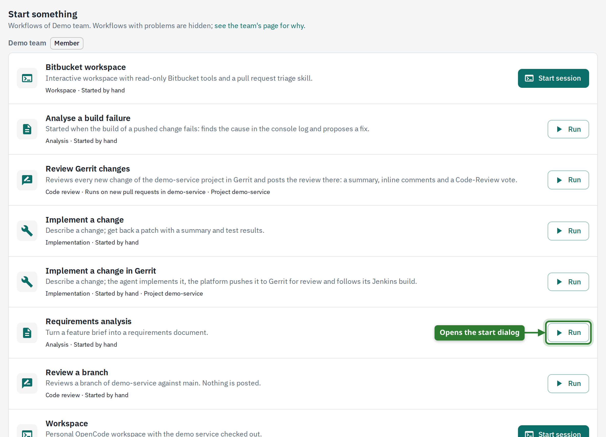
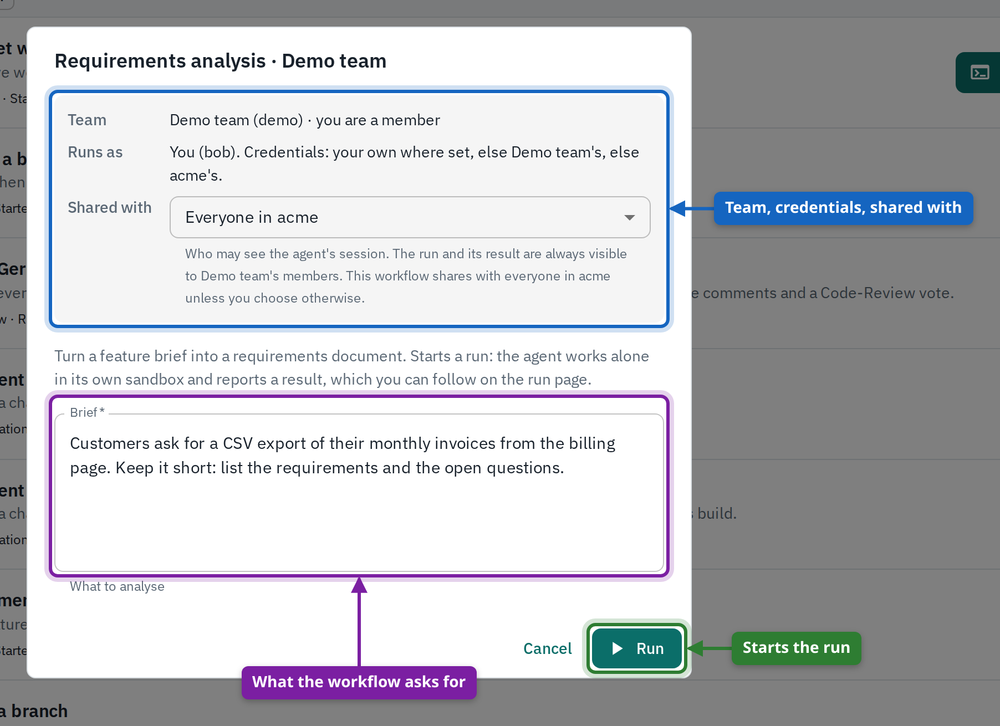
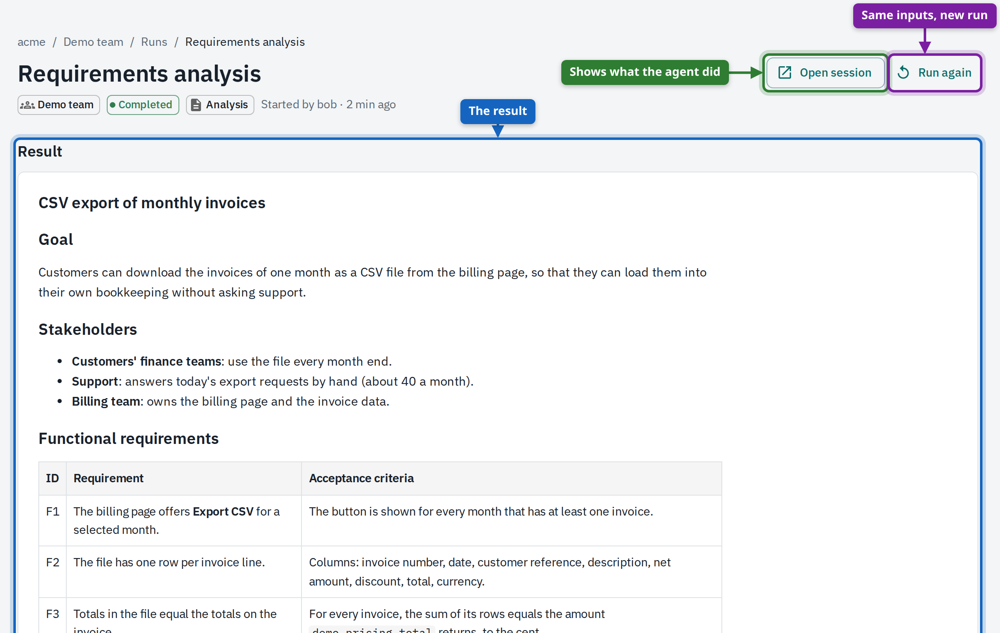

# OpenCode Agent Platform

A self-hosted, multi-tenant platform for running AI coding agents for your teams, without handing them your keys.

Teams describe their agents in their own Git repositories: the agent (its prompt), the sandbox it works in (model,
tools, network, limits) and the workflows people can start: a code review, an implementation, a requirements
analysis, or an interactive workspace. The platform turns each run into an isolated [OpenCode](https://opencode.ai)
session, gives the agent exactly the tools its team allowed, and hands back a checked result: review findings
(posted on the pull request or Gerrit change if you want), a patch with test results, or a document.

- **One platform, many organisations.** Tenants are fully isolated; inside a tenant, teams own their agents,
  sessions, runs, budgets and credentials. Membership and roles come from your identity provider.
- **Keys stay on the platform side.** LLM keys, Git tokens and tool credentials are added by the platform's
  gateways, so an agent never sees them. Every LLM call is metered, and every message and tool call lands in a
  tamper-evident audit trail.
- **Start agent work from one place.** Pick a workflow, fill in a short form, follow progress live, get the result.
  Reviews also start by themselves when a pull request or Gerrit change appears; other systems start workflows
  through webhooks.
- **Give agents tools safely.** MCP servers (Bitbucket, Jenkins, Jira, your own) run behind the platform's MCP
  gateway, which adds the right credential to each call and enforces a tool allow-list.
- **Share and continue work.** A session is shared with only you, your team or the whole tenant. Anyone who can
  see a session can fork it into their own copy and continue with their own credentials.
- **Stay in control.** Sandboxes have no internet unless a harness allows it, run read-only and unprivileged, and
  can't change their own configuration; harness policies block commands such as `git push`.
- **Run it anywhere.** Docker Compose on a laptop (with Keycloak, Gerrit and Jenkins if you like), or Kubernetes
  with the included Helm chart.

## Documentation

Everything beyond this page is on the documentation site: <https://alpha-prosoft.github.io/opencode-manager/>

| I am … | Start here |
|---|---|
| evaluating the platform, or bringing it into a company | [The path from zero to a working platform](https://alpha-prosoft.github.io/opencode-manager/story/) |
| a platform operator | [Install the platform](https://alpha-prosoft.github.io/opencode-manager/story/install/), [Connect your identity provider](https://alpha-prosoft.github.io/opencode-manager/story/identity/), then the [operator guide](https://alpha-prosoft.github.io/opencode-manager/guide/operator/) |
| a tenant admin | [Onboard a tenant](https://alpha-prosoft.github.io/opencode-manager/story/tenant/), then the [tenant admin guide](https://alpha-prosoft.github.io/opencode-manager/guide/tenant-admin/) |
| a team admin | [Set up a team](https://alpha-prosoft.github.io/opencode-manager/story/team/), [Automate the work](https://alpha-prosoft.github.io/opencode-manager/story/automate/), then the [team admin guide](https://alpha-prosoft.github.io/opencode-manager/guide/team-admin/) |
| a member of a team | [Guide for team members](https://alpha-prosoft.github.io/opencode-manager/guide/member/) |
| looking something up | The reference, below |

| Topic | Page |
|---|---|
| Tenants, teams, roles, who sees and may work in a session, forking, URLs | [Roles and visibility](https://alpha-prosoft.github.io/opencode-manager/reference/roles/) |
| Sign-in (OpenID Connect, JWT), claims parser, Keycloak example, key rotation | [Connect your identity provider](https://alpha-prosoft.github.io/opencode-manager/story/identity/) |
| Every `MANAGER_*` setting and Helm value | [Server settings](https://alpha-prosoft.github.io/opencode-manager/reference/settings/) |
| `tenant.json`: LLM connections, images, credentials, MCP servers, teams, sources | [tenant.json](https://alpha-prosoft.github.io/opencode-manager/reference/tenant-json/) |
| `team.json`: budget, limits, projects, required credentials | [team.json](https://alpha-prosoft.github.io/opencode-manager/reference/team-json/) |
| Agents, harnesses, workflows, triggers, activities, SCM providers | [Workflows, agents and harnesses](https://alpha-prosoft.github.io/opencode-manager/reference/definitions/) |
| Who provides a credential, which value a call uses, required credentials | [Credentials](https://alpha-prosoft.github.io/opencode-manager/reference/credentials/) |
| Webhooks: endpoint, authentication, mapping, status codes | [Webhooks](https://alpha-prosoft.github.io/opencode-manager/reference/webhooks/) |
| Pull request reviews, delivering changes, following builds, Gerrit and Jenkins | [Automate the work](https://alpha-prosoft.github.io/opencode-manager/story/automate/) |
| Sandbox isolation, gateways, sealed secrets, audit trail | [Security model](https://alpha-prosoft.github.io/opencode-manager/reference/security/) |
| Budgets, usage, audit, backups, upgrades, metrics, go-live checklist | [Govern and operate](https://alpha-prosoft.github.io/opencode-manager/story/operate/) |
| Kubernetes and the Helm chart | [Install the platform](https://alpha-prosoft.github.io/opencode-manager/story/install/) |
| An error message | [Troubleshooting](https://alpha-prosoft.github.io/opencode-manager/reference/troubleshooting/) |

The sources are in [docs/](docs/); `make docs` builds the site and `make docs-serve` serves it locally.

## A quick tour

| | |
|---|---|
|  |  |
| **Start something.** Home lists the workflows of your team: **Run** for automated ones, **Start session** for interactive ones. | **The start dialog** states the team, whose credentials the run uses and who the session is shared with, then asks for the inputs. |
|  |  |
| **The result.** A document, a review, or a patch with test results; the session behind it is one click away. | **Live activity.** What the agent is doing, which tools it used and what the harness policy blocked. |
|  |  |
| **Sessions.** Every sandbox you can see, its team and owner, and who it is shared with. Fork one to continue in your own copy. | **A team.** Its projects, workflows, runs, agents and harnesses, and the settings its admins control. |

The [guides](https://alpha-prosoft.github.io/opencode-manager/guide/member/) show every screen.

## Quick start

You need Docker with Compose v2, `git`, and a checkout of [edd-core](https://github.com/alpha-prosoft/edd-core)
next to this repository (the manager image is built from source).

```bash
git clone https://github.com/alpha-prosoft/opencode-manager
git clone https://github.com/alpha-prosoft/edd-core
cd opencode-manager

# 1. Get an LLM credential. The example tenant uses GitHub Copilot: log in once with OpenCode,
#    then copy the "refresh" value (gho_…) from local/opencode/auth.json.
docker run --rm -it -v "$PWD/local/opencode:/root/.local/share/opencode" ghcr.io/anomalyco/opencode:1.19.5 auth login

# 2. Store it as a secret: a file named after the secret. Never committed, never mounted into a session.
mkdir -p local/secrets && chmod 700 local/secrets
printf '%s' 'gho_…' > local/secrets/COPILOT_TOKEN

# 3. Publish the example repositories, build the session image and start the stack.
make dev
```

Open <http://localhost:8080> and pick a person on the test login page. The login has no passwords and is for
local use only (`MANAGER_AUTH_MODE=login`); each person's claims come from
[examples/dev-users.json](examples/dev-users.json), as an identity provider would send them.

| User | Tenant | Teams and roles |
|---|---|---|
| `alice` | acme | tenant admin; admin of Demo team |
| `frank` | acme | admin of Demo team (not a tenant admin) |
| `bob` | acme | member of Demo team and Payments |
| `carol` | acme | in no team |
| `dave` | acme | admin of Payments, member of Operations |
| `erin` | acme | member of Payments |
| `henry` | acme | member of Operations (a scheduled workspace and a tiny token budget) |
| `gina` | globex | tenant admin; admin of research |
| `hank` | globex | member of research |
| `ivy` | globex | member of research, admin of lab |
| `oscar` | — | platform operator |
| `nobody` | — | Keycloak only: no tenant, so the login is refused with the reason |

| URL | What |
|---|---|
| <http://localhost:8080> | Platform UI and API |
| `http://<session>.localhost:8080` | OpenCode sessions (browsers resolve `*.localhost` to your machine) |
| <http://localhost:9090> | Traefik dashboard (local only) |
| <http://keycloak.localhost:8180> | Keycloak, with `make dev-full` (admin console `admin` / `admin`; users' passwords are their usernames) |
| <http://gerrit.localhost:8080>, <http://jenkins.localhost:8080> | Gerrit and Jenkins, with `make dev-full` |

`make dev` starts the compose files your `.env` names in `COMPOSE_FILE` (only `compose.yml` by default).
`make dev-full` always adds Keycloak for single sign-on and a local Gerrit and Jenkins for the change review and
build-following flows. Any OpenAI-compatible LLM provider works instead of Copilot. The details, your own
repositories and the Kubernetes installation are in
[Install the platform](https://alpha-prosoft.github.io/opencode-manager/story/install/).

## Development

The manager is written in Clojure: an [edd-core](https://github.com/alpha-prosoft/edd-core) event-sourced service
and an [edd-core-web](https://github.com/alpha-prosoft/edd-core-web) re-frame UI on MUI. State lives in edd
aggregates (Postgres, or in memory for development); background workers start sandboxes, drive runs, poll pull
requests and stop idle sessions. [AGENTS.md](AGENTS.md) describes the architecture, the API contract and the
conventions.

```
service/     manager-svc: edge server, commands and queries, workers; test-e2e/ is the end-to-end suite
web/         manager-web: pages, theme, unit tests, Playwright tests, the guide's screenshot generator
charts/      Helm chart
deploy/      Keycloak realm, Gerrit and Jenkins setup, Traefik routes, placeholder secrets of the documentation stack
examples/    tenants acme and globex with their onboarding and team repositories, dev users, the demo service
images/      the session image, the example MCP servers and the scripted LLM of the documentation stack
schemas/     JSON Schemas for tenant.json, team.json and the definition files
docs/        the documentation site (MkDocs)
scripts/     seed-local-repos.sh, wait-for-stack.sh, stack-llm.sh, soak.sh, check-docs.py
```

| `make` target | What it does |
|---|---|
| `dev` | Publishes the example repositories, builds the session image, builds and starts the stack (`COMPOSE_FILE` from `.env`) |
| `dev-full` | The same, always with Keycloak, Gerrit and Jenkins |
| `down` | Stops the stack, overlays included |
| `clean` | Stops it and drops the local volumes and all session containers |
| `logs` | Follows the manager's log |
| `test` | Backend and UI unit tests |
| `docs-stack` | `clean`, then starts the documentation stack: `dev-full` plus `compose.docs.yml`, with the docs variant of the example tenants, whose LLM connection is a scripted LLM, and waits until it is up and synced |
| `guide` | Regenerates the guides in `docs/guide/` (pages and screenshots) against the running stack; says which LLM the stack uses and warns when it is not the scripted one |
| `docs-all` | `docs-stack`, `guide`, `docs`: the whole documentation from a clean stack |
| `docs-check` | Runs `scripts/check-docs.py`: renders the documented Helm commands with `helm template` and checks every Helm value and `MANAGER_*` setting the docs name against the chart and `config.clj` |
| `docs` | `docs-check`, then builds the site with `mkdocs build --strict` |
| `docs-serve` | Serves the site locally |

| Tests | Command |
|---|---|
| Backend unit tests | `cd service && clojure -M:test:unit` |
| UI unit tests | `cd web && clojure -M:shadow-cljs compile test` |
| API end to end (real LLM) | `cd service && MANAGER_URL=http://localhost:8080 clojure -M:e2e` (includes the Gerrit and Jenkins checks when they are up; `-M:e2e-ci` runs only those) |
| UI end to end (Playwright) | `cd web && MANAGER_URL=http://localhost:8080 clojure -M:it` (in oidc mode the tests sign in through Keycloak) |
| Soak | `scripts/soak.sh [iterations] [pause-seconds]`: runs both end-to-end suites repeatedly against a running stack and records durations, results, the manager's errors and whether a failure went away on a retry |
| UI development | `cd web && npm install && npm run fonts && clojure -M:shadow-cljs watch app` (see [AGENTS.md](AGENTS.md) for running the service beside it) |

### Regenerating the guides

The pages and screenshots under `docs/guide/` are generated by driving the real UI. To get the same content on
every run, without an LLM account, they are made on the **documentation stack**:

```sh
make docs-stack   # drops the local volumes, then starts the full stack with a scripted LLM
make guide        # plays the seeded cast once, then shoots the four guides (about 13 minutes on a clean stack, 9 of them the cast)
make docs         # checks and builds the site
```

- `compose.docs.yml` adds `llm-script` ([images/llm-script](images/llm-script)): a small OpenAI-compatible server
  that answers chat completions from `scenarios.json`, a fixed list of assistant turns (text and tool calls) per
  task. It keeps no state and calls no model. The manager's LLM gateway reaches it; sandboxes do not.
- `SEED_VARIANT=docs scripts/seed-local-repos.sh` publishes the docs variant of the example tenants: their LLM
  connection points at `llm-script` (same id, models and prices; its secret and the other operator secrets are the placeholders in `deploy/docs-secrets`, never a real token), the scheduled workflow runs every 8 minutes, and
  every repository is one commit with a fixed date. `examples/` itself is never changed.
- `clojure -M:guide` first plays the cast (`web/test/guide/manager_web/guide_seed.clj`): the people of acme start
  runs, share sessions, add credentials and call a webhook, in a fixed order under fixed ids. A stack that already
  has the cast is not seeded again.

`make clean && make dev-full` brings back the stack with the real LLM connection of the examples.

[docs/test-coverage.md](docs/test-coverage.md) maps every feature to its unit, API and UI tests. CI
([.github/workflows/build.yml](.github/workflows/build.yml)) runs the tests, builds the manager image and packages
the Helm chart.

## Licence

[Apache License 2.0](LICENSE)
