# OpenCode Agent Platform

A self-hosted platform for running AI coding agents for your teams, without handing them your keys.

Teams describe their agents in their own Git repositories: who the agent is (its prompt), the sandbox it works in
(model, tools, network, limits) and the workflows people can start (a code review, an implementation, a
requirements analysis, or an interactive workspace). The platform turns each run into an isolated
[OpenCode](https://opencode.ai) session, gives the agent exactly the tools its team allowed, and hands back a
checked result: review findings, a patch with test results, or a document.

Everything sensitive stays on the platform side. LLM keys, Git tokens and the credentials for tools like Bitbucket
or Jira are added by the platform's gateways, so an agent never sees them. Every LLM call is metered, every message
and tool call lands in a tamper-evident audit trail, and admins see usage and cost per team.

**What you can do with it**

- **Start agent work from one place.** Pick a workflow, fill in a short form, follow progress live, and get the
  result. Pull request reviews can also start by themselves when a PR is opened.
- **Give agents tools safely.** MCP servers (Bitbucket, Jira, your own) run behind the platform's MCP gateway. Each
  call uses the right credential (the person's own, or a shared one) and is checked against a tool allow-list.
- **Keep credentials personal.** People connect their own accounts once, at login. Their sessions only open for
  them; teammates can fork a session to continue it with their own credentials.
- **Stay in control.** Sandboxes have no internet unless a harness allows it, run read-only and unprivileged, and
  can't change their own configuration. Harness policies block commands such as `git push`.
- **See everything.** Live activity per session, a verified audit trail, token budgets, model pricing and a Prometheus
  endpoint.
- **Run it anywhere.** Docker Compose on a laptop, or Kubernetes with the included Helm chart.

## A quick tour

| | |
|---|---|
| 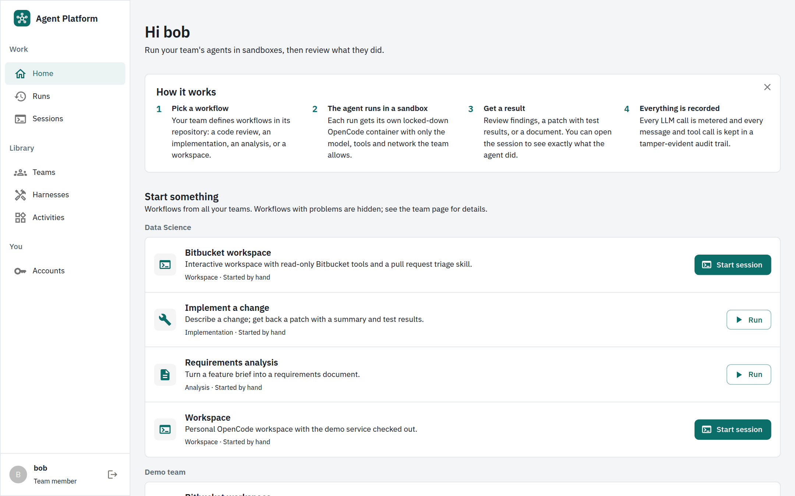 | 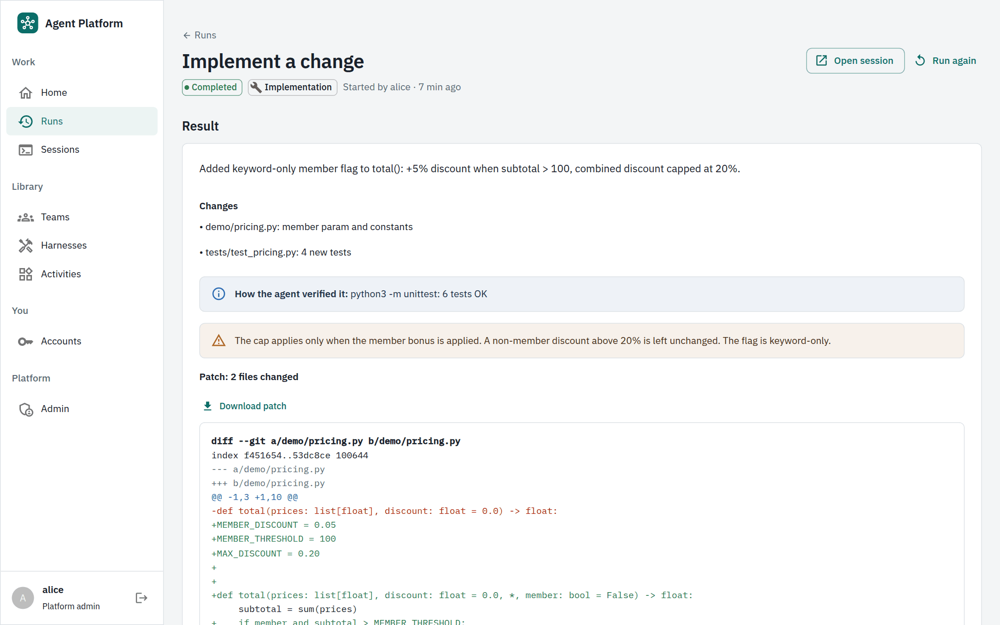 |
| **Home.** Every workflow you can start, grouped by team, with a short explanation of how runs work. | **Results.** An implementation run returns a summary, how the agent verified it, and a downloadable patch. |
| 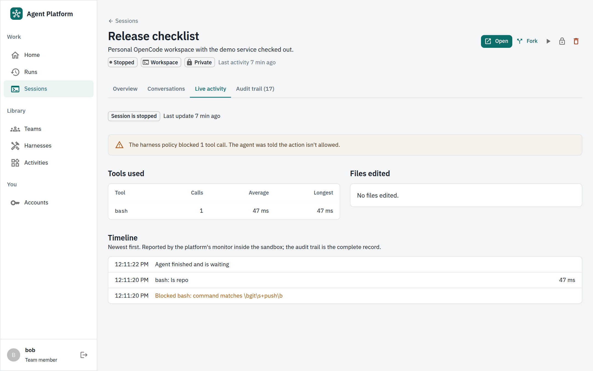 | 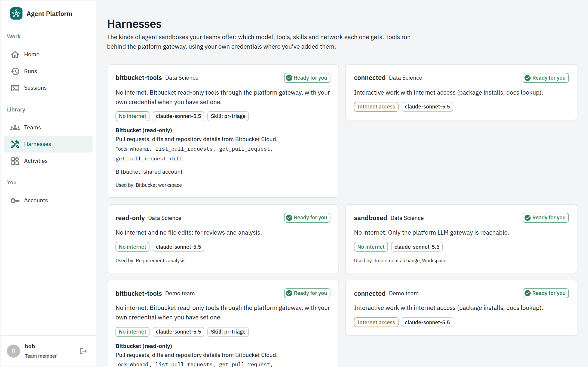 |
| **Live activity.** What the agent is doing, which tools it used, and what the harness policy blocked. | **Harnesses.** The kinds of sandboxes your teams offer, their MCP tools and skills, and whether they're ready for you. |
| 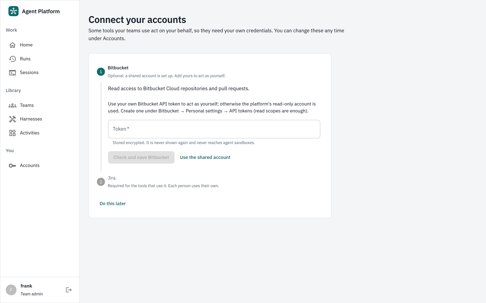 | 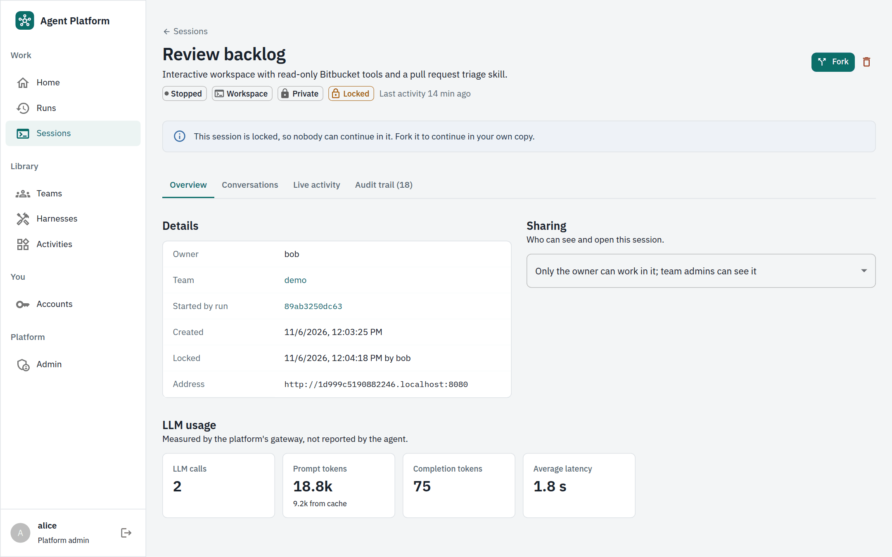 |
| **Connect your accounts.** At login, people add the credentials their teams' tools need, each checked before it's saved. | **Fork and lock.** Continue someone's session in your own copy, with your own credentials. Locked sessions can only be forked. |
| 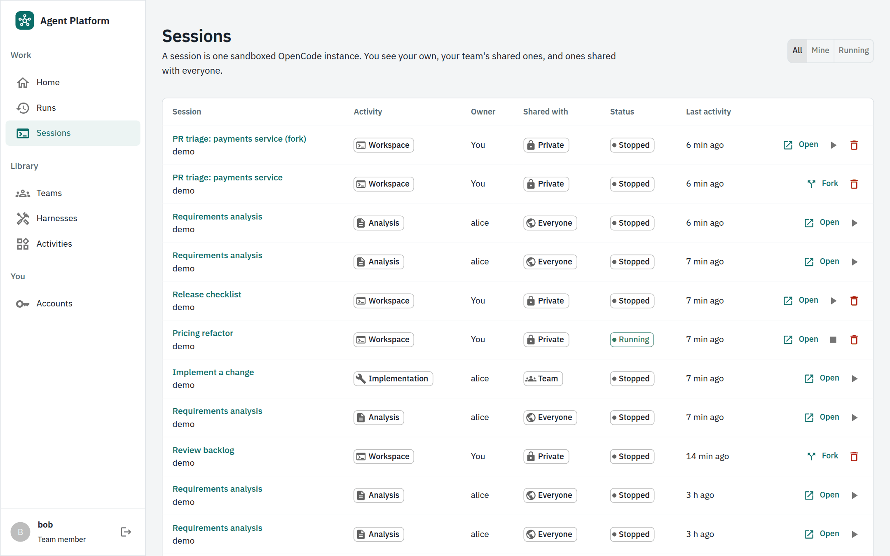 | 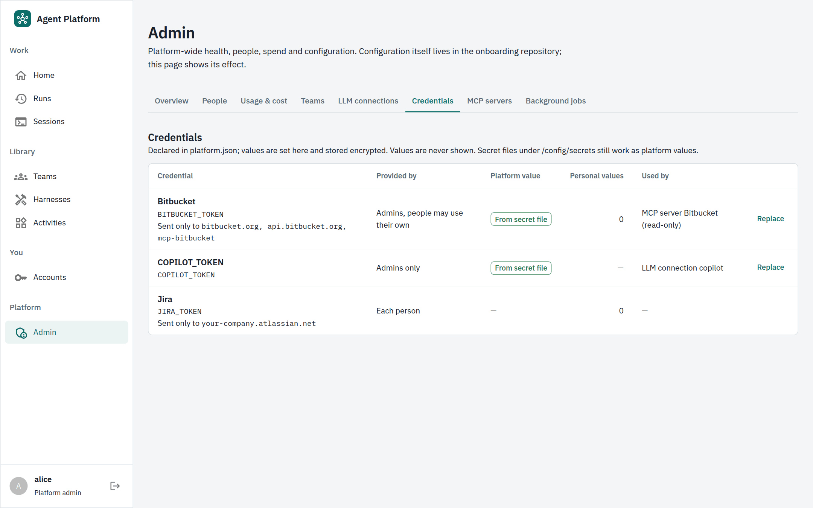 |
| **Sessions.** Every OpenCode instance you can see, who owns it, who it's shared with, and what you can do with it. | **Admin.** Credentials, MCP servers, people and roles, usage and cost, sync state and background jobs. |

## How it fits together

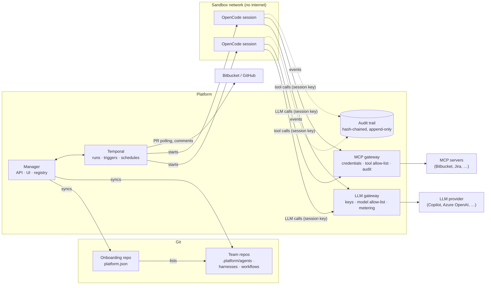

## Contents

1. [Concepts](#concepts)
2. [Quick start](#quick-start)
3. [Using the platform](#using-the-platform)
4. [Onboarding repository (platform admins)](#onboarding-repository)
5. [Team repository (teams)](#team-repository)
6. [Activities](#activities)
7. [Security model](#security-model)
8. [Audit trail and metrics](#audit-trail-and-metrics)
9. [Deploying on Kubernetes](#deploying-on-kubernetes)
10. [Development](#development)

## Concepts

| Concept | Where it lives | What it is |
|---|---|---|
| **Onboarding repo** | One Git repo, owned by platform admins | `platform.json`: platform admins, LLM connections, allowed images, and the list of teams with their repositories, members and granted secrets. |
| **Team repo** | One Git repo per team | A `.platform/` directory with the team's agents, harnesses and workflows. |
| **Agent** | `.platform/agents/<id>.json` | Persona and system prompt (OpenCode agent). |
| **Harness** | `.platform/harnesses/<id>.json` | The sandbox: LLM connection and models, network access, tool permissions, MCP servers, skills, image, CPU and memory. |
| **Credential** | Declared in `platform.json`, values set in the UI | A token or password tools need: shared by the platform, personal per user, or both. Stored encrypted; never sent into a sandbox. |
| **MCP server** | Declared in `platform.json` | A tool server sandboxes reach only through the platform's MCP gateway, which adds the right credential to each call. |
| **Workflow** | `.platform/workflows/<id>.json` | A trigger (manual, schedule, pull request) wired to an activity, with an agent, a harness and options. |
| **Activity** | Built into the platform | What a run does: interactive session, code review, implementation, business analysis. |
| **Run** | Platform | One execution of a workflow. It creates a sandboxed session, collects a typed result and meters usage. |
| **Session** | Platform | One OpenCode instance (a sandbox) owned by one person. It can hold many conversations. It can be forked into someone else's copy and locked. |

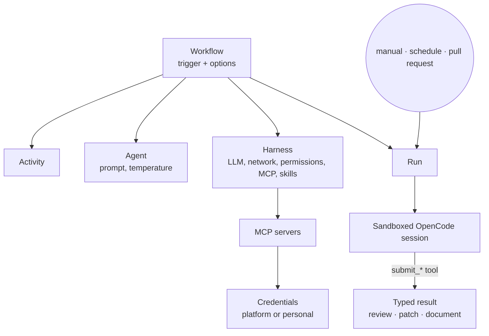

## Quick start

Requirements: Docker with Compose v2.

```bash
git clone https://github.com/alpha-prosoft/opencode-manager && cd opencode-manager

# 1. Publish the example onboarding repo, team repo and demo service as local Git repos.
./scripts/seed-local-repos.sh

# 2. Give the platform an LLM credential. The example uses GitHub Copilot.
#    Secrets are files named after the secret; they are never committed and never reach a session.
mkdir -p local/secrets && chmod 700 local/secrets
printf '%s' 'gho_…' > local/secrets/COPILOT_TOKEN   # see "Getting a Copilot token" below

# 3. Build the toolchain image (OpenCode + Python/Node/git) and start the stack.
docker compose --profile images build opencode-dev
docker compose up -d --build
```

Open <http://localhost:8080> and log in as `alice` (a platform admin in the example) or `bob` (a team member).
The demo team has four workflows ready to run. To check that everything works:

```bash
python3 tests/e2e.py
```

| URL | What |
|---|---|
| <http://localhost:8080> | Platform UI and API (`/api/docs`) |
| `http://<session>.localhost:8080` | OpenCode sessions (every browser resolves `*.localhost` to your machine) |
| <http://localhost:8233> | Temporal UI (local only) |
| <http://localhost:9090> | Traefik dashboard (local only) |

**Getting a Copilot token.** Log in once with OpenCode and copy the `refresh` value from the generated
`local/opencode/auth.json`:

```bash
docker run --rm -it -v "$PWD/local/opencode:/root/.local/share/opencode" ghcr.io/anomalyco/opencode:1.19.5 auth login
```

Any OpenAI-compatible provider works the same way; see [LLM connections](#llm-connections).

**Your own repositories.** Put your onboarding and team repos anywhere Git can reach (`https://…`), or keep
local overrides in `local/sources/<name>/`, which `seed-local-repos.sh` publishes alongside the examples. Everything
under `local/` is gitignored. Point the platform at the onboarding repo with `ONBOARDING_URL` (compose) or
`onboarding.url` (Helm).

## Using the platform

The sidebar groups pages by what you are doing: **Work** (Home, Runs, Sessions), **Library** (Teams, Harnesses,
Activities), **You** (Accounts) and, for platform admins, **Platform** (Admin).

When you log in and your teams' tools need credentials you haven't seen yet, you first land on **Connect your
accounts**: one step per credential, with a *Check and save* that tests the value against the service before it is
stored. Personal-only credentials can be skipped, but tools that need them won't work for you until you add them;
they are offered again at your next login. Credentials an admin adds later are offered at the next login too.

1. **Home.** A short *How it works*, then every workflow you can start, grouped by team, and your recent runs.
   Workflows with problems are hidden here and explained on the team page.
2. **Start a workflow.** *Run* for automated workflows, *Start session* for interactive ones. The form asks only
   for the activity's inputs.
   - *Interactive* workflows open a private sandbox you work in yourself.
   - *Automated* workflows show a progress bar: *Queued*, *Starting sandbox*, *Agent working*, *Collecting
     result*, *Done*.
3. **Runs → a run.** The result first: review findings, a patch with test results, or a document. Then the
   inputs, details and LLM usage. *Open session* shows exactly what the agent saw and did. Active runs can be
   cancelled; finished automated runs can be run again with the same inputs.
4. **Sessions → a session.** *Open* starts and opens it in OpenCode. Four tabs:
   - **Overview**: owner, team, sharing (only the owner, the team, or everyone), fork and lock history, LLM usage.
   - **Conversations**: every chat in this instance, each with its own *Open*.
   - **Live activity**: what the agent is doing now, tools used with durations, files edited, and any tool call
     the harness policy blocked.
   - **Audit trail**: every message and tool call, verified against tampering, downloadable as JSONL.
5. **Teams → a team.** Workflows, runs, *Agents & harnesses* (what each sandbox may do, in plain words, including
   blocked commands) and *People & usage* (members, daily budget, usage per model).
6. **Harnesses.** Every kind of sandbox your teams offer: model, network, MCP tools and skills, and whether it is
   **ready for you** or which credential you still need to add.
7. **Activities.** Reference for workflow authors: what each activity does, its options and inputs, and an
   example workflow file.
8. **Accounts.** Your own credentials: add, replace or remove them. You see a short hint, never the value.
9. **Admin** (platform admins): *Overview* (sync now, stop idle sessions, today's numbers and cost), *People*,
   *Usage & cost*, *Teams*, *LLM connections* (one-click test), *Credentials* (set the shared values; see how many
   people use their own), *MCP servers* (reachable, credential set, which harnesses use them) and *Background
   jobs*. Platform admins can see every session of every user.

### Fork and lock

Who may **work in** a live session is stricter than who may **see** it:

| Session | Owner | Team admins, platform admins | Team members |
|---|---|---|---|
| Private | Open | See | — |
| Shared with the team | Open | Open | Open |
| Uses the owner's personal credentials | Open | See | See (if shared) |
| Locked | See | See | See (if shared) |

Anyone who can see a session can **Fork** it (if they are in its team): the platform copies the workspace and all
conversations into a new private session owned by them, which runs with *their* credentials. This is how a
teammate continues work that used someone else's Jira or Bitbucket account.

The owner can **Lock** a session. It stops and can never be continued again, the owner included; everyone who
can see it can still read it and fork it. Locking can't be undone.

### Roles

| Role | Defined in `platform.json` | Can |
|---|---|---|
| Platform admin | `admins` | Everything: every team, the Admin page, `/metrics`, *Sync now*. |
| Team admin | `teams[].admins` | Run the team's workflows; stop, delete or re-share any team session; cancel any team run. |
| Team member | `teams[].members` | Run the team's workflows; see team and public sessions; manage their own sessions and runs. |

Anyone else can log in but sees only public sessions. With `MANAGER_AUTH_MODE=login` (local testing), the login page
offers a dropdown of every user in `platform.json`, with their roles. You can also type any other name.
The examples include dummy teams (*Payments*: `dave` admin, `erin` member; *Data Science*: `frank` admin, `grace`
and `bob` members) to try this out.

Visibility: interactive sessions are private to their owner by default; runs of automated workflows are visible to
the team (`"visibility": "team"`) or every user (`"public"`). Session owners and team admins can stop, delete or
change the visibility of a session. Deleting a session keeps its audit trail.

## Onboarding repository

`platform.json` at the root of the onboarding repo ([schema](schemas/platform.schema.json), [example](examples/onboarding/platform.json)):

```json
{
  "version": 1,
  "admins": ["alice"],
  "allowed_images": ["ghcr.io/anomalyco/opencode:1.19.5", "opencode-platform/opencode-dev:1.19.5"],
  "llm_connections": [
    { "id": "copilot", "type": "github-copilot", "secret": "COPILOT_TOKEN",
      "models": ["claude-sonnet-5.5", "gemini-3.5-flash"], "teams": "*" }
  ],
  "teams": [
    {
      "id": "payments",
      "name": "Payments",
      "repository": { "type": "git", "url": "https://bitbucket.org/acme/payments-agents.git", "branch": "main",
                      "credentials": "BITBUCKET_TOKEN", "username": "x-bitbucket-api-token-auth" },
      "members": ["bob", "carol"],
      "admins": ["bob"],
      "secrets": ["BITBUCKET_TOKEN"]
    }
  ]
}
```

| Field | Meaning |
|---|---|
| `admins` | Platform admins: see every team, trigger syncs, read `/metrics`. |
| `allowed_images` | The only container images harnesses may use. |
| `llm_connections` | Upstream LLM endpoints. `secret` names a platform secret; `models` is the allow-list; `teams` restricts which teams may use it. |
| `secret_hosts` | For each secret, the hosts it may be sent to in Git checkouts (e.g. `{"GITHUB_TOKEN": ["github.com"]}`). A secret is never sent anywhere else, even if a team repo asks for it. |
| `teams[].repository` | Where the team's definitions live (see [Team sources](#team-sources)). `path` is the directory with the definitions, `.platform` by default. |
| `teams[].members` / `admins` | Usernames. Members run workflows and see team sessions; admins also manage team sessions. |
| `teams[].secrets` | Platform secrets this team's workflows may reference (repository checkouts, pull request triggers). |
| `teams[].budget.daily_tokens` | Optional cap on prompt + completion tokens per UTC day; the LLM gateway answers `429` once it is reached. |
| `teams[].budget.max_running_sessions` | Optional cap on concurrently running sessions; new runs are refused until one stops. |
| `teams[].notifications.webhook` | Optional platform secret holding a webhook URL (e.g. a Slack incoming webhook). The platform POSTs `{"text": …, "run": …}` when a run ends with a status listed in `on` (default `completed` and `failed`). |
| `llm_connections[].pricing` | Optional prices per million tokens per model (`input`, `output`, `cached_input`), for the cost estimates on the Admin page. |

### Team sources

| `type` | Example | Notes |
|---|---|---|
| `git` (default) | `{"url": "https://bitbucket.org/acme/agents.git", "branch": "main", "credentials": "BITBUCKET_TOKEN"}` | https (token as Basic auth), ssh (`git@host:org/repo.git`, `credentials` holds a private key) or `file://` under an allowed local root. |
| `url` | `{"type": "url", "url": "https://artifacts.acme.com/agents.tar.gz", "credentials": "ARTIFACT_TOKEN"}` | A `.tar.gz` or `.zip` over https (max 50 MB), token sent as Bearer. Entries that would escape the directory are rejected. A single top-level folder is stripped. |
| `path` | `{"type": "path", "location": "/repos/payments"}` | A directory on the platform host. It must be under `MANAGER_LOCAL_REPO_ROOTS` (default `/repos`). It is read in place; its version is a hash of its contents. |

Credentials are only sent to the hosts listed for that secret in `secret_hosts`, for every source type. The
onboarding repository itself can use the same types: `MANAGER_ONBOARDING_URL` with an optional
`MANAGER_ONBOARDING_TYPE` (`git`, `url` or `path`, guessed from the location otherwise).


The platform syncs the onboarding repo and all team repos every `MANAGER_SYNC_INTERVAL_MINUTES` (default 10),
and on *Sync now*. Teams removed from `platform.json` disappear; their history stays.

### Credentials and MCP servers

```json
"credentials": [
  { "id": "BITBUCKET_TOKEN", "name": "Bitbucket", "kind": "token",
    "hosts": ["bitbucket.org", "api.bitbucket.org", "mcp-bitbucket"],
    "provided_by": "platform_or_user",
    "help": "Create an API token under Personal settings → API tokens.",
    "test": { "url": "https://api.bitbucket.org/2.0/user" } },
  { "id": "JIRA_TOKEN", "name": "Jira", "kind": "basic", "hosts": ["acme.atlassian.net"], "provided_by": "user" }
],
"mcp_servers": [
  { "id": "bitbucket", "name": "Bitbucket (read-only)", "url": "http://mcp-bitbucket:8000/",
    "credential": "BITBUCKET_TOKEN",
    "tools": ["whoami", "list_pull_requests", "get_pull_request", "get_pull_request_diff"] }
]
```

| Field | Meaning |
|---|---|
| `credentials[].provided_by` | `platform`: admins set one value. `platform_or_user`: admins set a shared value; people may use their own instead. `user`: no shared value; everyone adds their own. |
| `credentials[].kind` | `token` (one secret), `basic` (username and password, e.g. Atlassian e-mail and API token) or `ssh_key`. |
| `credentials[].hosts` | The only hosts the value is ever sent to, for MCP servers, Git checkouts and pull request APIs alike. |
| `credentials[].test` | Optional check when someone saves a value: `{"url": …}` is called with it (a non-2xx answer or a redirect to a login page rejects it), or `{"mcp_tool": "whoami"}` calls that tool of the MCP server using the credential, which also works for services only the MCP server can reach (for example behind a VPN). |
| `credentials[].teams` | Restrict which teams may use it (default: all). |
| `mcp_servers[].url` | A Streamable HTTP MCP endpoint reachable from the manager only (a cluster service, or the Docker network in compose). MCP servers that only speak stdio can be wrapped as an HTTP service. |
| `mcp_servers[].credential` | Added by the gateway to every request (`auth.header`, `auth.scheme`: `bearer`, `basic` or `raw`). |
| `mcp_servers[].tools` | Allow-list. Other tools are hidden from `tools/list` and refused on `tools/call`. |

How a credential is chosen for a call: the session **owner's own value** when the credential allows personal values
and they have added one; otherwise the **platform value**; otherwise the call fails with "add your credential under
Accounts". Automated runs (pull request triggers, schedules) have no person, so they always use the platform value;
a workflow that runs automatically and needs a `user`-only credential is rejected at sync time.

Credential values are stored in the manager database, encrypted with AES-GCM under `MANAGER_CREDENTIALS_KEY` (32
bytes, base64; generated on the data volume if unset) and bound to their credential and owner. The API returns
only a short hint. Values in `/config/secrets` keep working as platform values.

**Services behind a VPN or a company CA.** The manager never has to reach a tool's service itself: the MCP server
does. If a service is only reachable through a VPN on the host, run that MCP server with host networking (bound to
the Docker bridge address, `HOST=172.17.0.1`), point `mcp_servers[].url` at `http://host.docker.internal:<port>/`,
and use `"test": {"mcp_tool": "whoami"}` for its credential. Mount the company CA bundle read-only and set
`SSL_CERT_FILE` for internal certificates. Keep such overrides in a local compose file (`COMPOSE_FILE` in `.env`).

`images/mcp-bitbucket` is a small read-only Bitbucket Cloud MCP server used by the examples. It holds no credentials
of its own: it forwards the `Authorization` header the gateway adds.

### LLM connections

| `type` | Upstream | Secret |
|---|---|---|
| `openai-compatible` | `base_url` (e.g. `https://my-azure.openai.azure.com/openai/v1`, vLLM, LiteLLM) | API key, sent as `Authorization: Bearer` |
| `github-copilot` | `https://api.githubcopilot.com` | GitHub OAuth token (`gho_…`) from `opencode auth login` |

### Platform secrets

Secrets are resolved by name, from a file `/config/secrets/<NAME>` (compose: `local/secrets/<NAME>`; Kubernetes:
a key of `platformSecrets.existingSecret`) or from the environment variable `PLATFORM_SECRET_<NAME>`. They are
only ever read by the manager: sessions never receive them.

## Team repository

```
.platform/
├── agents/          one JSON file per agent    (id = file name)
├── harnesses/       one JSON file per harness
├── workflows/       one JSON file per workflow
└── …                any files referenced by the definitions (prompts, guidelines, templates)
```

See the complete [example team repo](examples/team-repo/.platform). JSON Schemas for editor validation (add
`"$schema": "<url>"` to a file; the platform ignores that key): [agents](schemas/agents.schema.json),
[harnesses](schemas/harnesses.schema.json), [workflows](schemas/workflows.schema.json).

### Agent

```json
{
  "description": "Careful code reviewer that reports only verified issues",
  "prompt_file": "prompts/reviewer.md",
  "temperature": 0.1,
  "steps": 50
}
```

Set exactly one of `prompt` (inline) or `prompt_file` (relative to `.platform/`).

### Harness

```json
{
  "description": "No internet and no file edits: for reviews and analysis.",
  "image": "opencode-platform/opencode-dev:1.19.5",
  "llm": { "connection": "copilot", "models": ["claude-sonnet-5.5", "gemini-3.5-flash"] },
  "network": "none",
  "permissions": { "edit": "deny", "bash": "allow" },
  "resources": { "cpus": 1, "memory_mb": 2048, "pids": 512 },
  "idle_minutes": 15,
  "policy": { "deny_commands": ["\\bgit\\s+push\\b"], "deny_paths": ["(^|/)\\.env$"] },
  "mcp": ["bitbucket"],
  "skills": ["skills/pr-triage"]
}
```

| Field | Meaning |
|---|---|
| `llm.models` | Tried in order: if a model is unavailable, the run moves on to the next one. |
| `network` | `none`: the session can only reach the platform's LLM gateway. `internet`: outbound internet as well (web search and fetch are then allowed). |
| `permissions` | OpenCode tool permissions (`allow` / `ask` / `deny`) for `bash`, `edit`, `read`, `webfetch`, … Automated runs never ask questions. |
| `image` | Must be in the onboarding repo's `allowed_images`. Defaults to the platform image. |
| `idle_minutes` | Idle sessions are stopped after this long (they wake up when opened again). |
| `policy.deny_commands` | Regular expressions. A `bash` call whose command matches one is blocked before it runs; the agent sees *Blocked by platform policy* and the block shows up in *Live activity*. |
| `policy.deny_paths` | Regular expressions matched against the file path of `read`, `edit`, `write` and similar tools. |
| `mcp` | MCP servers (from `platform.json`) this harness's sessions get, through the platform gateway. |
| `skills` | Directories in the team repo, each with a `SKILL.md` ([Agent Skills](https://opencode.ai/docs/skills/) format). They are copied into the read-only config at session start; text files only, no links, 1 MB in total. |

The harness is turned into an OpenCode configuration that is **mounted read-only** into the session, so the agent
cannot change its own model, permissions or tools.

### Workflow

```json
{
  "name": "Review GitHub pull requests",
  "description": "Reviews every new PR (dry-run: nothing is posted).",
  "activity": "review",
  "agent": "reviewer",
  "harness": "read-only",
  "trigger": {
    "type": "pull_request",
    "provider": "github",
    "repository": "acme/payments",
    "credentials": "GITHUB_TOKEN",
    "target_branches": ["main"],
    "poll_minutes": 15
  },
  "options": { "guidelines_file": "context/review-guidelines.md", "post_mode": "dry-run", "max_comments": 20 },
  "visibility": "team"
}
```

| Trigger | Fields | Behaviour |
|---|---|---|
| `manual` (default) | none | Started from the UI or `POST /api/teams/<team>/workflows/<workflow>/runs`. |
| `schedule` | `every_minutes`, `inputs` | Started on an interval with fixed inputs. |
| `pull_request` | `provider` (`bitbucket`, `github`), `repository`, `credentials`, `target_branches`, `poll_minutes`, `backfill` | Polls for new PRs and starts one review per PR. PRs already open when the trigger first runs are skipped unless `backfill` is `true`. Each PR is reviewed once. Pull-request workflows can also be run by hand for any PR number. |

Every workflow is validated on sync: references to agents, harnesses, activities, files, secrets, LLM connections
and images must resolve, and `options` must match the activity's schema. The UI shows the reason for every
invalid definition.

## Activities

The **Activities** page shows each activity's options and inputs, generated from the same schemas the platform
validates against.

| Activity | Kind | Options (workflow file) | Inputs (per run) | Result |
|---|---|---|---|---|
| `session` | interactive | `repository`, `instructions_file` | `title`, `prompt`, `branch` | A personal OpenCode workspace. |
| `review` | automated | `scm`, `guidelines_file`, `post_mode` (`off` · `dry-run` · `auto`), `max_comments` | `pull_request` | Structured review: verdict, findings (severity, file, line, fix), checked items, and a comment plan. |
| `implement` | automated | `repository`, `guidelines_file`, `pull_request`, `ci` | `task`, `pull_request`, `branch` | Title, summary, changes, verification commands and whether they passed, and a **patch computed by the platform** from the working tree. Optionally a pull request and its build (below). |
| `analysis` | automated | `repository`, `template_file` | `brief` | A Markdown analysis document. |

Automated activities end with the agent calling a typed result tool (`submit_review`, `submit_implementation`,
`submit_document`). The platform validates the result and decides what happens next. For example, a review is
turned into at most `max_comments` comments (a summary plus inline comments anchored only to lines that are in the
diff, highest severity first) and posted only in `auto` mode. The agent never posts anything itself.

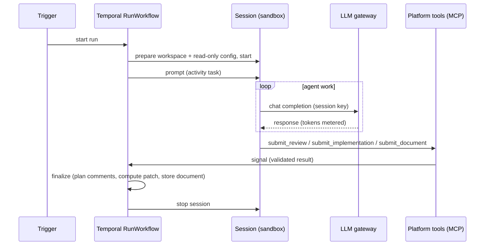

### Pull requests and builds

An `implement` workflow can hand its change over as a pull request and follow the build:

```json
"options": {
  "repository": { "url": "https://bitbucket.org/acme/service.git", "branch": "main", "credentials": "BITBUCKET_TOKEN" },
  "pull_request": { "provider": "bitbucket", "repository": "acme/service" },
  "ci": { "mcp_server": "jenkins", "job": "acme/service/PR-{pr}", "timeout_minutes": 120, "on_failure": "build-failure" }
}
```

- **The platform pushes, never the agent.** After the agent submits, the platform commits the working tree as the
  person who started the run, pushes `agent/<run-id>` with that person's credential (or the shared one), and opens a
  pull request. It is never merged. If the agent reports that its checks didn't pass (`verified: false`), the pull
  request is opened as a **draft** and says so.
- **Continue on a pull request.** Pick an open pull request in the run form (the list is read with your
  credential): its branch is checked out and the change is pushed to it, without a new pull request.
- **Follow the build.** With `ci`, the run gets a *Following build* step: every minute the platform reads the job
  through the MCP server's `get_build` tool, until the build passes, fails or `timeout_minutes` runs out. The run
  page shows the build number, its stages and a link. Builds that started before the push are ignored.
- **Analyse failures.** With `ci.on_failure`, a failed build starts that workflow (a manual `analysis` or
  `session` workflow of the same team) for the same person, with the failed stages and the end of the console log.
  A session checks out the pull request's branch, so the agent can reproduce and fix the failure; the original run
  links to it.

`images/mcp-jenkins` is a read-only Jenkins MCP server (`whoami`, `list_jobs`, `get_builds`, `get_build`,
`get_build_log`) for this. Like the Bitbucket one, it holds no credentials of its own.

## Security model

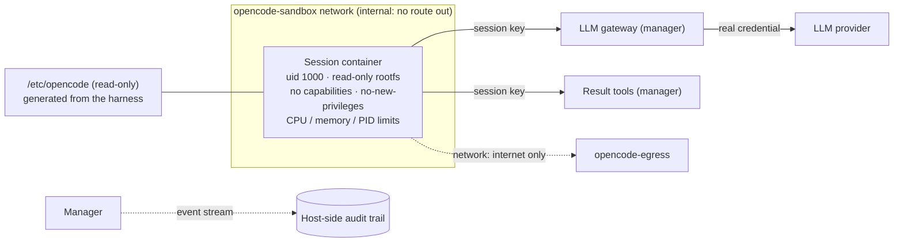

- **No credentials in sessions.** LLM API keys, Git tokens, SCM tokens and MCP credentials (shared or personal)
  stay in the manager. Sessions authenticate to the LLM gateway, the MCP gateway and the result tools with
  per-session keys derived from the platform signing key. A key only works for its own session, its harness's
  models and MCP servers, and its run's result tool. Every MCP tool call is written to the session's audit trail,
  with which credential was used (personal or platform).
- **Personal credentials stay personal.** Only the owner can work in a session that uses their own credentials;
  others fork it and continue with theirs.
- **Network isolation.** Sessions run on an internal-only network: no internet, only the manager (gateway, result
  tools) and the HTTP gateway (for you). `network: internet` opts a harness into outbound access. On Kubernetes the
  same rules are enforced by NetworkPolicies.
- **Immutable agent configuration.** The OpenCode config (model, provider, permissions, MCP servers) is generated
  by the platform and mounted read-only. Project-level and home-directory overrides are disabled, and external
  plugins are turned off.
- **Hardened containers.** Non-root user, read-only root filesystem (only the workspace and `/tmp` are writable),
  all Linux capabilities dropped, no privilege escalation, resource limits; on Kubernetes also a `RuntimeDefault`
  seccomp profile and no service account token.
- **Least privilege by definition.** Images, LLM connections, models and secrets must be granted in the onboarding
  repo before a team can use them; violations are rejected at sync time. Secrets are bound to the hosts listed in
  `secret_hosts`. `file://` repositories must live under `MANAGER_LOCAL_REPO_ROOTS` (`/repos` by default; set it
  to `[]` in production). Referenced files cannot escape the team repo, not even through symlinks.
- **Cost control.** Optional per-team daily token budgets, enforced by the LLM gateway.
- **Access control.** Only team members see a team's workflows, runs and sessions; private sessions are visible to
  their owner only. Sessions are opened through a short-lived, session-bound handoff token.
- **Controlled side effects.** Agents return typed results; the platform decides what is posted, with hard limits.

The test suite probes these controls from inside a real session (`tests/e2e.py`).

## Audit trail and metrics

- **Audit trail.** For every running session the manager subscribes to OpenCode's event stream (with the session's
  server password, which the agent cannot intercept) and records completed messages, tool calls with their inputs
  and outputs, and session events. It also backfills after reconnects. Records are stored **on the host**, outside
  the sandbox, in a table that rejects updates and deletes. Each record is hash-chained to the previous one, so
  tampering is detectable. View it under *Sessions → Audit trail*, verify it with
  `GET /api/sessions/<id>/audit/verify`, and export it as JSONL.
- **Usage.** The LLM gateway records prompt, completion and cached tokens, latency and errors for every call, per
  session, run, team and model. These numbers come from the upstream response, not from the agent. They are shown
  on runs, sessions and teams.
- **Live monitoring.** Every session loads a platform plugin from the read-only config mount. It uses OpenCode's
  hooks (`tool.execute.before` / `after` and the event bus) to report tool calls, durations, file edits, status
  changes and permission requests to `POST /api/telemetry`, and to enforce the harness `policy`. It authenticates
  with a key scoped to that session and to telemetry only. The agent cannot change or disable the plugin: the config
  mount is read-only, and project and user plugins are disabled. Live activity is a convenience view. The audit
  trail, collected outside the sandbox, remains the record of truth.
- **Prometheus.** `GET /metrics` (platform admins) exposes `opencode_llm_tokens_total`,
  `opencode_llm_requests_total`, `opencode_llm_errors_total`, `opencode_runs_total` and `opencode_sessions_running`.

## Deploying on Kubernetes

```bash
kubectl apply --server-side -f https://github.com/kubernetes-sigs/gateway-api/releases/download/v1.7.0/standard-install.yaml
kubectl create namespace agents
kubectl -n agents create secret generic platform-secrets \
  --from-literal=COPILOT_TOKEN=gho_… --from-literal=GIT_TOKEN=…
helm dependency build charts/opencode-manager
helm install platform charts/opencode-manager -n agents \
  --set domain=agents.example.com \
  --set onboarding.url=https://git.example.com/platform/onboarding.git \
  --set onboarding.credentials=GIT_TOKEN \
  --set platformSecrets.existingSecret=platform-secrets \
  --set credentialsKey.existingSecret=opencode-credentials-key
```

Create the credentials key once (`kubectl -n agents create secret generic opencode-credentials-key
--from-literal=key=$(openssl rand -base64 32)`) and keep it: it decrypts every stored credential. Run MCP
servers as ordinary cluster services; sessions with internet access are kept away from private address ranges
(`networkPolicies.internetExcept`), so they reach MCP servers only through the gateway.

The chart installs:
- the manager (with Temporal and Traefik as sub-charts);
- an HTTPRoute for `domain` and `*.domain`;
- the ForwardAuth middleware;
- NetworkPolicies isolating session pods;
- shared storage for workspaces.

Point DNS for both `domain` and `*.domain` at the gateway. Sessions run as Deployments scaled to zero when idle.
The shared volume needs `ReadWriteMany` when session pods can land on different nodes. Your CNI must enforce
NetworkPolicies.

## Development

```
manager/app/
├── platform/        spec, registry (sync), catalog (activities), harness, gateway, audit, runs, triggers, tools
├── temporal/        workflows (RunWorkflow, triggers, sync, reaper) and activities
├── backends/        Docker and Kubernetes session backends
├── routes/          REST API, session gateway (handoff, ForwardAuth)
manager/ui/          React 19 + MUI + React Router
charts/              Helm chart
examples/            onboarding repo, team repo and demo service used by the quick start
schemas/             JSON Schemas for the definition files
tests/e2e.py         end-to-end tests against a running stack
```

- `docker compose up -d --build` rebuilds the manager. `./scripts/seed-local-repos.sh` republishes example and
  local repos; the platform picks the changes up on the next sync.
- `cd manager && pip install -r requirements.txt -r requirements-dev.txt && pytest` runs the unit tests (spec
  validation, security rules, harness lockdown, audit chain, review planning).
- `python3 tests/e2e.py` runs the end-to-end suite. `E2E_REVIEW=<team>/<workflow>/<pr>` adds a real code review.
- CI (`.github/workflows/build.yml`) builds the manager image with the UI and packages the Helm chart.
