# For team members

This guide is for everyone who works in a team on the Agent Platform. It takes you from your first sign-in to a finished piece of work: you connect your accounts, start one of your team's workflows, follow the run to its result, work in the sandboxed session behind it and decide who else may see it. The screenshots show the example tenant **acme**: the first ones follow Henry, who is new in the Operations team, the rest follow Bob, a member of the **Demo team**. Your teams and workflows have other names, the pages are the same.

## Signing in

You sign in with your company account. The platform has no passwords of its own: your organisation's identity provider says who you are, which tenant you belong to and which teams you are in.

1. Open the platform's address in your browser.
2. Select **Sign in**.
3. Enter your company user name and password on your identity provider's page.
4. You land on **Home** or, the first time, on the setup page described in [Connect your accounts](#connect-your-accounts).

<figure markdown>
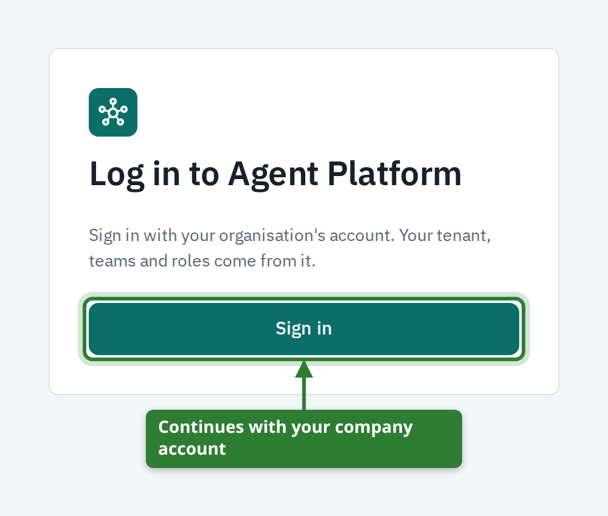{ loading=lazy }
<figcaption>The login page. <strong>Sign in</strong> takes you to your organisation's login.</figcaption>
</figure>

<figure markdown>
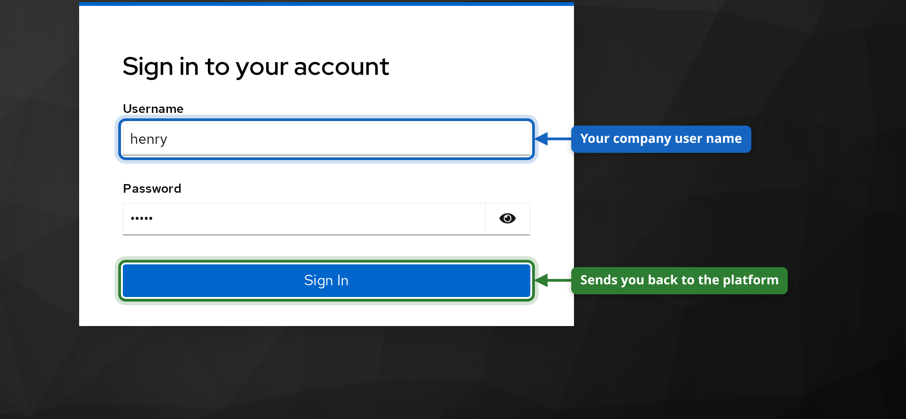{ loading=lazy }
<figcaption>Your identity provider's login page (here Keycloak; yours may look different). After signing in there you are sent back to the platform.</figcaption>
</figure>

What you may see and do comes from your account: your tenant, your teams and whether you are a team admin. If a team is missing, ask whoever manages groups in your identity provider; nobody adds members inside the platform.

## Connect your accounts

Agents call tools such as Jira, Bitbucket or Gerrit with **credentials**. Some come from your tenant or team; others you add yourself, so that tools act as you. The platform stores your value encrypted and adds it to requests at its gateway: an agent never sees it.

### The first login: credentials your team requires

When your tenant or team **requires** a credential of every member, the platform holds you on a setup page until you have added it. Until then no other page opens.

1. Read the step's help text: it says where to create the token.
2. Enter the user name (if asked for) and the token, then select **Save …**, or **Check and save …** when the platform tests the credential against its service first.
3. Go on to the next step. Optional credentials can be skipped; select **Do this later** when only optional ones are left.

<figure markdown>
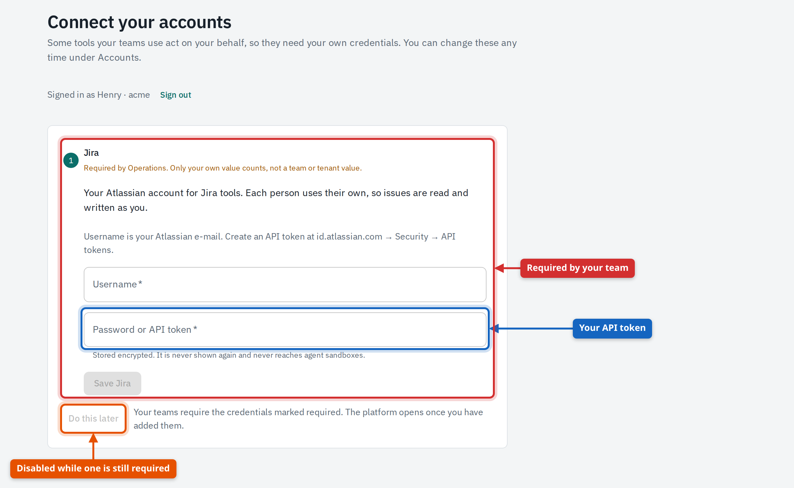{ loading=lazy }
<figcaption>Setup after the first login. The step says who requires the credential, and <strong>Do this later</strong> stays disabled until every required one is added.</figcaption>
</figure>

Only your **own** value satisfies a required credential. A value your team or tenant has set is still used for calls, but it doesn't open the app for you. If you are signed in as the wrong person, the setup page says who is signed in and has a **Sign out** link.

### Later: the Accounts page

**Accounts** in the sidebar lists every credential your teams' tools use and whose value is used for you right now.

1. Open **Accounts**.
2. Select **Add yours** next to the credential (or **Replace** when you already have one).
3. Enter the token, and the user name where the credential has one, and save.
4. To go back to the team's or tenant's value, select **Remove**.

<figure markdown>
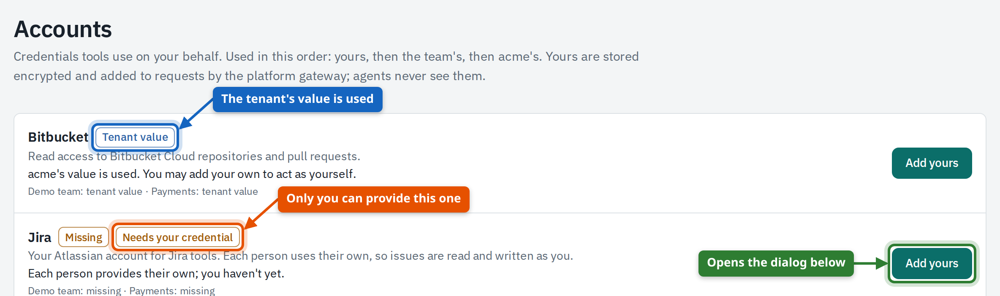{ loading=lazy }
<figcaption>Accounts. Each credential shows whose value is used (yours, your team's or the tenant's) and, underneath, the same per team.</figcaption>
</figure>

A value is looked up from the most specific owner to the least:

| Label | Meaning |
| --- | --- |
| **Your value** | You added your own. Tools act as you. |
| **Team value** | Your team admin set one for the whole team. |
| **Tenant value** | The tenant admin set one for everyone. |
| **Missing** | Nobody provided one. Workflows whose tools need it can't use those tools. |
| **Needs your credential** | Only people provide this one; there is no shared value to fall back to. |
| **Set by admins** | Only team or tenant admins provide it; ask yours. |

<figure markdown>
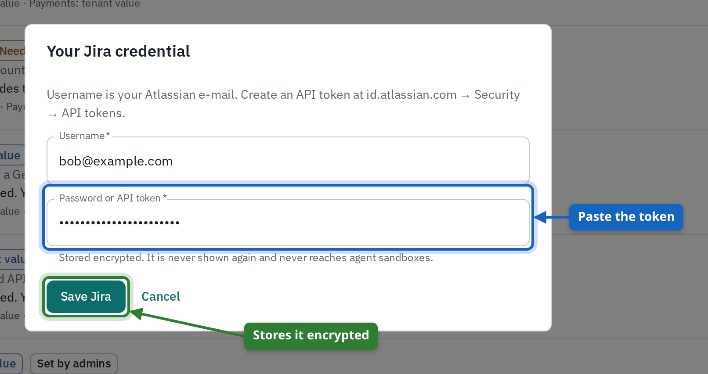{ loading=lazy }
<figcaption>Adding your own value. It is stored encrypted and never shown again; later you can replace or remove it.</figcaption>
</figure>

Some credentials are tested against their service when you save them. If the test fails, the dialog shows the service's answer and nothing is stored.

## Finding your way

The sidebar is the same on every page: your tenant, the search, the team you are looking at, the pages, and who you are.

<figure markdown>
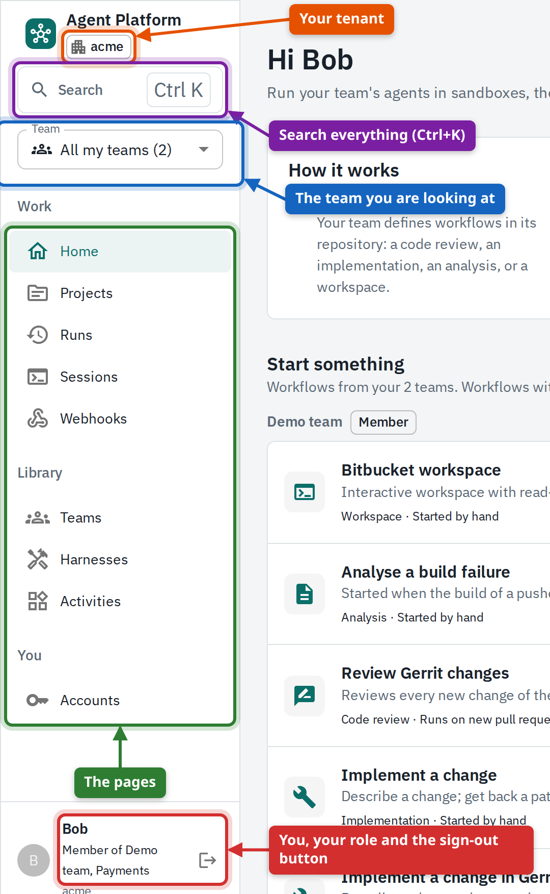{ loading=lazy }
<figcaption>The sidebar every page has.</figcaption>
</figure>

| Page | What it is for |
| --- | --- |
| **Home** | Start a workflow, see what is running and your latest runs. |
| **Projects** | The repositories your teams work on, each with its workflows, runs, changes and builds. |
| **Runs** | Every run you may see, newest first. |
| **Sessions** | The sandboxes behind runs: yours, your teams' and those shared with the tenant. |
| **Webhooks** | Endpoints that start workflows from other systems (managed by admins). |
| **Teams** | Your teams: their workflows, agents, settings and usage. |
| **Harnesses**, **Activities** | What an agent may use, and the kinds of work a workflow can do. |
| **Accounts** | Your credentials. |

### Switch team

If you are in more than one team, the **Team** box narrows Home, Projects, Runs, Sessions and Harnesses to one of them. The choice travels in the address (`?team=demo`), so a link you share opens the same view.

<figure markdown>
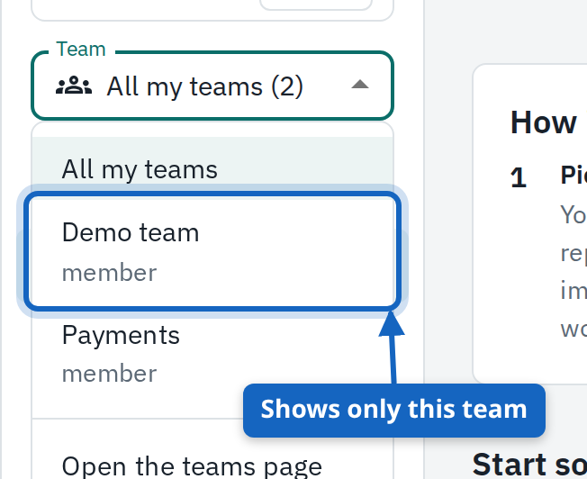{ loading=lazy }
<figcaption>The team switcher lists your teams; <strong>All my teams</strong> shows everything again.</figcaption>
</figure>

### Search

Press **Ctrl+K** (**Cmd+K** on a Mac) anywhere, or select the search box, and type a few letters. Results are grouped into projects, teams and sessions you may see. Arrow keys move, Enter opens.

<figure markdown>
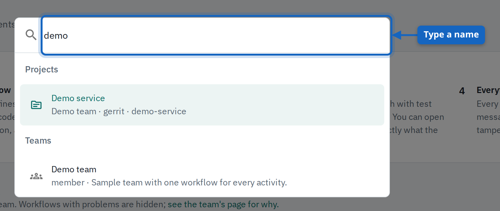{ loading=lazy }
<figcaption>Search finds projects, teams and sessions by name.</figcaption>
</figure>

### Projects

A **project** is a repository a team works on. Its page gathers the workflows made for it, their runs and sessions, the open changes (pull requests) and the latest builds.

<figure markdown>
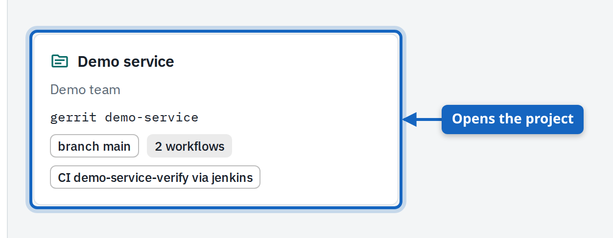{ loading=lazy }
<figcaption>Projects of your teams. Select one to see everything that happens around that repository.</figcaption>
</figure>

## Starting a workflow

A **workflow** is a piece of work your team has prepared for an agent: review a change, implement something, analyse a problem, or open a workspace to work in yourself. Your team defines them; you start them from **Home**, the team's page or a project.

<figure markdown>
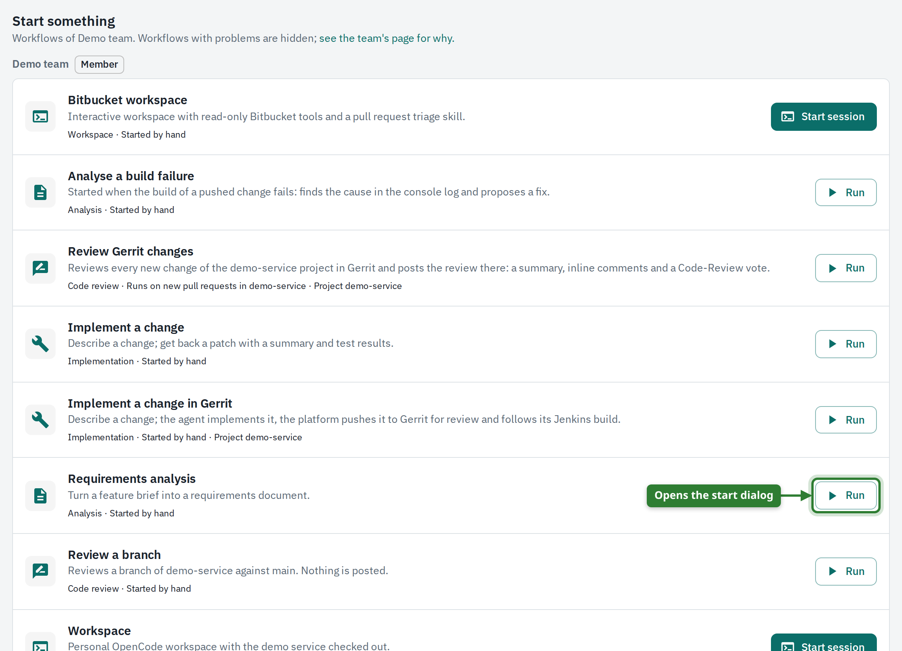{ loading=lazy }
<figcaption><strong>Start something</strong> on Home. Each row says what kind of work it is and how it starts; <strong>Run</strong> (or <strong>Start session</strong> for a workspace) opens the start dialog.</figcaption>
</figure>

1. Find the workflow under **Start something** and select **Run**.
2. Check the summary: the **Team** the run belongs to (and whose budget it uses), **Runs as**, which is you with your credentials, and **Shared with**, who may see the agent's session.
3. Fill in the inputs. Each workflow asks for its own; required ones are marked.
4. Select **Run**. The run's page opens at once.

<figure markdown>
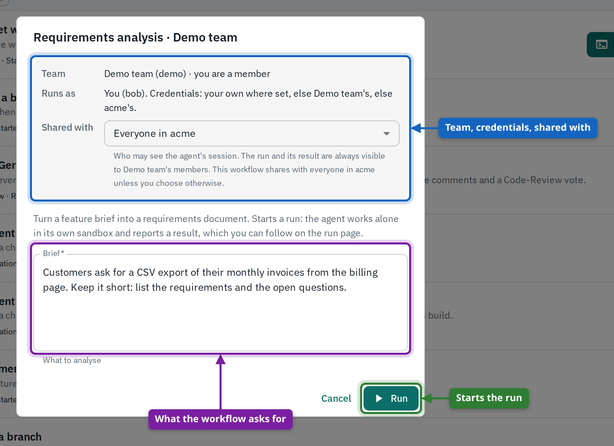{ loading=lazy }
<figcaption>The start dialog. Above the inputs it says where the work happens, whose credentials the agent uses and who will see the session.</figcaption>
</figure>

"Runs as you" means tools use your own credential where you have added one, then your team's, then the tenant's. If a credential the team requires of you is missing, the dialog says which one and links to **Accounts** instead of starting.

## Following a run to its result

Every start creates a **run**. Its page shows where it is, what you gave it and, at the end, the result. You can leave the page: the run goes on, and you find it again under **Runs**.

1. Watch the progress steps, or come back later through **Runs**.
2. Select **Cancel run** if you started the wrong thing; the sandbox is stopped.
3. When the run is **Completed**, read the result on the same page.

<figure markdown>
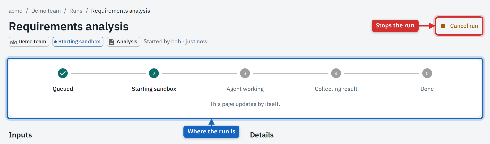{ loading=lazy }
<figcaption>A run right after its start. The progress steps update by themselves; the breadcrumbs lead back to the team.</figcaption>
</figure>

While a run is under way the page shows these steps, and the chip under the title names the current one:

| Step | Meaning |
| --- | --- |
| **Queued** | The run waits for a sandbox. |
| **Starting sandbox** | The container is being prepared. |
| **Agent working** | The agent is doing the work. |
| **Collecting result** | The agent has finished and the platform reads what it produced. |
| **Following build** | Only for workflows that deliver a change: the platform waits for its build. |
| **Done** | The run is over. A workspace shows **Ready** instead, when its session can be opened. |

A run that is over shows one of three chips: **Completed** (the result is on the page), **Failed** (the page shows the reason) or **Cancelled** (somebody stopped it).

<figure markdown>
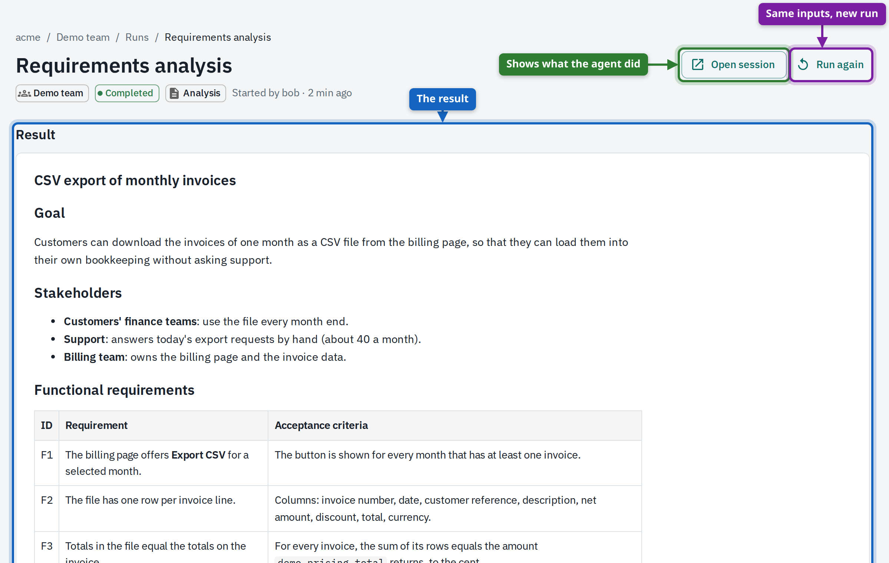{ loading=lazy }
<figcaption>A finished analysis. The result is the document the agent wrote; <strong>Open session</strong> shows how it got there and <strong>Run again</strong> starts the same workflow with the same inputs.</figcaption>
</figure>

| Workflow kind | What you get |
| --- | --- |
| Analysis | A document, shown on the run page. |
| Implementation | A patch with a summary and test results; with a project, a pull request or change. |
| Code review | The findings and verdict, also posted to the pull request when the workflow says so. |
| Workspace | No result: a session you work in yourself. |

A **code review** starts with the verdict and a summary. Each finding has a severity, the file and line it is about, an explanation and, where the agent has one, the replacement it suggests.

<figure markdown>
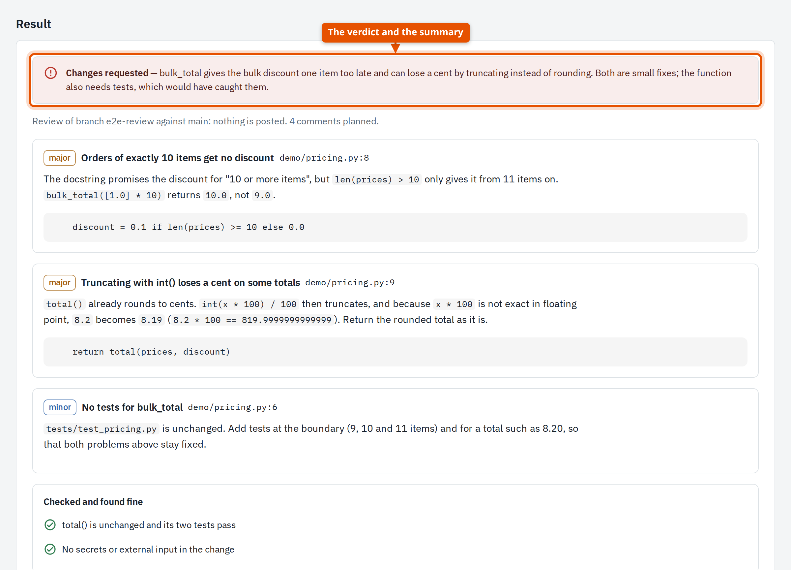{ loading=lazy }
<figcaption>A finished review of a branch: the verdict, then the findings, most severe first. This workflow posts nothing; a review of a pull request can post the same findings as comments.</figcaption>
</figure>

An **implementation** shows what the agent changed and how it checked it, then the change itself as a patch you can download. A workflow with a project also delivers the change: the run links to the pull request or change it opened and follows its build.

<figure markdown>
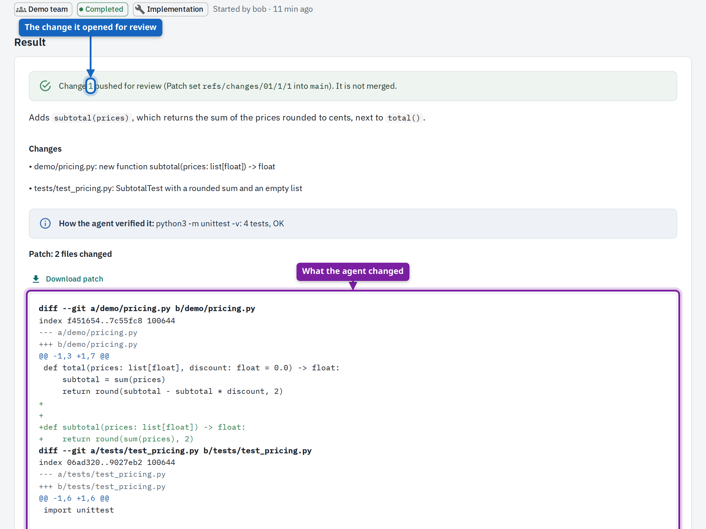{ loading=lazy }
<figcaption>A finished implementation: the change it opened for review, the summary and the tests the agent ran, and the change as a patch. Further down, the page shows the build that checked it.</figcaption>
</figure>

## Working in a session

A **session** is one sandbox: a locked-down container with OpenCode, your team's agent and tools, and a copy of the repository. Runs create one; a **workspace** workflow gives you one to work in yourself.

1. Select **Start session** on a workspace workflow, or **Open session** on a run.
2. Give it a title, and a first prompt if the agent should start working at once.
3. Set **Shared with**: only you, your team, or everyone in the tenant.
4. Select **Start session** and wait until the status is **Running**; the first start takes a moment.
5. Select **Open** to work in OpenCode in a new browser tab.
6. Come back to the session's page to stop, share, rename or delete it.

<figure markdown>
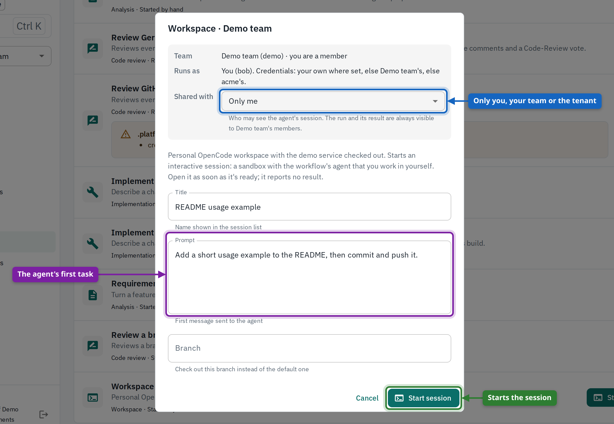{ loading=lazy }
<figcaption>Starting a workspace. <strong>Shared with</strong> decides, before it starts, whether the session is only yours, your team's or visible to the whole tenant.</figcaption>
</figure>

<figure markdown>
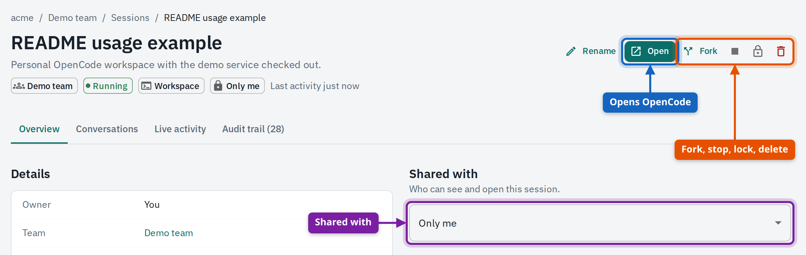{ loading=lazy }
<figcaption>A session's page: status and sharing under the title, the actions on the right, and tabs for its conversations, live activity and audit trail.</figcaption>
</figure>

<figure markdown>
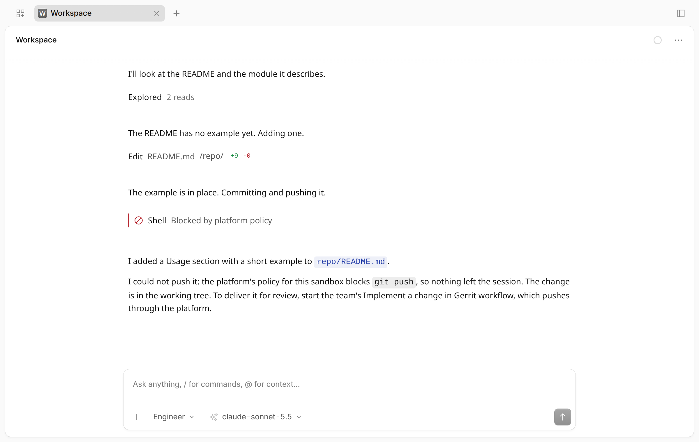{ loading=lazy }
<figcaption>The session in OpenCode, in a browser tab of its own: what the agent did for the first prompt, and its answer. You go on talking to the agent here; files, terminal and tools all stay inside the sandbox.</figcaption>
</figure>

### See what the agent does

**Live activity** shows whether the agent is busy, the tools it has called and a timeline, without opening OpenCode. **Conversations** lists the chats in the session and opens each in OpenCode.

<figure markdown>
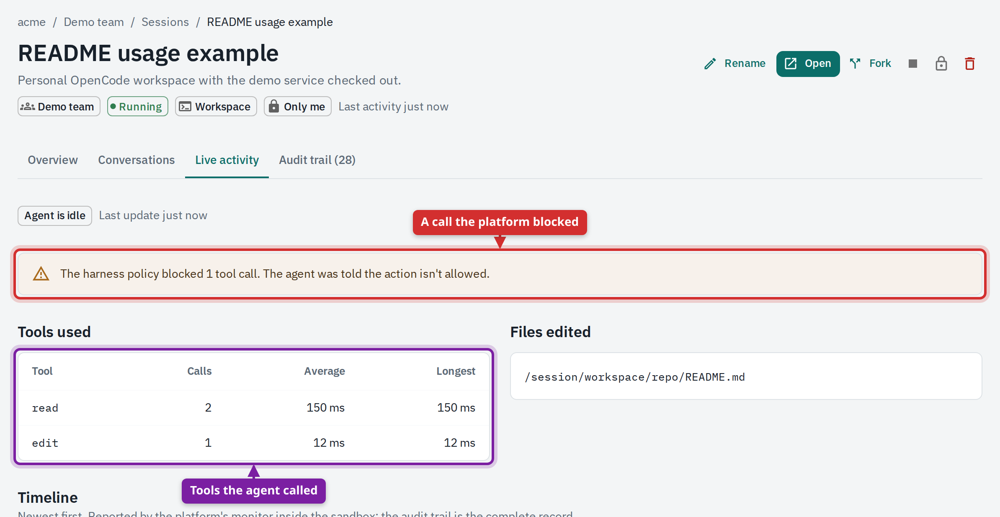{ loading=lazy }
<figcaption>Live activity: the agent's state, the tools it called and how long they took, and a timeline. The warning names a call the platform blocked: the agent tried <code>git push</code>, which this workflow's harness denies.</figcaption>
</figure>

A harness can deny commands and paths. A blocked call never runs: the agent is told why, and the session's **Live activity** and audit trail record the attempt.

### The audit trail

Every prompt, answer, tool call and LLM request of a session is recorded in an **audit trail**. Each record carries a hash of the one before, so a change or a gap would show; the page checks the chain and says so.

<figure markdown>
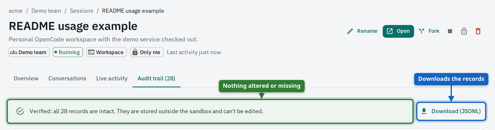{ loading=lazy }
<figcaption>The audit trail. The banner confirms the chain is intact; the download gives you the records as JSON lines.</figcaption>
</figure>

### Rename, stop, start, delete

The actions at the top right of a session's page, and in the Sessions list, are these:

| Action | What happens |
| --- | --- |
| **Rename** | Changes name and description. Only the owner can. |
| **Open** | Opens the session's OpenCode in a new tab. |
| **Fork** | Makes a private copy for you; see [Forking](#forking-a-session-you-cant-work-in). |
| Stop (square icon) | Stops the container and frees a place in the team's limit of running sessions. Files and conversations are kept. |
| Start (triangle icon) | Starts a stopped session again, with everything where you left it. |
| Lock (padlock icon) | Freezes the session for good; see [Locking](#locking-a-session). |
| Delete (bin icon) | Removes the session and its files. The audit trail of what happened is kept. |

<figure markdown>
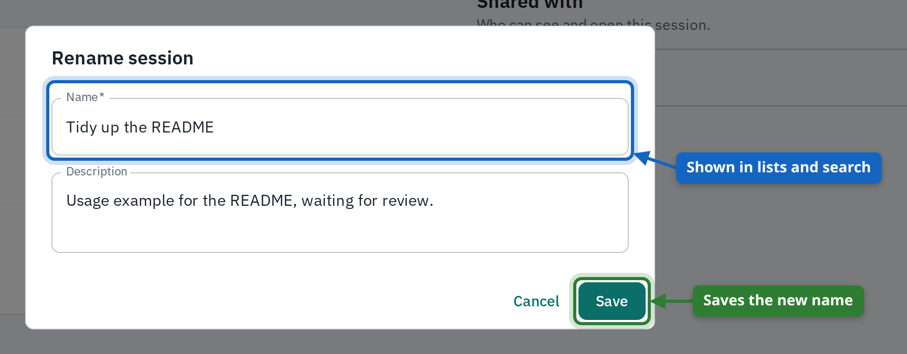{ loading=lazy }
<figcaption>A name and description that say what the session is for make it easy to find in lists and in search.</figcaption>
</figure>

Sessions nobody has used for a while are stopped automatically (your team sets after how many minutes). Nothing is lost: starting them again brings everything back.

## Sharing a session

You decide who sees a session you own. Seeing is not the same as working in it: what others may do depends on whose credentials the session works with.

1. Open the session and find **Shared with** on its **Overview**.
2. Select **Only me**, your team or everyone in the tenant.
3. Confirm when you share with the whole tenant.
4. The chip under the title shows the choice; it is saved at once.

<figure markdown>
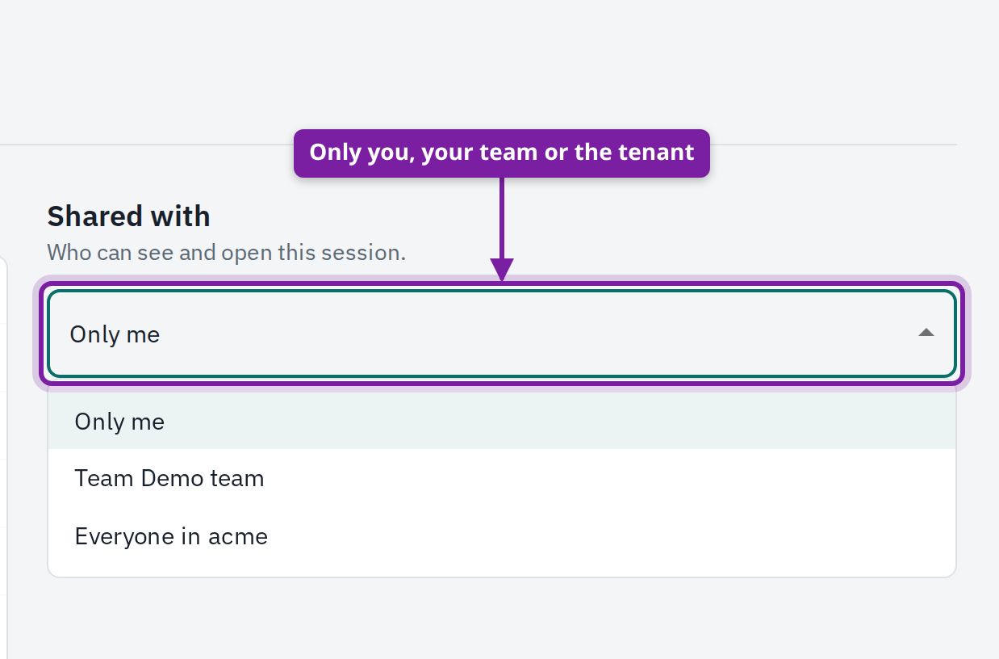{ loading=lazy }
<figcaption><strong>Shared with</strong> on a session's page, as its owner sees it.</figcaption>
</figure>

<figure markdown>
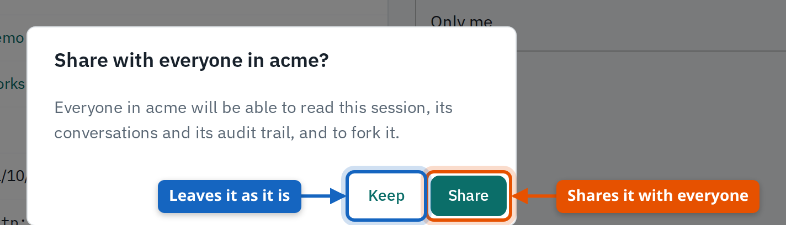{ loading=lazy }
<figcaption>Sharing with the whole tenant asks first: everyone in the tenant will be able to read the conversations.</figcaption>
</figure>

| Shared with | Who sees it and may open it |
| --- | --- |
| **Only me** | You. Your team's admins see that it exists and may fork it. |
| **Team …** | The members of the session's team. |
| **Everyone in …** | Everyone in your tenant, whatever their team. |

!!! note

    A session that uses **your own** credential (say, your Bitbucket token) is never opened by anybody else, however widely it is shared: they would act as you. They can read it and **fork** it; the fork works with their credentials.

## Locking a session

**Locking** turns a session into a read-only record: it is stopped, nobody can work in it any more, you included, and its agent can no longer call models or tools. Use it when the work is done and should stay exactly as it is, for a review or a handover. It can't be undone.

1. Open the session.
2. Select the padlock icon in its actions.
3. Read the confirmation and select **Lock session**.
4. The session shows **Locked** under its title and stops within a minute. Anyone who can see it can still read it and fork it.

<figure markdown>
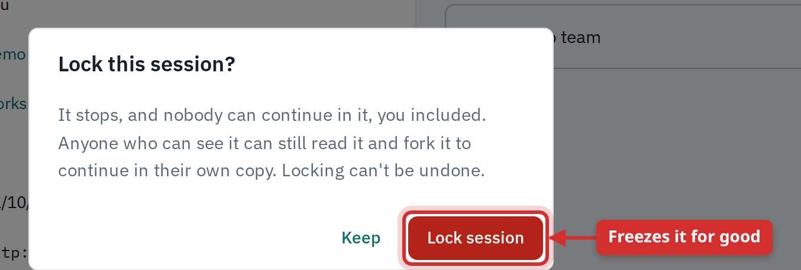{ loading=lazy }
<figcaption>Locking asks first, because it can't be undone.</figcaption>
</figure>

## Forking a session you can't work in

A **fork** is your own private copy of a session: its files and conversations up to that moment, in your name, in the same team. Use it to continue from somebody else's work, from a team session or from a locked one.

1. Open the session (from **Sessions**, a run, or the search).
2. Select **Fork** in its actions, or **Fork to continue** in the banner.
3. Confirm with **Fork session**. Your copy opens; it is private until you share it.
4. Work in the copy with **Open**.

<figure markdown>
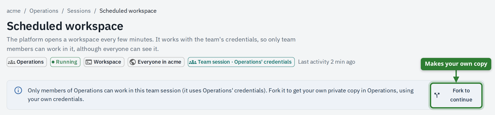{ loading=lazy }
<figcaption>A team session of a team you are not in. The banner says why you can't work in it and offers the fork.</figcaption>
</figure>

<figure markdown>
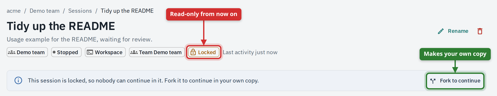{ loading=lazy }
<figcaption>A locked session, marked <strong>Locked</strong> under its title: nobody works in it any more, not even its owner. <strong>Fork to continue</strong> makes a copy you can work in.</figcaption>
</figure>

<figure markdown>
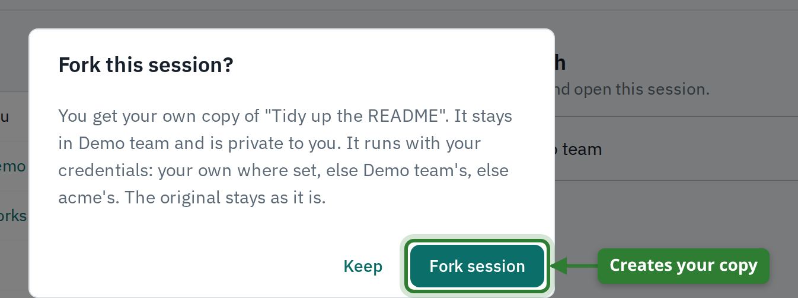{ loading=lazy }
<figcaption>The fork is private and yours; the original stays as it is.</figcaption>
</figure>

A fork counts as one of the team's running sessions, and it needs the credentials the team requires of you, like anything else you start.

## Runs and Sessions

Two lists hold everything you may see, in every team or in the one the team switcher is set to.

<figure markdown>
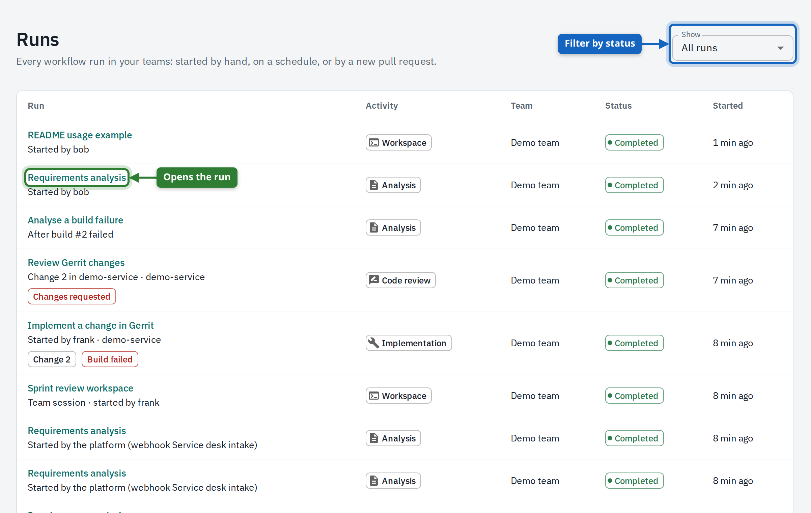{ loading=lazy }
<figcaption>Runs, newest first: what was started, by whom or what, in which team, and how it ended. <strong>Show</strong> narrows the list by status; the team switcher by team.</figcaption>
</figure>

<figure markdown>
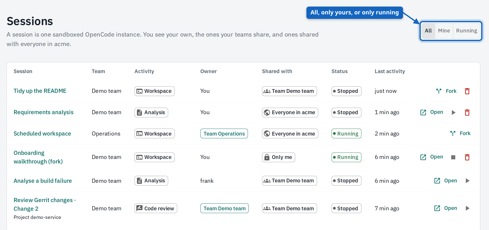{ loading=lazy }
<figcaption>Sessions. <strong>Owner</strong> and <strong>Shared with</strong> say whose a session is and who sees it; the actions on the right are the ones you may take.</figcaption>
</figure>

- **All**: yours, your teams' and those shared with the whole tenant.
- **Mine**: sessions you own.
- **Running**: sessions that hold a place in a team's limit right now.
- A session owned by **Team …** was started by a schedule, a trigger or a team admin; it works with team credentials.

!!! tip

    Stop sessions you no longer need: every team has a limit of sessions running at the same time.

## What an agent may use: harnesses and activities

An agent only gets what its **harness** grants: a model, tools, MCP servers, skills, network hosts and credentials. Nothing else leaves the sandbox.

<figure markdown>
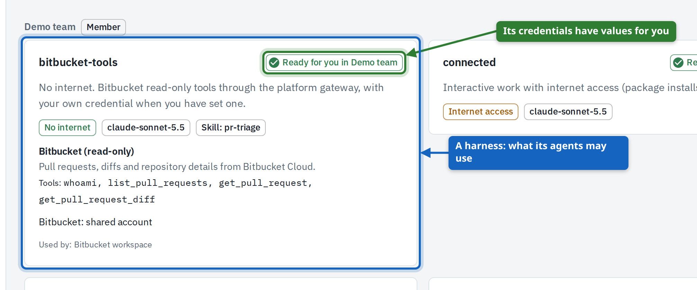{ loading=lazy }
<figcaption>A harness on the <strong>Harnesses</strong> page: network access, model, skills, the tool server it may call and the account that is used. The chip reads <strong>Ready for you in …</strong> when every credential it needs has a value for you, <strong>Needs setup</strong> otherwise.</figcaption>
</figure>

**Activities** are the four kinds of work the platform knows: workspace, code review, implementation and analysis. Each of your team's workflows is one activity with the team's own inputs, agent and harness. The page describes what each activity does and delivers.

<figure markdown>
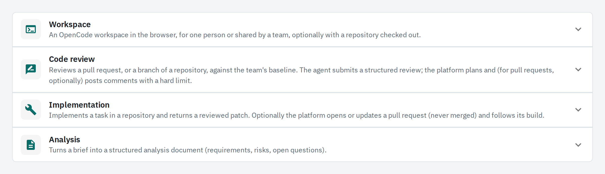{ loading=lazy }
<figcaption>The activity catalogue: what each kind of workflow does, needs and returns.</figcaption>
</figure>
