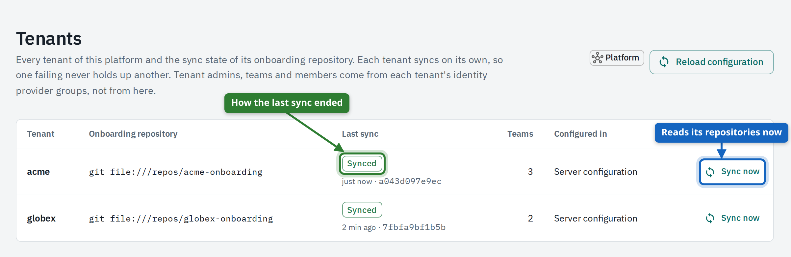
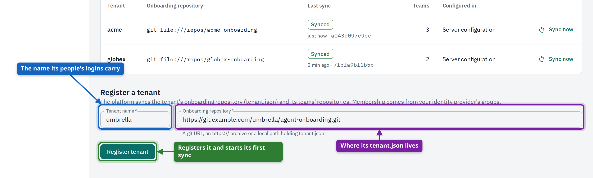
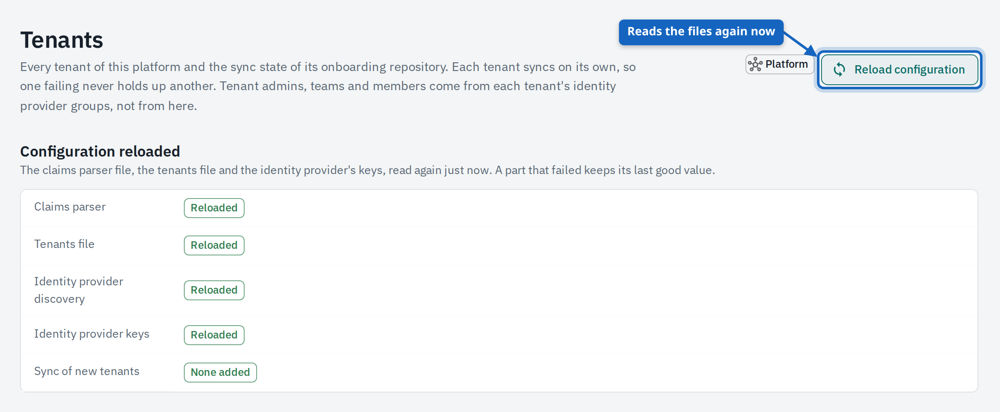
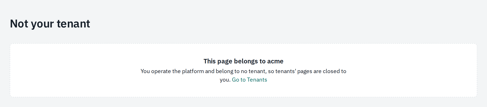

# For platform operators

This guide is for the people who run the platform itself. As an operator you decide which tenants exist and keep their configuration flowing in: you register tenants, watch and trigger their sync, and reload the server's own configuration. What happens inside a tenant (its teams, runs and sessions) belongs to that tenant and its admins. The screenshots show Oscar, operator of a platform with the tenants **acme** and **globex**.

## The Tenants page

A **tenant** is one organisation on the platform, with its own teams, people, credentials and data. Operators see the list of tenants and the state of their configuration, nothing of their work. After signing in you land on **Tenants**, the only page in an operator's sidebar.

1. Open **Tenants**.
2. Find the tenant and read its state and version under **Last sync**.
3. Select **Sync now** in its row to read its repositories at once, for example after its admins fixed a broken file.
4. The row updates by itself when the sync has finished.

<figure markdown>
{ loading=lazy }
<figcaption><strong>Tenants</strong>: every tenant with its onboarding repository, the state and version of its last sync, its number of teams and where it was configured.</figcaption>
</figure>

| State | Meaning |
| --- | --- |
| **Synced** | The onboarding repository and the team repositories were read; the tenant runs the version shown. |
| **Sync failed** | The last sync failed; the reason is shown underneath. A tenant that synced before keeps working with its last good configuration. |
| **Not synced yet** | The tenant is known but its repository has not been read so far. |

**Configured in** says where the tenant comes from: **Server configuration** (the tenants file or setting the platform was started with) or **Registered here** (added on this page).

Tenant admins can sync their own tenant from their Admin page. One tenant's failing sync never holds up another's: each has its own status.

## Register a tenant

A tenant starts as a name and an **onboarding repository**: a Git repository (or directory) the tenant's admins own, with `tenant.json` at its root. It lists the tenant's LLM connections, credentials, MCP servers and teams. Registering makes the tenant known; the platform reads the repository at once.

1. Agree a name with the tenant: lower case, and the same value the identity provider puts into the `tenant` claim of its people.
2. Enter the name and the location of the onboarding repository: a Git URL, an https archive or a directory on the server.
3. Select **Register tenant**. The tenant appears in the list and its first sync starts.
4. Watch the state. **Sync failed** shows the reason, typically an unreachable repository or an invalid `tenant.json`.

<figure markdown>
{ loading=lazy }
<figcaption>The registration form under the list, filled in for a new tenant.</figcaption>
</figure>

Tenants can also be listed in the server's configuration (`MANAGER_TENANTS` or `MANAGER_TENANTS_FILE`), which suits set-ups kept in version control. People of the tenant can sign in as soon as their identity provider sends the tenant's name with their login. A private repository needs a credential: give the onboarding source as a map with `url`, `branch` and `credentials` in the tenants file instead of a plain URL.

## Reload the configuration

The platform re-reads its own configuration files by itself: the tenants file, the claims parser that turns logins into tenants, teams and roles, and the identity provider's keys. **Reload configuration** does it now and tells you, part by part, whether it worked.

1. Change the file on the server (or rotate the keys at the identity provider).
2. Open **Tenants** and select **Reload configuration**.
3. Check that every part says **Reloaded**; fix what failed and reload again.

<figure markdown>
{ loading=lazy }
<figcaption>After <strong>Reload configuration</strong>: one line per part. A part that failed keeps its last good value and shows why.</figcaption>
</figure>

| Part | What is reloaded |
| --- | --- |
| **Claims parser** | The rules that read a person's tenant, teams and roles from their login. |
| **Tenants file** | The list of tenants the server is configured with. |
| **Identity provider discovery**, **keys** | The provider's discovery document and its signing keys. |
| **Sync of new tenants** | Whether tenants new in the file were synced, or that none was added. |

Nothing breaks while a file is wrong: the platform keeps the last version that loaded and logs the error.

## What an operator does not see

Operating the platform is not the same as being in a tenant. An operator account that belongs to no tenant has no teams, runs, sessions or credentials, and the pages of a tenant stay closed to it.

<figure markdown>
{ loading=lazy }
<figcaption>A tenant's address opened as an operator: the page says whose it is and loads none of its data.</figcaption>
</figure>

- You **can** register tenants, see every tenant's sync state, sync any tenant and reload the server's configuration.
- You **can** read the platform's metrics endpoint (`/metrics`) for monitoring.
- You **can't** open a tenant's teams, runs, sessions, audit trails, usage or credentials.
- You **can't** set a tenant's credential values in the UI; operators provide secrets as files on the server instead.

If you also work in a tenant, use an account that the identity provider places in that tenant. The operator role alone opens nothing inside it.
