# For team admins

This guide is for the admins of a team. You look after what the team's agents may use and spend: its settings and limits, the credentials the team shares, team sessions, its projects and the webhooks that let other systems start its workflows. It assumes you know the [guide for team members](member.md). The screenshots show Frank, admin of the **Demo team** in the example tenant **acme**.

## The team page

Everything about a team is on its page: select **Teams** in the sidebar and then the team. The chip at the top right says in which role you see it.

<figure markdown>
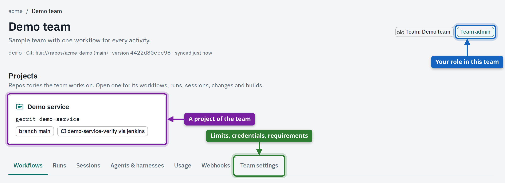{ loading=lazy width="1198" }
<figcaption>The team's page. Under the name: the repository its definitions come from, the version in use and when it was last synced.</figcaption>
</figure>

| Tab | What it shows |
| --- | --- |
| **Workflows** | The team's workflows, each with its start button. A workflow that can't be used shows why. |
| **Runs** | The team's runs, newest first. |
| **Sessions** | The team's sessions you may see, and **Start team session**. |
| **Agents & harnesses** | Who does the work (agents) and what each sandbox may use (harnesses). |
| **Usage** | Tokens and cost by model. |
| **Webhooks** | Endpoints other systems call to start the team's workflows. |
| **Team settings** | Budget and limits, models, MCP servers, projects, required and team credentials. |

Who is a member or an admin of the team is decided in your identity provider (its groups), not here. The platform reads it from each person's login.

## Team settings: budget, models and tools

**Team settings** shows what the team has been given. The values come from the team's `.platform/team.json` (see [Where the definitions live](#where-the-teams-definitions-live)); the page shows them next to what is used right now.

<figure markdown>
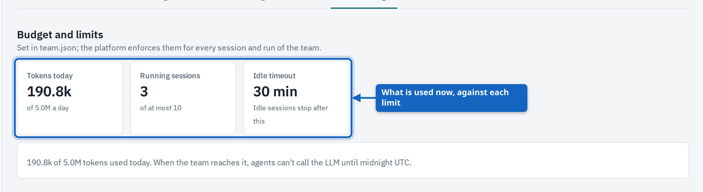{ loading=lazy width="1205" }
<figcaption><strong>Budget and limits</strong>: tokens used today against the daily budget, sessions running against the limit, and after how many idle minutes a session is stopped.</figcaption>
</figure>

| Limit | What happens when it is reached |
| --- | --- |
| **Tokens today** | Agents of the team can't call the LLM any more until midnight UTC. Running sessions stay, but answer with an error. |
| **Running sessions** | Nobody can start a run, a session or a fork in the team until one is stopped. |
| **Idle timeout** | A session nobody used for this long is stopped. It can be started again. |

<figure markdown>
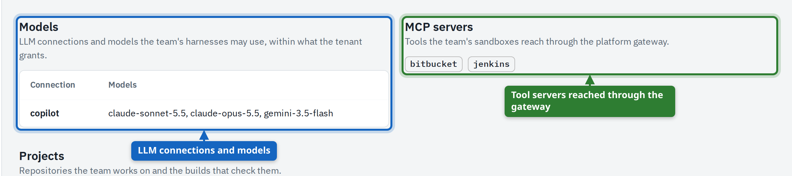{ loading=lazy width="1207" }
<figcaption><strong>Models</strong> and <strong>MCP servers</strong> the team's harnesses may use, within what the tenant grants.</figcaption>
</figure>

### Credentials every member must add

A team can require that each member adds their **own** value of a credential before working in it, so that tools always act as the person. The tenant can require the same of everyone.

1. Add the credential's id to `required_credentials` in the team's `.platform/team.json`.
2. Commit and push; the platform picks the change up with the next sync.
3. From then on a member who lacks their own value lands on setup at the next page they open.

Only credentials people may provide themselves can be required. A value of the team or the tenant doesn't satisfy the requirement: the point is that each person acts as themselves. Team settings lists what is required under **Required of every member**, and the member guide shows [what a member then sees](member.md#the-first-login-credentials-your-team-requires).

## Team credentials

A **team credential** is a value the whole team shares, used instead of the tenant's: a service account for the team's repositories, for example. A member's own value still wins over it.

1. Open the team's **Team settings** and scroll to **Team credentials**.
2. Select **Set** next to the credential, enter the value and save.
3. To replace it, select **Replace**; **Clear** removes it after a confirmation.

<figure markdown>
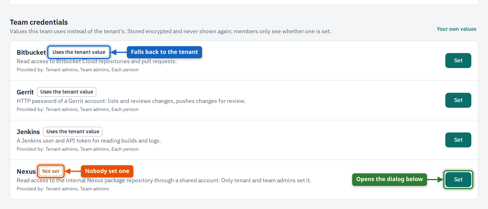{ loading=lazy width="1200" }
<figcaption><strong>Team credentials</strong> at the bottom of Team settings. Each row says whose value the team uses now and who may provide one.</figcaption>
</figure>

<figure markdown>
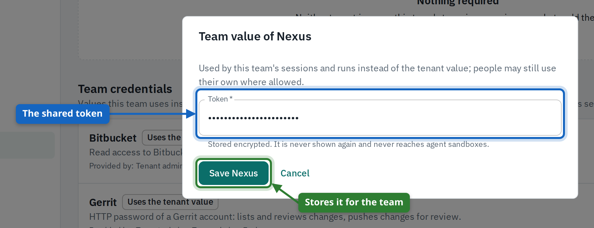{ loading=lazy width="900" }
<figcaption>Setting the team's value. It is stored encrypted for the team and never shown again.</figcaption>
</figure>

<figure markdown>
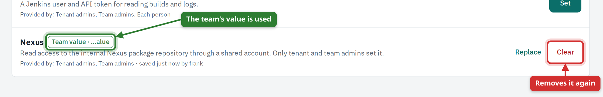{ loading=lazy width="1201" }
<figcaption>With a team value set, the row shows it and offers <strong>Clear</strong> to go back to the tenant's value.</figcaption>
</figure>

| Provided by | Meaning |
| --- | --- |
| **Tenant admins** | The tenant may hold a value for everyone. |
| **Team admins** | You may set a value for your team. |
| **Each person** | Members may add their own under **Accounts**; theirs wins. |

!!! note

    Members see only whether a team value is set, never the value or its hint. Workflows started by a schedule, a trigger or a webhook run as the platform: they use team and tenant values, never anybody's personal one.

## Starting a team session

A **team session** belongs to the team, not to a person. It works with the team's credentials, so every member may work in it and it survives people leaving. Use it for a shared workspace, or for work that should not depend on one person's accounts.

1. Open the team's **Sessions** tab.
2. Select **Start team session** and choose a workspace workflow.
3. Fill in the inputs, check **Shared with**, and select **Start team session**.
4. Members find it under **Sessions**, owned by **Team …**, and work in it with **Open**.

<figure markdown>
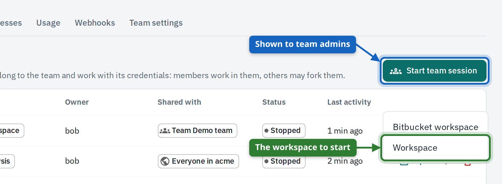{ loading=lazy width="846" }
<figcaption><strong>Start team session</strong> on the team's <strong>Sessions</strong> tab lists the workspace workflows of the team.</figcaption>
</figure>

<figure markdown>
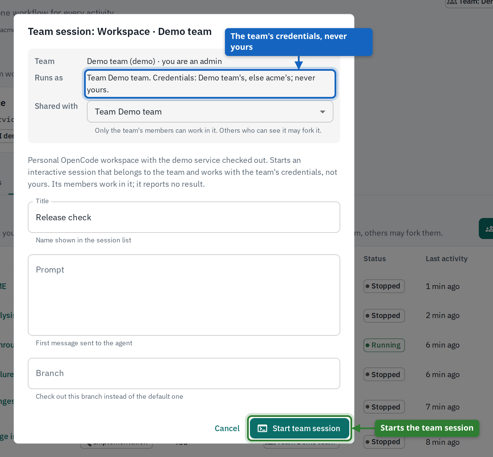{ loading=lazy width="868" }
<figcaption>The start dialog of a team session. <strong>Runs as</strong> names the team: the session uses the team's and the tenant's credentials, nobody's personal ones.</figcaption>
</figure>

People outside the team who can see a team session can't work in it; they fork it and continue in their own copy. Sessions started by schedules and triggers are team sessions too.

## Projects

A **project** ties a repository to the team: where its code lives, which branch is the baseline, which credential reaches it and which builds check it. Workflows name a project instead of repeating all that, and the project's page gathers what happens around it.

1. Describe the project under `projects` in `.platform/team.json`: id, name, branch, `scm` and, if builds should be followed, `ci`.
2. Name it in a workflow with `"project": "<id>"`; the workflow then takes its repository, credential and build job from it.
3. Push. After the next sync the project appears on the team's page and under **Projects**.

<figure markdown>
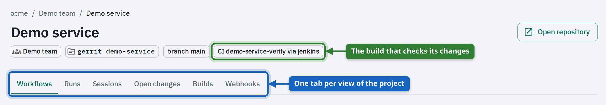{ loading=lazy width="1189" }
<figcaption>A project's page: repository, branch and build job under the name, and a tab for each view.</figcaption>
</figure>

| Tab | What it shows |
| --- | --- |
| **Workflows** | The team's workflows made for this project, ready to start. |
| **Runs**, **Sessions** | Runs and sessions of those workflows. |
| **Open changes** | Pull requests (or Gerrit changes) open in the repository, read live from it. |
| **Builds** | Builds the platform followed for changes its agents delivered, with their result. |
| **Webhooks** | Webhooks that start this project's workflows. |

<figure markdown>
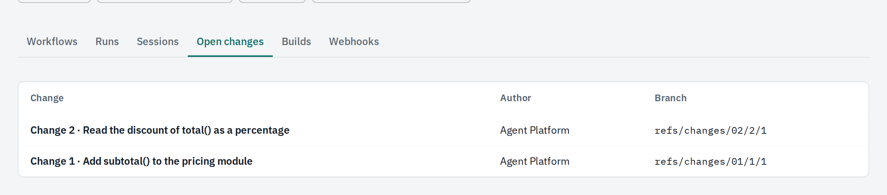{ loading=lazy width="1200" }
<figcaption><strong>Open changes</strong>: what waits for review in the repository, here a change an agent pushed to Gerrit. The list is read live from the code host.</figcaption>
</figure>

<figure markdown>
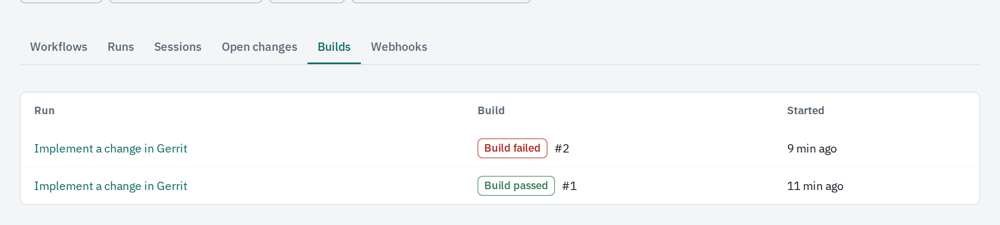{ loading=lazy width="1200" }
<figcaption><strong>Builds</strong>: each change an agent delivered, with the build that checked it and its result. A failed build can start an analysis workflow that looks for the cause.</figcaption>
</figure>

### When a build fails

A workflow that delivers changes can follow their build: `ci` in its options names how long to wait and, with `on_failure`, the workflow to start when the build fails. The run of the change then shows the build with its stages and links to the analysis it started.

1. Open the project's **Builds** tab and select the run of the failed build.
2. Read the build's stages on the run's page; the build number opens it in the build server.
3. Select the link to the analysis to read what the agent found.

<figure markdown>
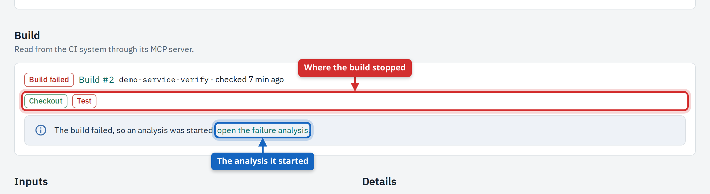{ loading=lazy width="1200" }
<figcaption>The run of a change whose build failed: the stages of the build, and the analysis run the platform started because the workflow names one in <code>on_failure</code>.</figcaption>
</figure>

<figure markdown>
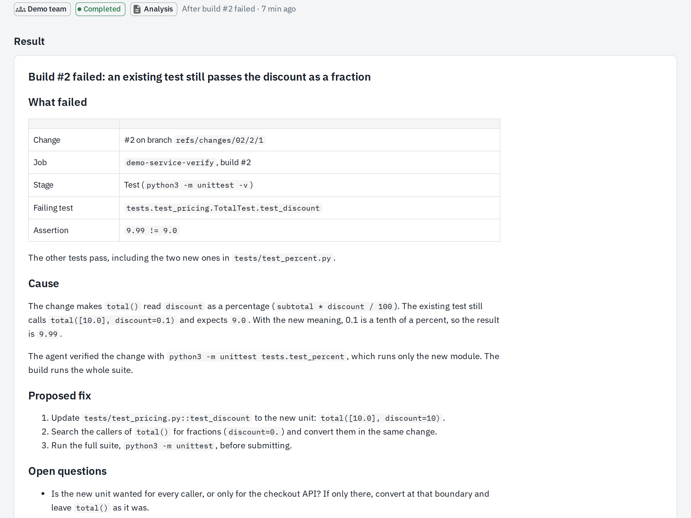{ loading=lazy width="1200" }
<figcaption>The analysis of the failed build: what failed, why, and a proposed fix. It was started for the person whose change failed and runs with the team's read-only harness.</figcaption>
</figure>

## Webhooks

A **webhook** is an address another system calls to start one of the team's workflows: an issue tracker when a ticket is filed, a monitoring tool when an alert fires, a script. Team admins manage the webhooks of their team and its projects.

1. Open the team's **Webhooks** tab (or a project's, to bind the webhook to that project) and select **New webhook**.
2. Give it a name that says who calls it.
3. Under **Starts workflow**, select the workflow it starts.
4. Select the **Authentication**: a secret in a header, basic authentication, or an HMAC signature of the body. Enter a secret or select **Generate**, and copy it now: it is never shown again.
5. Under **Inputs**, map each input of the workflow: a fixed value, or a path into the request's JSON body such as `$.alert.summary`, a header or a query parameter.
6. Optionally limit the caller's addresses and the **Requests a minute**, then select **Create webhook**.

<figure markdown>
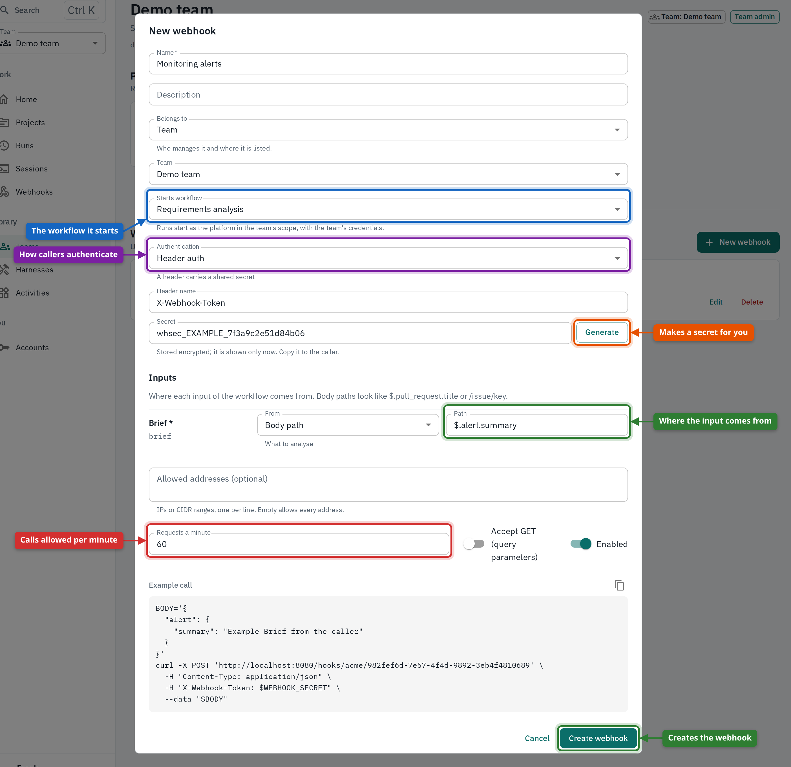{ loading=lazy width="1403" }
<figcaption>A new webhook: what it starts, how callers prove who they are, how the request is turned into the workflow's inputs, and the limits on callers.</figcaption>
</figure>

<figure markdown>
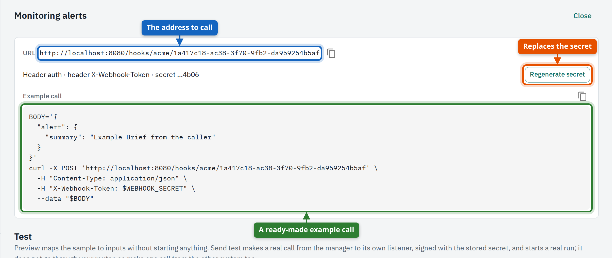{ loading=lazy width="1206" }
<figcaption>The saved webhook. Give the caller the address and the secret; the example <code>curl</code> call shows exactly what to send.</figcaption>
</figure>

### Try it before you hand it out

The test panel under the webhook lets you paste a sample request. **Preview inputs** shows what it would turn into without starting anything; **Send test** makes a real, signed call to the public address.

<figure markdown>
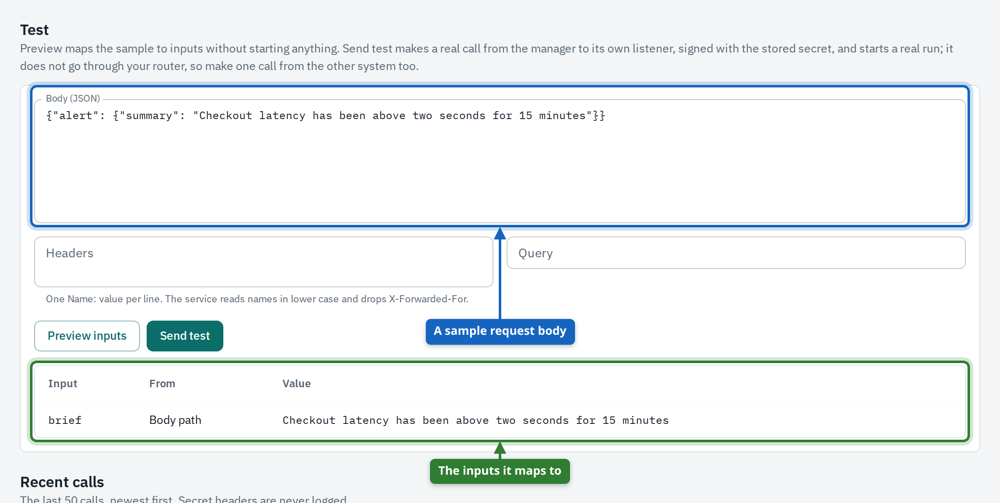{ loading=lazy width="1200" }
<figcaption><strong>Preview inputs</strong>: the sample body, and the inputs the workflow would get from it. Nothing is started.</figcaption>
</figure>

<figure markdown>
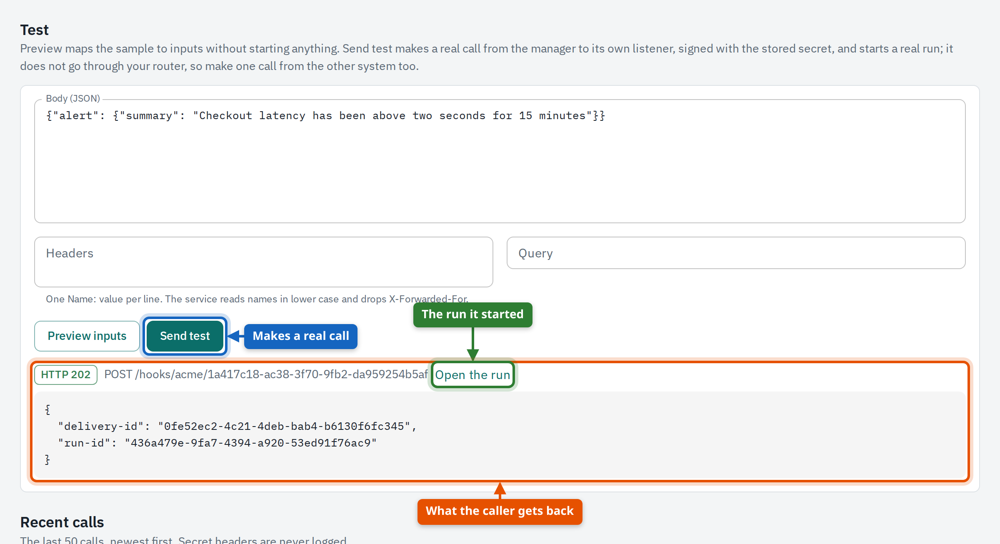{ loading=lazy width="1200" }
<figcaption><strong>Send test</strong> with the same body: the address answers 202, as the caller would see it, and the panel links to the run the call started.</figcaption>
</figure>

| Answer | Meaning |
| --- | --- |
| **202** | Accepted: a run was started. The answer carries its id. |
| **401** | The secret or signature is wrong. |
| **403** | The caller's address is not allowed. |
| **404** | The webhook doesn't exist or is switched off. |
| **422** | The request doesn't give the workflow valid inputs; the answer lists the fields. |
| **429** | Too many calls per minute. |

!!! note

    A test that answers 202 starts a real run, which uses the team's token budget. Runs started by a webhook run as the platform with the team's credentials; people fork their sessions to continue.

### Replace the secret

If a secret may have leaked, or the person who knew it has left, select **Regenerate secret**. The old one stops working at once.

<figure markdown>
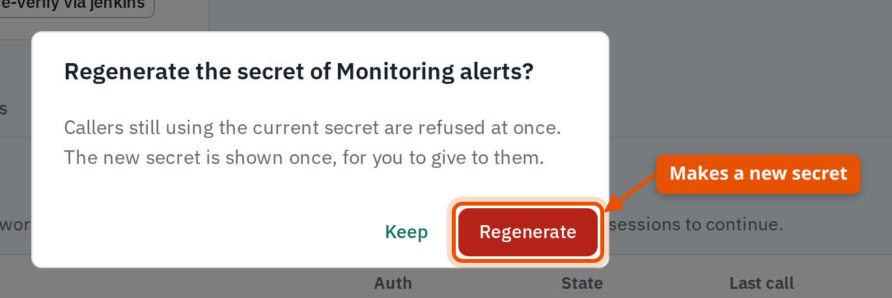{ loading=lazy width="685" }
<figcaption>Regenerating asks first: every caller still using the old secret is refused from that moment.</figcaption>
</figure>

<figure markdown>
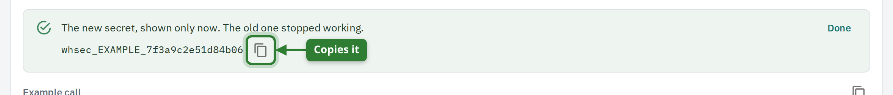{ loading=lazy width="1178" }
<figcaption>The new secret is shown once. Copy it and give it to the caller; after <strong>Done</strong> it can't be read again.</figcaption>
</figure>

### Recent calls

Every call is recorded with its time, answer, where it came from and how it ended. Select a webhook's name in the list to see its calls.

<figure markdown>
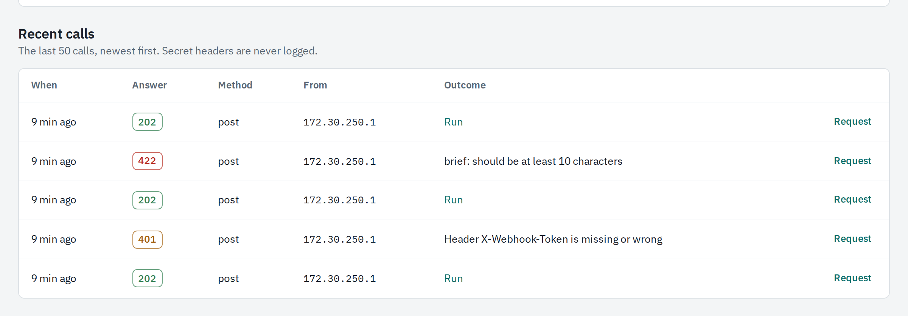{ loading=lazy width="1200" }
<figcaption><strong>Recent calls</strong> of a webhook in use: the last 50 calls with their answers. An accepted call links to the run it started; a refused one says why. <strong>Request</strong> shows what was sent; secret headers are never recorded.</figcaption>
</figure>

### Switch off or delete

A webhook that is switched off answers 404 to everybody but keeps its settings and its recent calls. Deleting removes it for good.

1. Select **Edit** next to the webhook.
2. Turn **Enabled** off and select **Save** to stop it without losing it.
3. Select **Delete** and confirm to remove it.

<figure markdown>
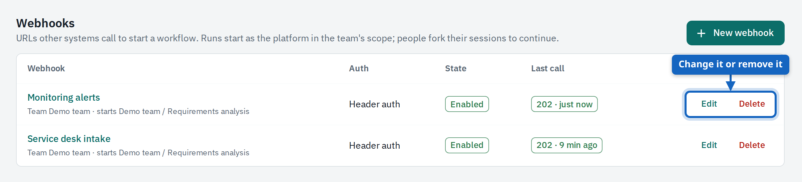{ loading=lazy width="1202" }
<figcaption>The team's webhooks: what each starts, its authentication, whether it is enabled and how the last call ended.</figcaption>
</figure>

## Where the team's definitions live

Nothing about a team is edited in the platform. Workflows, agents, harnesses and settings are files in the **team repository**, under `.platform/`. You change them like code (commit, review, push) and the platform reads them at the next sync. The team page shows which version it uses.

| File | What it defines |
| --- | --- |
| `.platform/team.json` | Budget and limits, models, MCP servers, projects, required credentials. |
| `.platform/workflows/*.json` | One workflow each: the activity, its agent and harness, inputs, triggers and schedule. |
| `.platform/agents/*.json` | Who does the work: the instructions given to the model. |
| `.platform/harnesses/*.json` | What a sandbox may use: models, tools, network, resources, credentials. |
| `.platform/prompts/`, `skills/`, `context/` | Texts the agents and workflows refer to. |

1. Change the file in the team repository and push it to the branch the tenant configured.
2. Wait for the next sync, or ask a tenant admin to [sync the tenant's repositories](tenant-admin.md#sync-the-configuration-now) at once.
3. Check the version under the team's name, and the **Workflows** tab for problems.

<figure markdown>
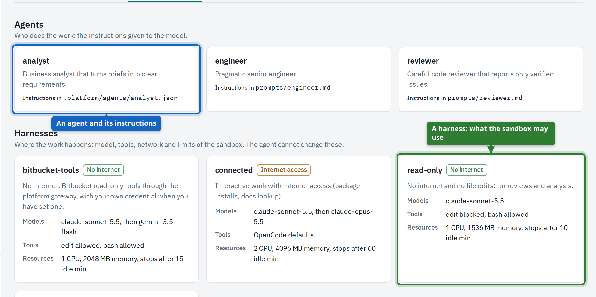{ loading=lazy width="1207" }
<figcaption><strong>Agents &amp; harnesses</strong> shows what the platform read from the repository: each agent with the file holding its instructions, each harness with its models, tools and limits.</figcaption>
</figure>

### When a workflow can't be used

The platform checks every workflow against what the team has been granted: its agent and harness must exist, and its models, MCP servers and credentials must be ones the tenant gives the team. A workflow that fails the check is not hidden from you: the team page says why, and the others keep working. An invalid `team.json` fails the team's sync instead, and the last good configuration stays in use.

<figure markdown>
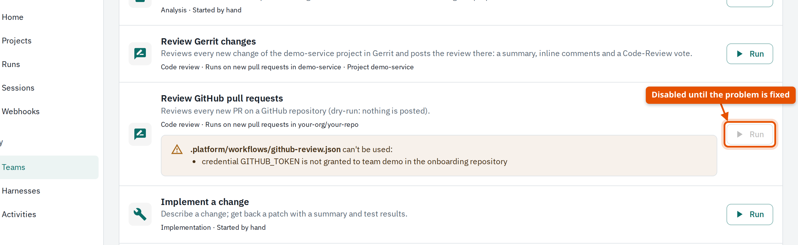{ loading=lazy width="1384" }
<figcaption>A workflow that can't be used: the <strong>Workflows</strong> tab names its file and the reason, here a credential the tenant has not granted the team. <strong>Run</strong> stays disabled until that is fixed and synced.</figcaption>
</figure>

The reference pages describe every field: [team.json](../reference/team-json.md) and [workflows, agents and harnesses](../reference/definitions.md).
