# For tenant admins

This guide is for the admins of a tenant: the organisation's own space on the platform, with its teams, people, credentials and LLM connections. You watch its health and spend, keep its shared credentials working and decide what its teams may use. It assumes you know the guides for [team members](member.md) and [team admins](team-admin.md): as tenant admin you are an admin of every team of the tenant. The screenshots show Alice, tenant admin of **acme**.

## The Admin page

**Admin** in the sidebar (under **Tenant**) is your view of the whole tenant. It shows the effect of the tenant's configuration; the configuration itself is a file, `tenant.json`, in the tenant's onboarding repository.

<figure markdown>
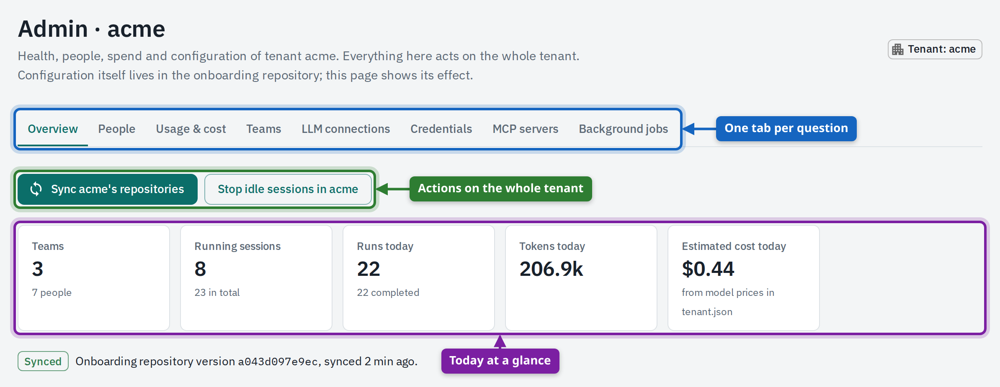{ loading=lazy }
<figcaption>The Admin page on <strong>Overview</strong>: teams and people, sessions running now, today's runs, tokens and estimated cost, and the state of the tenant's configuration.</figcaption>
</figure>

| Tab | What it answers |
| --- | --- |
| **Overview** | Is the configuration in sync? How much is running and what does today cost? |
| **People** | Who has used the platform, in which teams and roles? |
| **Usage & cost** | Which team and model used how many tokens, and what did it cost? |
| **Teams** | Which teams exist, where do their definitions come from, are they in sync? |
| **LLM connections** | Which models may teams use, and does the connection work? |
| **Credentials** | Which credentials exist, who provides them, which are required? |
| **MCP servers** | Which tool servers do sandboxes reach, and with which credential? |
| **Background jobs** | Which recurring jobs does the platform run for the tenant? |

## Sync the configuration now

The platform reads the onboarding repository and every team repository regularly. After a change you don't want to wait for, sync by hand.

1. Push the change to the onboarding repository or a team repository.
2. Open **Admin** and select **Sync …'s repositories**.
3. Wait for the outcome under the buttons: **Synced** with the number of team repositories that are up to date, or what failed.
4. Select **See each team** to open the **Teams** tab with every team's source and last sync.

<figure markdown>
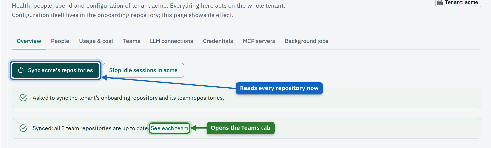{ loading=lazy }
<figcaption>After <strong>Sync …'s repositories</strong>: the page first confirms the request, then shows the outcome with a link to the teams.</figcaption>
</figure>

<figure markdown>
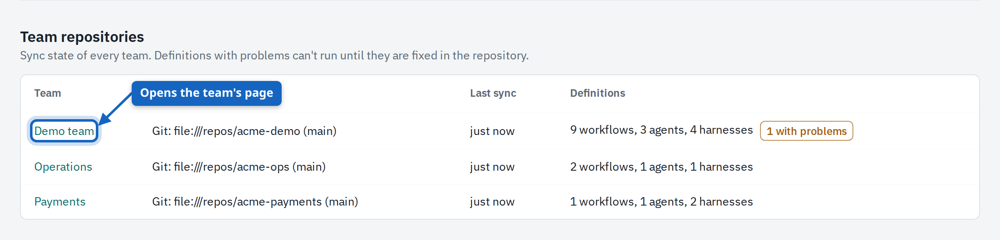{ loading=lazy }
<figcaption><strong>Teams</strong>: each team with the source of its definitions, when it was last synced and how many definitions were read. The name opens the team's page.</figcaption>
</figure>

A team whose files are invalid keeps its last good version; its row says what is wrong. Teams are added and removed in `tenant.json` (`teams`: id, name, repository). Who belongs to a team is decided in your identity provider.

## People, usage and cost

Two tabs answer who uses the platform and what it costs. Both read what the platform's gateway measured: every LLM call passes through it.

<figure markdown>
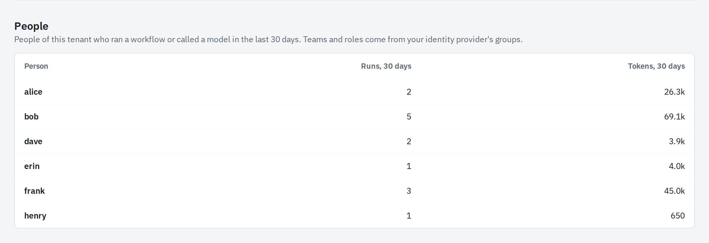{ loading=lazy }
<figcaption><strong>People</strong>: everyone of the tenant who ran a workflow or called a model in the last 30 days, with their number of runs and the tokens they used.</figcaption>
</figure>

1. Open **Admin** and select the **Usage & cost** tab.
2. Select the period at the top right.
3. Compare teams in the first table; the second splits each team by model, with cached and failed calls.

<figure markdown>
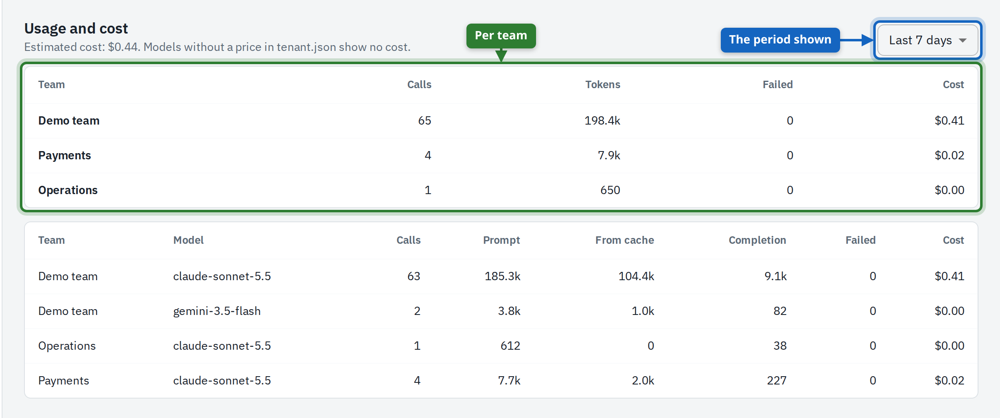{ loading=lazy }
<figcaption><strong>Usage &amp; cost</strong> by team, then by team and model. The cost is an estimate from the model prices in <code>tenant.json</code>; a model without a price shows none.</figcaption>
</figure>

A team's own **Usage** tab shows the same numbers for that team, and **Team settings** how close it is to its daily token budget.

## LLM connections

An **LLM connection** is a model provider the tenant has an account with. `tenant.json` names the connections, their models and prices; teams pick from them. Agents never get the provider's key: their calls go through the platform's gateway, which adds it.

1. Open **Admin** and select the **LLM connections** tab.
2. Select **Test connection**.
3. Read the answer under the connection's models.

<figure markdown>
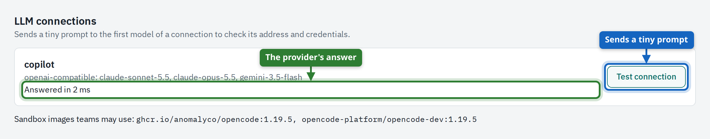{ loading=lazy }
<figcaption><strong>LLM connections</strong>. <strong>Test connection</strong> sends a tiny prompt to the connection's first model and shows whether address and key work.</figcaption>
</figure>

If the test fails, check the connection's secret under **Credentials** and its address in `tenant.json`.

## Tenant credentials

`tenant.json` declares every credential the tenant's tools use: its name, the hosts it may be sent to, who may provide a value and whether each person must add their own. The **Credentials** tab shows them and holds the tenant's values.

<figure markdown>
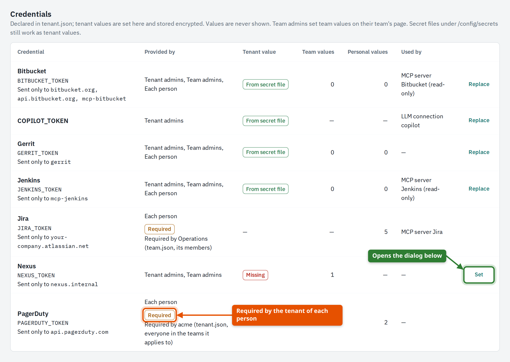{ loading=lazy }
<figcaption><strong>Credentials</strong>: who may provide each one, whether the tenant has a value, how many teams and people added their own, and what uses it.</figcaption>
</figure>

| Tenant value | Meaning |
| --- | --- |
| **Set** | A value stored encrypted on the platform, set on this page. |
| **From secret file** | A value the platform operator provides as a file on the server. |
| **Missing** | No tenant value. Teams or people have to provide their own, or tools needing it fail. |
| A dash | The credential is provided by people only; the tenant can't hold one. |

1. Open **Admin** and select the **Credentials** tab.
2. Select **Set** (or **Replace**) in the credential's row.
3. Enter the value, and the user name where the credential has one, and save.
4. A credential with a test is checked against its service first; a wrong value is refused and not stored.

<figure markdown>
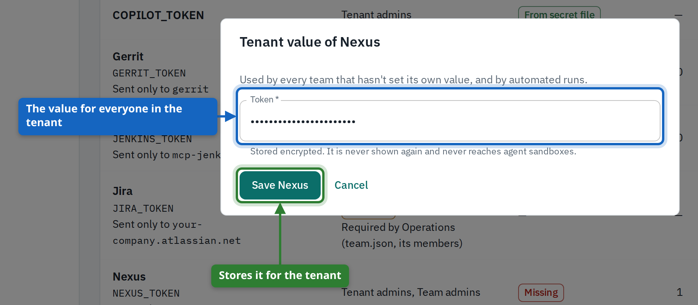{ loading=lazy }
<figcaption>Setting the tenant's value. It is stored encrypted and never shown again, only a short hint.</figcaption>
</figure>

### Require a credential of everyone

Mark a credential `"required": true` in `tenant.json` when every person in the teams it applies to must work with their own account, as PagerDuty is in the figure above. The row then shows **Required** and who requires it; people without their own value are held on the setup page at their next visit. Teams can require credentials of their own members in their `team.json`.

<figure markdown>
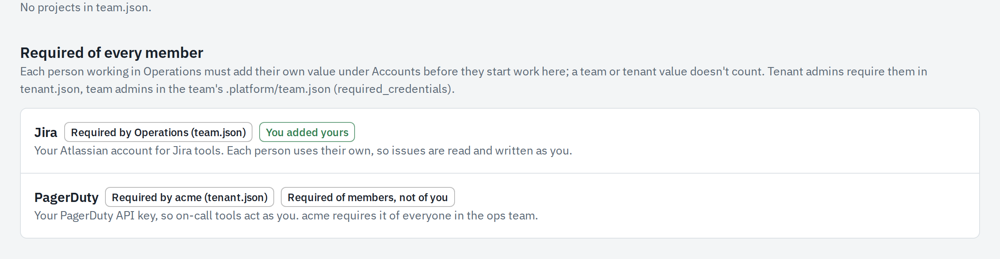{ loading=lazy }
<figcaption><strong>Required of every member</strong> on a team's <strong>Team settings</strong>: here one credential is required by the team itself (<code>team.json</code>) and one by the tenant (<code>tenant.json</code>).</figcaption>
</figure>

!!! note

    LLM connection secrets are tenant values only: neither teams nor people can replace them. Values never travel into a sandbox; the gateway adds them to requests for the declared hosts.

## MCP servers and background jobs

**MCP servers** are the tool servers agents may call: issue trackers, code hosts, build servers. They are declared in `tenant.json` with the credential they use and, optionally, the teams and tools they are limited to.

<figure markdown>
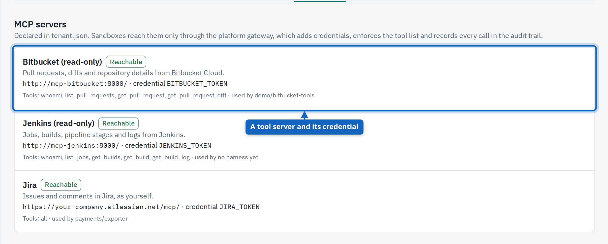{ loading=lazy }
<figcaption><strong>MCP servers</strong>: each server with its address, the credential the gateway adds and the tools agents may call.</figcaption>
</figure>

<figure markdown>
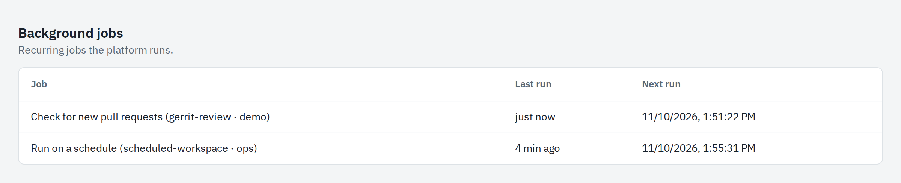{ loading=lazy }
<figcaption><strong>Background jobs</strong>: the recurring jobs behind workflows that start by themselves, on a schedule or when a new pull request appears, with their last and next run.</figcaption>
</figure>

Sandboxes keep running until somebody stops them or their idle timeout passes. **Stop idle sessions in …** on the **Overview** stops, at once, every session of the tenant that has been idle longer than its limit, and reports how many it stopped. Nothing is lost: owners start them again.

## Tenant webhooks

The **Webhooks** page lists every webhook you may see across the tenant. Only tenant admins create webhooks that **belong to the tenant** rather than to one team: use them for callers that serve the whole organisation, such as a central issue tracker. A tenant webhook still starts one workflow of one team.

1. Open **Webhooks** in the sidebar and select **New webhook**.
2. Set **Belongs to** to the tenant.
3. Select the team and the workflow to start, the authentication and the input mapping.
4. Select **Save**, then test it as described in the [team admins' guide](team-admin.md#webhooks).

<figure markdown>
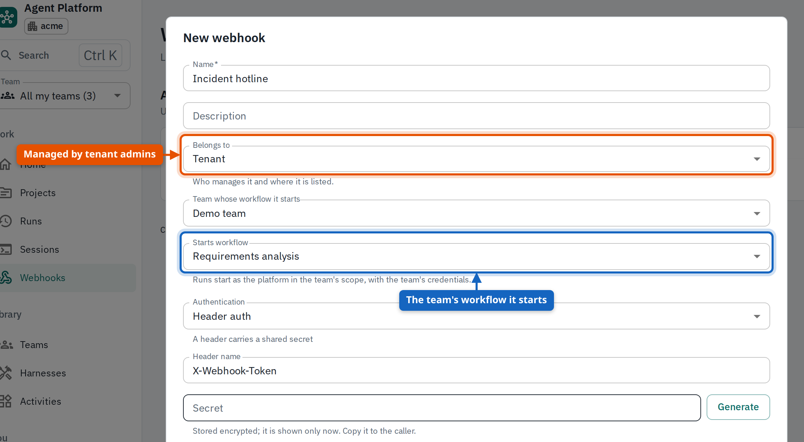{ loading=lazy }
<figcaption>A webhook that belongs to the tenant: <strong>Belongs to</strong> decides who manages it and where it is listed, <strong>Team whose workflow it starts</strong> and <strong>Starts workflow</strong> what it starts.</figcaption>
</figure>

Only tenant admins can change a webhook that belongs to the tenant.

## Teams you oversee without being a member

As tenant admin you are an admin of every team, also of those your account isn't a member of. The platform says so wherever it matters, because some things depend on membership.

<figure markdown>
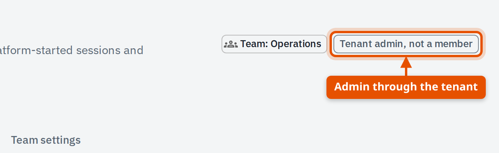{ loading=lazy }
<figcaption>A team seen as tenant admin. The chip says <strong>Tenant admin, not a member</strong>: you manage the team, but you are not one of its people.</figcaption>
</figure>

| You can | You can't, or needn't |
| --- | --- |
| See the team's page, runs and sessions | Work in a member's private session; you fork it instead |
| Set team credentials, start team sessions, manage webhooks | Be asked for the credentials the team requires of its members |
| Stop, lock or delete the team's sessions | Appear in the team's member counts |

The sidebar shows your own role under your name. Every team of the tenant is reached through **Teams** in the sidebar or the **Teams** tab of the Admin page.
