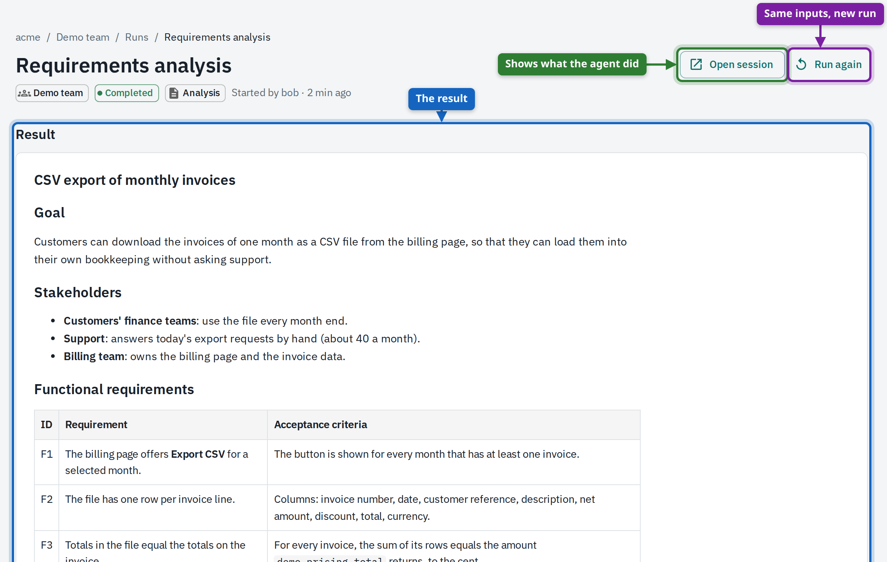
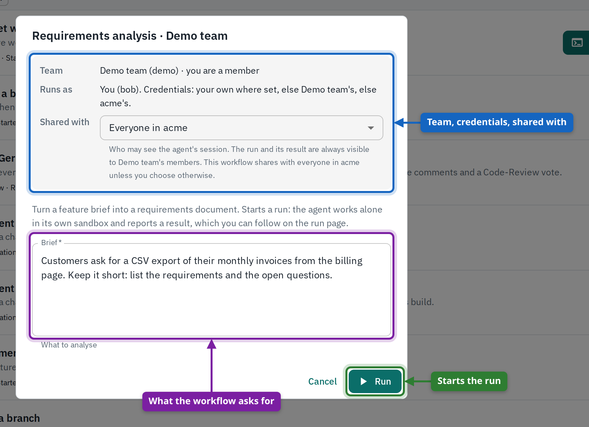
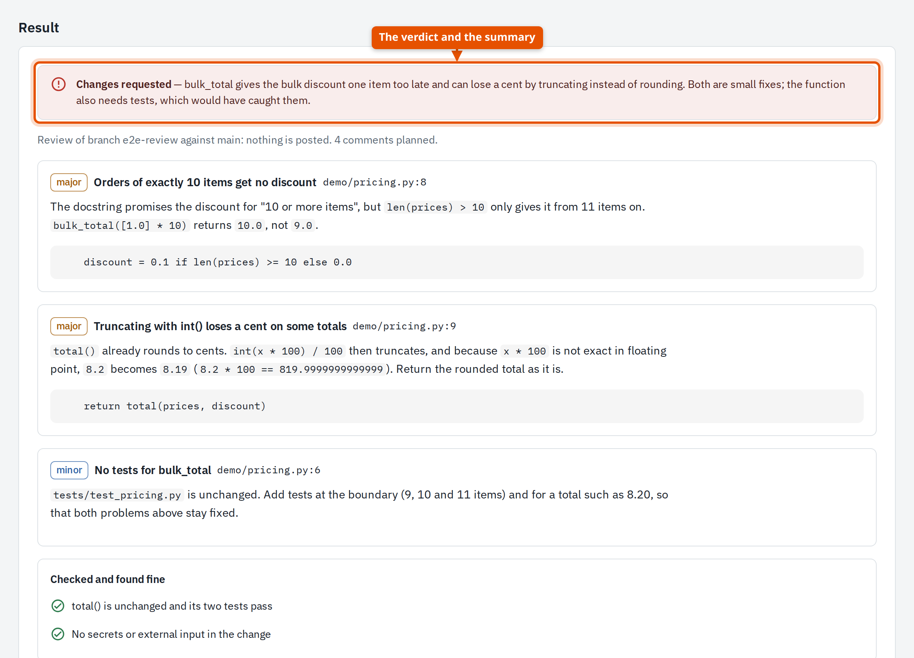
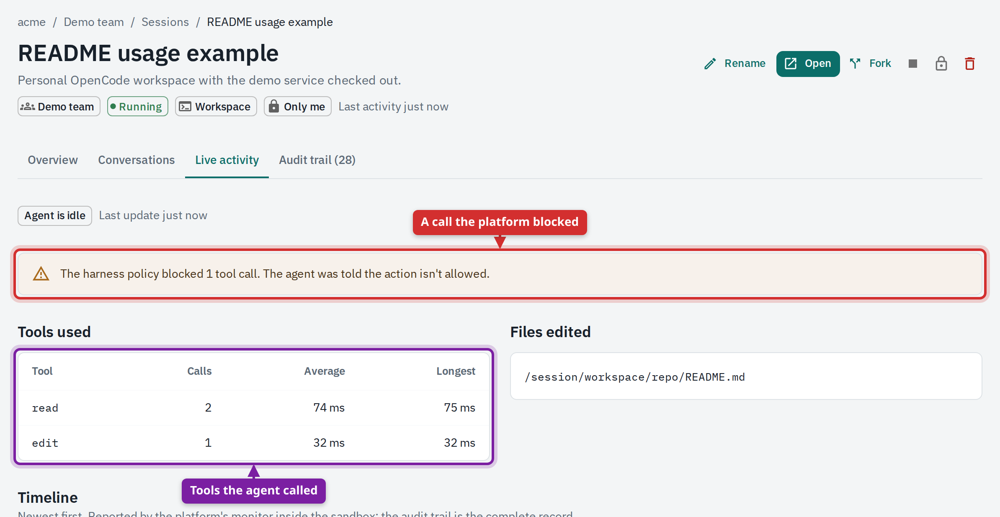
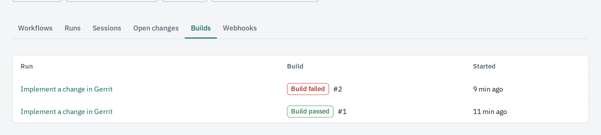

---
hide:
  - navigation
  - toc
---

# AI coding agents for every team, without handing them your keys

The Agent Platform runs coding agents for your teams on your own infrastructure. Each piece of work runs in a locked-down sandbox, uses the tools its team allowed, and comes back as a checked result: review findings, a patch with test results, or a document.

[See the path to a working platform](story/index.md){ .md-button .md-button--primary }
[Try it on a laptop](story/install.md#evaluation-on-a-laptop){ .md-button }

<figure class="pitch-shot" markdown>
{ loading=lazy width="900" }
</figure>

## The problem it solves

Agents are useful the moment they can read your code, call your tools and open pull requests. That is also the moment they hold your tokens, reach your network and act with nobody watching. Teams end up either blocking agents or running them on laptops with personal keys.

-   :material-key-chain:{ .lg .middle } **Keys never reach an agent**

    ---

    LLM keys, Git tokens and tool credentials stay on the platform side. Its gateways add them to each call, so a prompt injection has nothing to steal.

-   :material-shield-lock:{ .lg .middle } **Sandboxed by default**

    ---

    Every run gets its own container: no internet unless its harness allows it, read-only, unprivileged, and unable to change its own configuration.

-   :material-clipboard-text-clock:{ .lg .middle } **Everything is recorded**

    ---

    Every message and tool call lands in a tamper-evident audit trail outside the sandbox. Every LLM call is metered per team, with budgets you set.

-   :material-account-group:{ .lg .middle } **Your identity provider decides**

    ---

    People sign in with their company account. Tenants, teams and roles come from its groups; nobody is added by hand, and tenants never see each other.

## How it works

A team keeps its agents in its own Git repository, reviewed like any other code. People start work from one page and get a result they can check.

-   **Describe**

    ---

    A team commits its agents, the sandbox each one works in and the workflows people can start: a review, an implementation, an analysis, a workspace.

-   **Run**

    ---

    A person starts a workflow from a short form. Reviews also start by themselves on new pull requests or Gerrit changes, on a schedule, or from another system's webhook.

-   **Check**

    ---

    The result comes back structured: findings on the lines they concern, a patch with the tests the agent ran, or a document. The session behind it stays open to inspect, share and fork.

-   **Govern**

    ---

    Admins see usage and cost per team and person, set budgets and limits, require credentials of members, and export the audit trail.

## What your teams get

<figure markdown>
{ loading=lazy width="460" }
<figcaption><strong>One place to start agent work.</strong> Every start says which team it runs in, whose credentials it uses and who will see it.</figcaption>
</figure>

<figure markdown>
{ loading=lazy width="460" }
<figcaption><strong>Results you can act on.</strong> Review findings on real lines, posted to the pull request or Gerrit change if you want.</figcaption>
</figure>

<figure markdown>
{ loading=lazy width="460" }
<figcaption><strong>Agents you can watch.</strong> Live activity shows each tool call, including the ones the harness blocked.</figcaption>
</figure>

<figure markdown>
{ loading=lazy width="460" }
<figcaption><strong>Changes followed to their build.</strong> A change is delivered for review, its CI build is followed, and a failure starts an analysis.</figcaption>
</figure>

## Built for an organisation, not a demo

| You need | The platform gives you |
|---|---|
| **Separation between organisations and teams** | Tenants are fully isolated. Inside a tenant, each team owns its agents, sessions, runs, budget and credentials. See [Roles and visibility](reference/roles.md). |
| **Single sign-on** | Any OpenID Connect provider. Groups and roles in the token decide tenant, teams and admin rights. See [Connect your identity provider](story/identity.md). |
| **Control over what an agent can touch** | Models, tools, network hosts and commands are an allow-list per harness, set in the team's repository. See the [Security model](reference/security.md). |
| **Tools without shared passwords** | MCP servers (Bitbucket, Jenkins, Jira, your own) sit behind a gateway that adds the right credential per call: the person's, the team's or the tenant's. See [Credentials](reference/credentials.md). |
| **Cost you can predict** | Daily token budgets and running-session limits per team, enforced at the gateway, with usage per team, person and model. See [Govern and operate](story/operate.md). |
| **Evidence** | A hash-chained audit trail per session that can be verified and exported. |
| **Your infrastructure** | Docker Compose on a laptop to evaluate, Kubernetes with the included Helm chart to run it. Bring your own LLM provider. See [Install the platform](story/install.md). |
| **Integration** | Pull-request and Gerrit triggers, schedules, CI build following, and signed webhooks for other systems. See [Automate the work](story/automate.md). |

## Start here

-   :material-rocket-launch:{ .lg .middle } **Evaluating it**

    ---

    Follow the seven steps from an empty machine to a team doing real work, with the shipped example company.

    [The path](story/index.md)

-   :material-server:{ .lg .middle } **Running it**

    ---

    Install the platform, connect your identity provider and register tenants.

    [Install](story/install.md) · [Operator guide](guide/operator.md)

-   :material-domain:{ .lg .middle } **Administering a tenant or team**

    ---

    Onboard a tenant, set up a team, and manage credentials, budgets and webhooks.

    [Tenant](story/tenant.md) · [Team](story/team.md) · [Admin guides](guide/tenant-admin.md)

-   :material-account:{ .lg .middle } **Using it**

    ---

    Sign in, connect your accounts, run a workflow and read the result, with screenshots of every step.

    [Member guide](guide/member.md)

New to the vocabulary? [Concepts and terms](reference/concepts.md) defines tenant, team, harness, workflow, run and session, and shows how the parts fit together.
