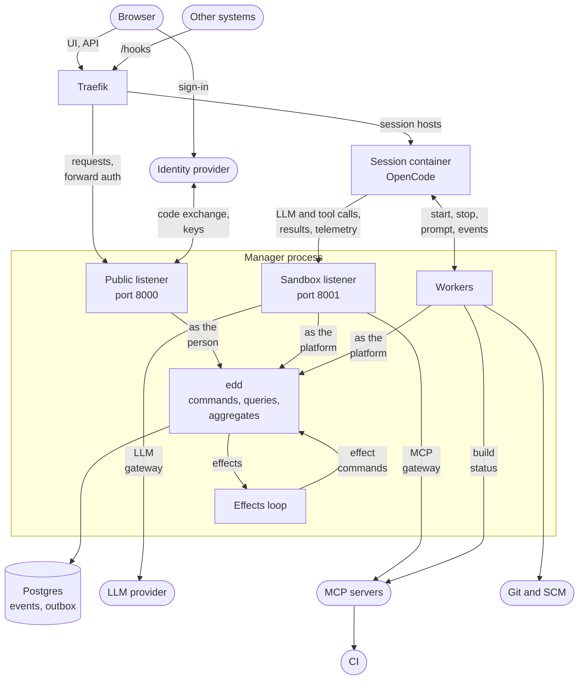
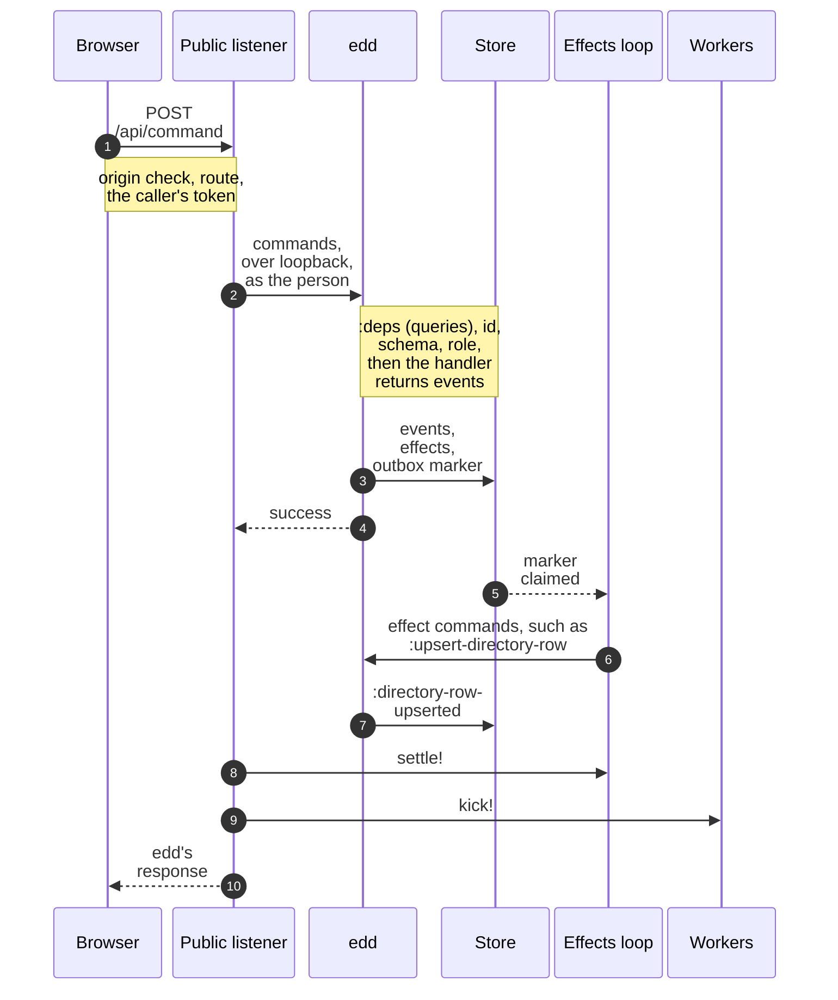
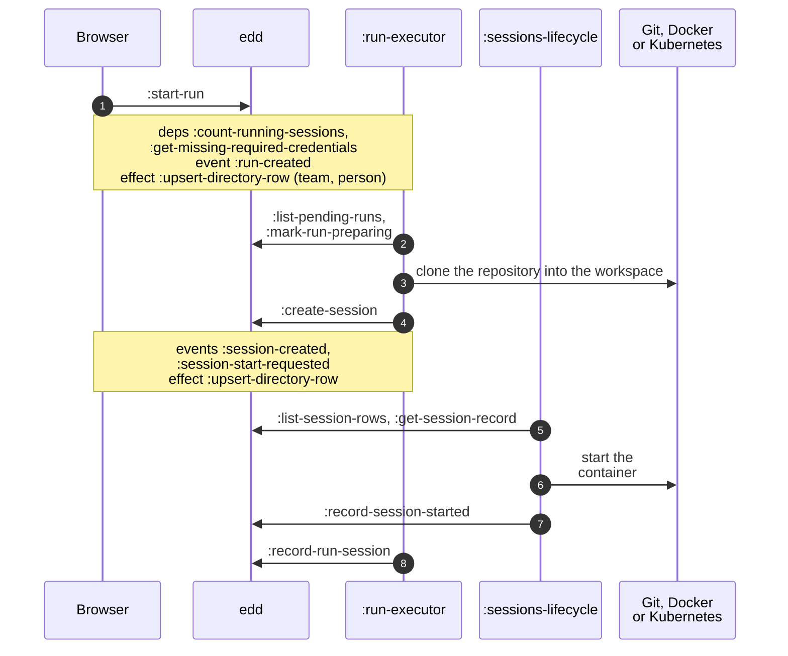
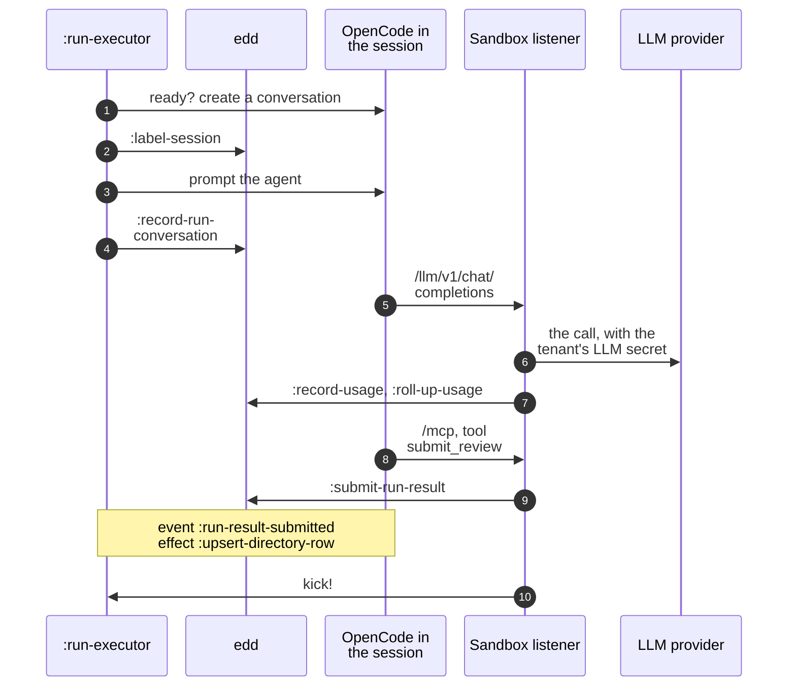
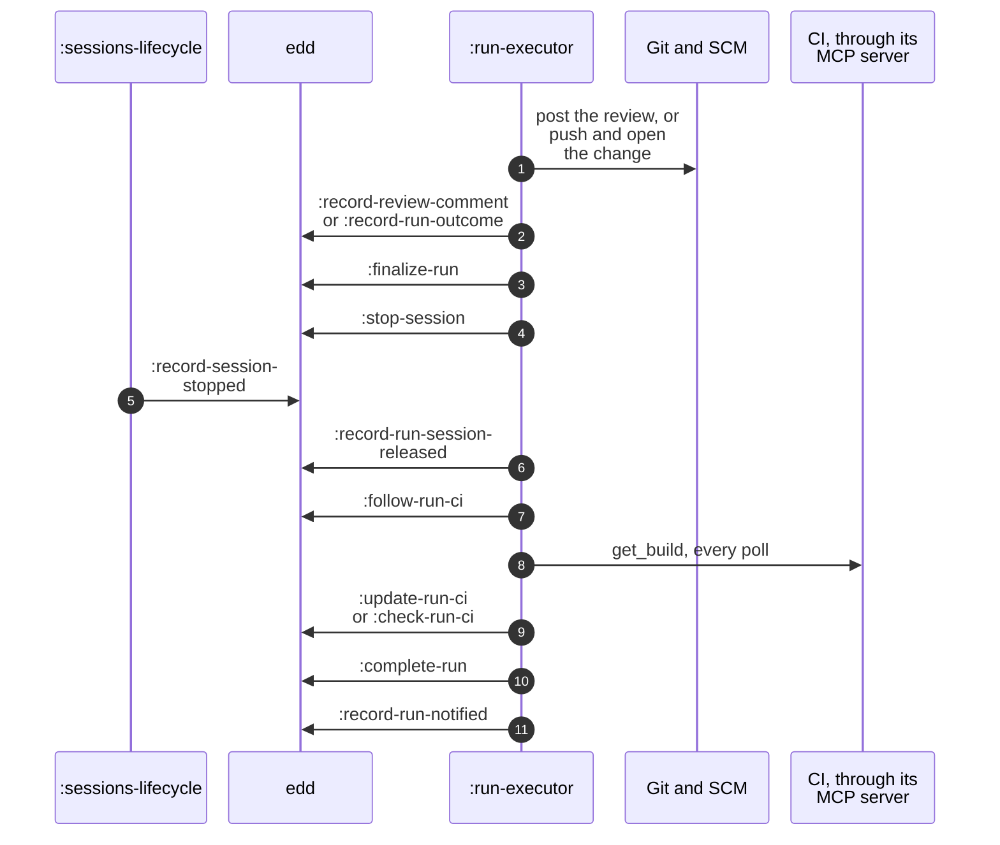
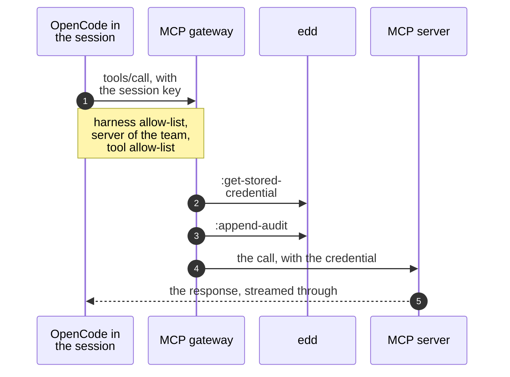
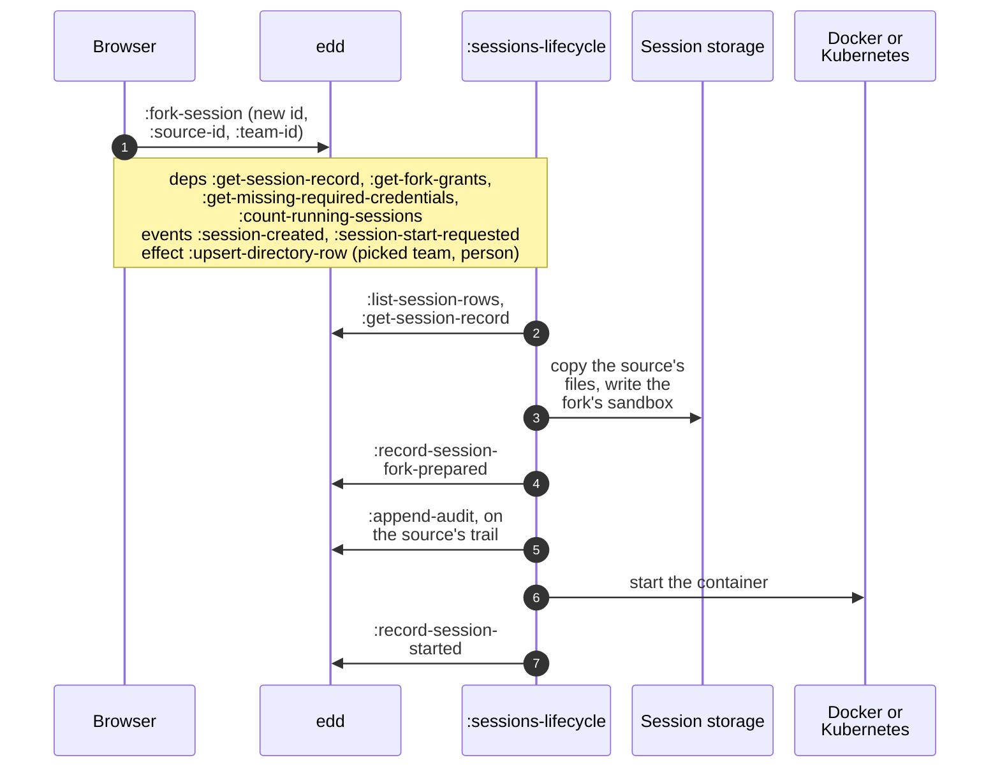
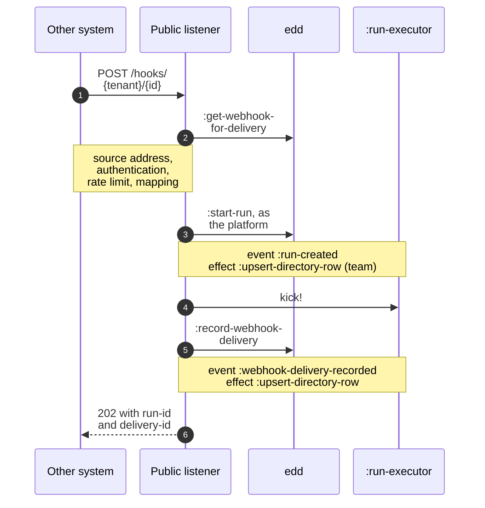
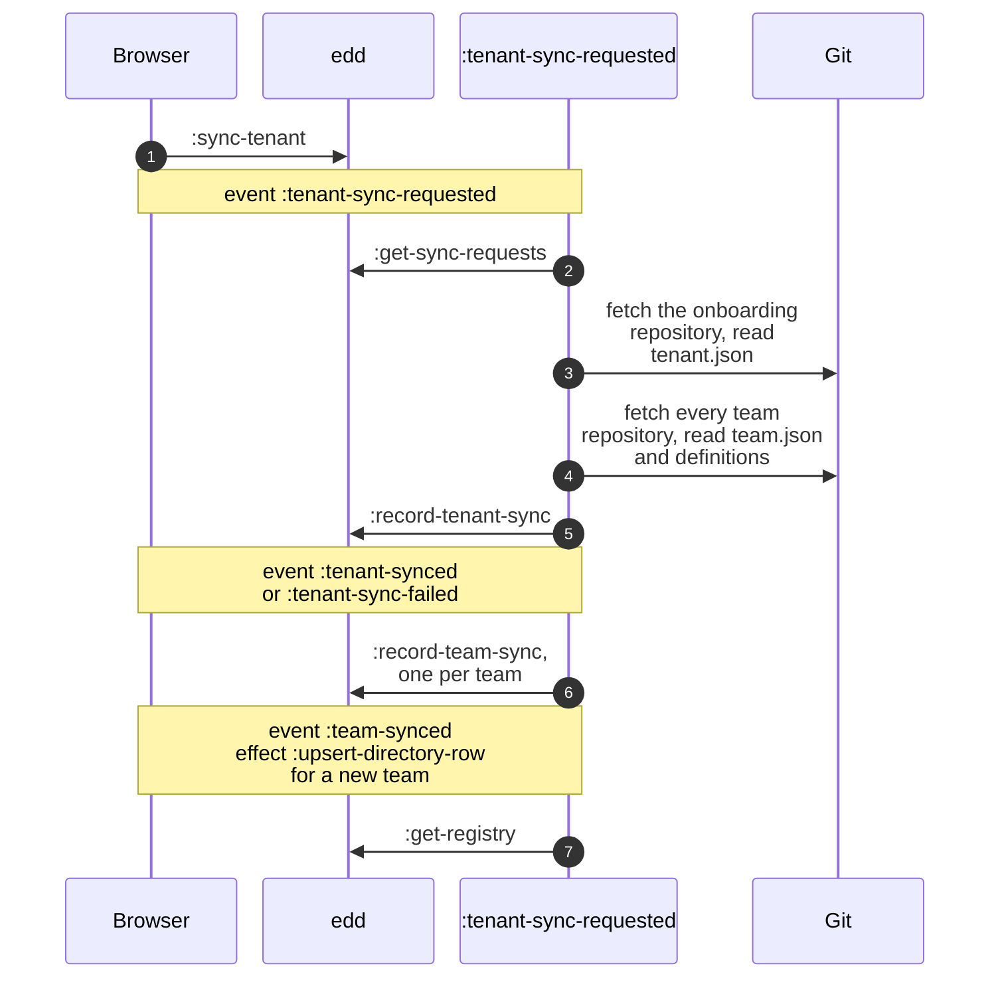
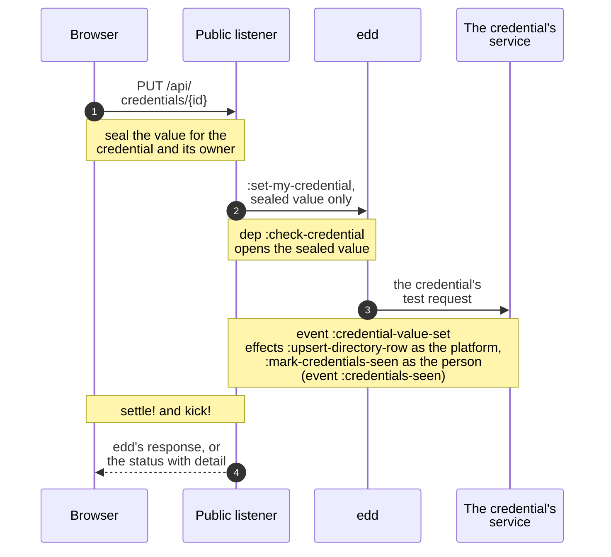

# Architecture

This page is for developers who change the platform and operators who debug it. It shows the parts of the manager and how a request moves through them as commands, events and effects, follows the main flows step by step, lists every command with the events it writes and what follows from them, and ends with where to look when something is stuck.

One rule explains the whole design: **a command only validates and writes events**. It never starts a container, calls Git or talks to an agent. Everything with a side effect happens afterwards, in one of two places:

- an **effect**: a follow-up command the platform sends itself because of an event, for example the row that makes a new run appear in a list;
- a **worker**: a background job that reads the state the events left behind, acts on the outside world, and records the outcome with another command.

So a state change you can see is always an event on an aggregate, and something that did not happen is always a job that has not run, could not act, or could not record its outcome.

## The parts

Arrows point from the caller to what it calls; the two double arrows are exchanges in both directions (the code exchange and key lookup at the identity provider, and workers that start, stop and prompt a session and follow its events). The public listener also kicks the reactive workers after every command, which the next diagram shows.

The manager is one process with one edd runtime. Its public and sandbox listeners are plain handlers on that runtime; edd itself answers only on 127.0.0.1 (`MANAGER_EDD_PORT`), which is never published. A listener, a worker or a gateway that needs a command or a query sends it there through `manager-svc.client`, with a token the manager issued itself.

| Part | Namespace | What it does |
|---|---|---|
| Public listener | `manager-svc.edge.listener`, routes from every domain | Serves the UI, `/api/query` and `/api/command`, sign-in, the endpoints that seal a secret, `/hooks`, the session entry and Traefik's forward auth, `/metrics`. Turns a login cookie (or, in jwt mode, the provider's token) into the person's platform token. |
| Sandbox listener | same, `sandbox-routes` only | Serves sessions: the LLM gateway, the MCP gateway, the result tools at `/mcp` and telemetry. A session authenticates with a key derived for that session and one purpose. No route here knows a person. |
| edd | `manager-svc.service`, `manager-svc.<domain>.*` | Handles commands (validate, return events), applies events to aggregates, answers queries. Runs each request as the person of its platform token (`:user`) or as the platform (`:non-interactive`). |
| Effects loop | `manager-svc.effects` | Delivers effects and events back to the service itself: from the outbox of the Postgres store, or through an in-process router with the memory store. `settle!` waits until nothing is waiting. |
| Workers | `manager-svc.workers`, `workers` of every domain | Scheduled jobs that carry out side effects. Reactive jobs also run right after a person's command. |
| Store | Postgres, or memory with `MANAGER_STORE=memory` | Events, aggregate snapshots, identities, the request log and the effect outbox. |
| Session container | `manager-svc.sessions.docker`, `.kubernetes` | OpenCode in a sandbox. It holds no credentials and reaches only the sandbox listener, unless its harness allows internet. |
| Traefik | `manager-svc.sessions.routing` | Routes people to the public listener and to session hosts. Every request to a session host is checked by the manager's forward auth first. |

The domains are `platform`, `sessions`, `runs`, `credentials`, `observability` and `webhooks`, plus the shared `manager-svc.directory`. `manager-svc.module` lists them once. A domain calls another only through its facade `manager-svc.<domain>.api`.

### Who a request runs as

| Caller | Token | edd role |
|---|---|---|
| A person through the public listener | Their platform token, issued by `manager-svc.signin` at sign-in (login and oidc mode) or per request (jwt mode) | `:user` |
| Workers, gateways, facades | The platform's service token, held and renewed by `manager-svc.client` | `:non-interactive` |
| Effects | The meta the effect carries: the platform's for directory rows and the first sync, the person's for `:mark-credentials-seen` | as that meta |

The tables below call these **people** and **platform**. Role checks that depend on data (tenant, team, owner, admin) are done in the handler with `manager-svc.roles`.

## The life of a command

What each step means in the code:

| Step | Where | Detail |
|---|---|---|
| 1 | `edge.listener/answer` | The listener refuses a state-changing request with cookies from another origin, finds the route, and puts the caller's `:identity` and platform `:token` on the request. |
| 2 | `edge.api`, `manager-svc.client` | Only `:commands` (or `:query`) of the body are forwarded, with fresh request ids, over loopback. |
| Between 2 and 3 | edd, the command's registration | `:deps` are queries of the same service, resolved before the handler and put on `ctx` under their key. `:id-fn` resolves the aggregate id for commands named by something other than a UUID. The body is checked against `:consumes`, the caller's role against `:auth`. The handler is a pure function of `ctx` (aggregate, dependencies, caller) and the command: it throws through `manager-svc.errors` or returns events. Returning nothing is a successful no-op. |
| 3 | edd, the store | Events, the effects computed from them and the outbox marker are stored together. Event handlers (`reg-event`) fold the events into the aggregate. |
| 5 to 7 | `manager-svc.effects`, the distributor | Effects come from `reg-event-fx` (one event) and `reg-fx` (all events of a command, used by `directory/reg-rows`). Each is a command sent back to the service. An effect command can itself have effects: the first row of a new team also lists the team in its tenant. |
| 8 | `effects/settle!` | Polls every 10 ms until no effect or event is waiting, so the next query of the caller reads its own write. After 3 seconds it logs `Effects did not settle within 3000 ms` and continues. |
| 9 | `workers/kick!` | Submits every job marked `:reactive` to the job pool. A job never runs twice at once: a kick that arrives while it runs makes it run once more afterwards. |

The edge's own endpoints (credential values, webhooks) send their command with `edge.api/command!`, which does steps 2 to 9 the same way and answers a refusal as its HTTP status with `{"detail": …}`. Workers send theirs with `client/command` (settles, no kick) or `client/command-no-settle` (for writes nobody reads back, and for anything sent while holding a lock).

!!! note "Lists are effects"
    A list in the UI never searches. It reads the directory aggregate of a tenant, team or person, whose rows are written by `:upsert-directory-row` effects. The executor and the session lifecycle find their work in the same rows. A run that exists but is missing from its list, or is never picked up, is an effect that was not handled.

## Starting and executing a run

A run moves `:queued` → `:preparing` → `:running` → `:awaiting-result` → `:finalizing` → `:following-ci` → `:completed`, or ends `:failed` or `:cancelled`. The `:run-executor` job performs the step the status calls for and records it. Everything a step needs is on the run aggregate, so the executor picks up where it was after a restart.

### From the click to a running session

- `:start-run` checks that the caller works in the team, that the workflow exists and its inputs are valid, that the caller has the credentials the team requires, and that the team may run another session. A run the platform starts (trigger, schedule, webhook, CI follow-up) skips the person's checks; its session limit is checked when the executor prepares the session.
- The session id is derived from the run id, so preparing twice finds the same session.
- The executor writes the sandbox configuration to the session's storage, then sends `:create-session`. `:session-start-requested` only sets `:pending :start` on the session; the `:sessions-lifecycle` job starts the container and records `:record-session-started` (or `:record-session-failed`).
- `:record-run-session` moves the run to `:running`.

### From the prompt to the submitted result

- The conversation is labelled on the session before the agent is prompted, so a repeated pass reuses it instead of prompting a second agent.
- `:record-run-conversation` moves the run to `:awaiting-result`. An interactive run is completed here with `:complete-run`: the person takes over.
- While it waits, the executor asks OpenCode whether the agent is still busy. An idle agent without a result is nudged up to twice (`:record-run-nudge`); a model that cannot serve the conversation makes the run fall back to the harness's next model (`:record-model-unavailable`), or fail when there is none.
- The result tool in the diagram is `submit_review`; an implementation submits with `submit_implementation`, an analysis with `submit_document`.
- The LLM gateway checks the session key, the model allow-list and the team's daily token budget before the call, and meters every call with `:record-usage` and `:roll-up-usage` (per day, in total and per run).
- The result tools accept only the tool the run's activity expects, once, while the run is `:running` or `:awaiting-result`.

### From the result to the end

- Each thing the executor does outside is recorded as it happens (`:record-review-comment` per posted comment, `:record-run-outcome` for the opened change), so a repeated pass never posts or opens twice.
- `:finalize-run` moves the run to `:finalizing` with its result. The session of a run that is not interactive is stopped with `:stop-session`, which the lifecycle job carries out.
- `:follow-run-ci` is sent only when the workflow has `options.ci` and the run opened a change. A poll that changes the state or the build sends `:update-run-ci`; any other poll sends `:check-run-ci`, which changes no list row. A failed build may start a follow-up run with `:start-run` (as the platform).
- Without CI the run goes straight to `:complete-run`. A finished run still gets its session released and, when the team has a notification webhook, the team notified; `:record-run-notified` records that.
- A failing step is recorded with `:record-run-step-error` and retried on the next pass. The third failure in a row, or the first permanent one (bad inputs, missing definitions, any refusal below HTTP 500), makes the executor send `:fail-run`.

## A tool call through the MCP gateway

A session reaches an MCP server only through `/mcp-gw/<server-id>` on the sandbox listener. The gateway decides whose credential the call carries from the session: its tenant, its team and, unless the platform owns the session, its owner.

| Server | What the call carries | Recorded |
|---|---|---|
| With a `credential` | The person's value, then the team's, then the tenant's, as `provided_by` allows (`:get-stored-credential` per scope) | `:append-audit` with the credential's name and the source (`:user`, `:team`, `:tenant`) |
| Without one | Nothing | `:append-audit` |

- A call that cannot be recorded in the audit trail is not forwarded.
- Values are read sealed from edd on every call and kept nowhere else.

## Forking a session into a team

Anyone who may see a session may fork it into a private session of their own, in one of their teams.

- The command fails with 403 for a team the caller's claims don't name, 404 for a team the tenant doesn't have, and 422 when that team may not run the source's workflow (`:get-fork-grants` lists what it lacks), when the caller lacks a credential the team requires, or when the team is at its session limit.
- The fork runs the source's workflow as a session of the picked team: its sandbox is built from the definitions of the team the workflow belongs to (label `workflow-team`) with the keys and grants of the fork's team.
- Preparing a fork that fails records `:record-session-failed` with action `:fork`; the session then shows the error instead of starting.

## A webhook delivery

The endpoint has no login: the webhook's own authentication decides. A refused call is recorded too (`:record-webhook-delivery` with the status and the reason), except one refused by the rate limit, an unknown or disabled webhook (404) and a method the webhook does not take (405). Saving a webhook goes through `PUT /api/webhooks/{id}`, which seals `auth.secret` and sends `:save-webhook`; `POST /api/webhooks/{id}/rotate` generates a secret, seals it and sends `:set-webhook-secret`.

## Syncing a tenant's repositories

- The same sync runs for every tenant from the `:tenant-sync` job (at start, then every `MANAGER_SYNC_INTERVAL_MINUTES`) and for tenants that appear in the tenants file from `:config-reload`. Tenants sync concurrently, each under its own lock.
- `:record-tenant-sync` carries `:handled-request`, the time of the request it answers, so a request is synced once.
- A team's first `:team-synced` is preceded by `:directory-created` and `:directory-tenant-joined`; their effects list the team in its tenant (`:entities`) and the tenant in the platform (`:tenants`).
- `:register-tenant` writes `:tenant-registered`, whose effect sends `:sync-tenant` as the platform, so a new tenant is synced at once.
- Handlers read definitions from the in-memory registry (`:platform/registry`), which mirrors the aggregates and is rebuilt after every sync. A failed team sync keeps the last good commit, `team.json` and definitions.

## Saving a credential

- edd keeps command bodies in its request log, so a plaintext secret never travels in a command. The edge seals it bound to the credential id and the owner (`user:<tenant>/<username>`, `team:<tenant>/<team>` or `tenant:<tenant>`); a value sealed for another credential or owner does not open.
- The check is the query dependency `:check-credential`. It answers `{:ok :message :status}`, and the handler fails with the check's message, so nothing is written for a value the service rejects.
- Team values go through `PUT /api/teams/{team}/credentials/{id}` (`:set-team-credential`), tenant values through `PUT /api/admin/credentials/{id}` (`:set-tenant-credential`). Deleting needs no secret and is a plain command.

## Commands, events and effects by domain

The service registers 62 commands. **Called by** is the role its `:auth` admits: people, the platform, or both. An event in *italics* is written only the first time. "Row" stands for the effect `:upsert-directory-row` (or `:remove-directory-row` once the thing is deleted) on the named directory collection.

### Directory

One aggregate per tenant (`/tenant/<tenant>`), team (`/team/<tenant>/<team>`) and person (`/user/<username>`) and one for the platform (`/platform`), each found through its edd identity. It holds the entity's configuration and the rows its lists show.

| Command | Called by | Events | Effects / follow-up |
|---|---|---|---|
| `:upsert-directory-row` | platform | *`:directory-created`*, *`:directory-tenant-joined`*, `:directory-row-upserted` | `:directory-created` of a tenant → row in `/platform` `:tenants`; `:directory-tenant-joined` → row in `/tenant/<tenant>` `:entities` |
| `:remove-directory-row` | platform | *`:directory-created`*, `:directory-row-removed` | as above for `:directory-created` |

A row carries the `:id` and `:version` of the aggregate it describes: an older version never replaces a newer one, and a removed row stays removed for older versions, however late or often an effect arrives. An upsert that changes nothing writes no event.

### Platform

| Command | Called by | Events | Effects / follow-up |
|---|---|---|---|
| `:register-tenant` | people (operator) | *`:directory-created`*, `:tenant-registered` on `/platform` | `:tenant-registered` → `:sync-tenant` as the platform |
| `:sync-tenant` | both | *`:directory-created`*, `:tenant-sync-requested` on the tenant | Row in `/platform` `:tenants` the first time. Job `:tenant-sync-requested` syncs it |
| `:record-tenant-sync` | platform | *`:directory-created`*, `:tenant-synced` or `:tenant-sync-failed` | Row in `/platform` `:tenants` the first time |
| `:record-team-sync` | platform | *`:directory-created`*, *`:directory-tenant-joined`*, `:team-synced` on the team | Row in `/tenant/<tenant>` `:entities` the first time |

Queries read the in-memory registry (tenants, teams, definitions, projects, harnesses, activities), the entity aggregates behind it (`:get-registry`, `:get-sync-requests`), and directory rows for the admin views and the global search. `:test-llm-connection` calls the LLM provider.

### Sessions

Events are on the session aggregate, except `:idle-sessions-stop-requested`, which is on the tenant's reaper aggregate.

| Command | Called by | Events | Effects / follow-up |
|---|---|---|---|
| `:create-session` | platform | `:session-created`, `:session-start-requested` | Row. Lifecycle job starts the container |
| `:fork-session` | people | `:session-created`, `:session-start-requested` | Row. Lifecycle job prepares the fork, then starts it. Deps: `:get-session-record`, `:get-missing-required-credentials`, `:count-running-sessions`, `:get-fork-grants` |
| `:update-session` | people | `:session-updated` | Row |
| `:start-session` | both | `:session-start-requested` | Row. Lifecycle job starts the container. Dep for a person: `:count-running-sessions` |
| `:stop-session` | both | `:session-stop-requested` | Row. Lifecycle job stops the container |
| `:delete-session` | people | `:session-delete-requested` | Row. Lifecycle job deletes the container and the storage |
| `:lock-session` | people | `:session-locked` | Row. Sets a pending stop, so the lifecycle job stops the container |
| `:label-session` | platform | `:session-labelled` | Row |
| `:touch-session` | platform | `:session-touched` | None: activity changes no row |
| `:record-session-started` | platform | `:session-started` | Row |
| `:record-session-stopped` | platform | `:session-stopped` | Row |
| `:record-session-deleted` | platform | `:session-deleted` | Row removed |
| `:record-session-fork-prepared` | platform | `:session-fork-prepared` | Row |
| `:record-session-failed` | platform | `:session-action-failed` | Row, with the error |
| `:stop-idle-sessions` | people (tenant admin) | `:idle-sessions-stop-requested` | Job `:sessions-reap-requests` stops the tenant's idle sessions |

A session's row is in its team's `:sessions` and, when a person owns it, in that person's `:sessions`. A `:record-session-…` outcome for an action that is no longer pending writes nothing, so a newer request stays pending.

Queries read session aggregates and directory rows, then live state: the container status from Docker or Kubernetes (`:list-sessions`, `:get-session`, `:count-running-sessions`) and the conversations recorded in the audit trail (`:list-conversations`).

### Runs

Events are on the run aggregate, except those of triggers and schedules, which have their own.

| Command | Called by | Events | Effects / follow-up |
|---|---|---|---|
| `:start-run` | both | `:run-created` | Row. Executor prepares the run. Deps: `:count-running-sessions`, `:get-missing-required-credentials` |
| `:start-team-session` | people (team admin) | `:run-created` (platform-started) | Row. Same deps |
| `:retry-run` | people | `:run-created` on a new run | Row. Deps: `:get-run-source`, `:get-missing-required-credentials`, `:count-running-sessions` |
| `:cancel-run` | people | `:run-cancelled` | Row. Executor releases the session |
| `:submit-run-result` | platform | `:run-result-submitted` | Row. Executor finalises |
| `:mark-run-preparing` | platform | `:run-preparing` | Row |
| `:record-run-session` | platform | `:run-session-created` | Row |
| `:record-run-conversation` | platform | `:run-conversation-started` | Row |
| `:record-run-nudge` | platform | `:run-nudged` | None |
| `:record-model-unavailable` | platform | `:run-model-unavailable` | Row |
| `:record-review-comment` | platform | `:run-review-comment-posted` | None |
| `:record-run-outcome` | platform | `:run-outcome-recorded` | Row |
| `:finalize-run` | platform | `:run-finalized` | Row |
| `:follow-run-ci` | platform | `:run-ci-followed` | Row |
| `:update-run-ci` | platform | `:run-ci-updated` | Row |
| `:check-run-ci` | platform | `:run-ci-checked` | None |
| `:record-run-step-error` | platform | `:run-step-failed` | None |
| `:record-run-step-recovered` | platform | `:run-step-recovered` | None |
| `:complete-run` | platform | `:run-completed` | Row |
| `:fail-run` | platform | `:run-failed` | Row |
| `:record-run-session-released` | platform | `:run-session-released` | Row |
| `:record-run-notified` | platform | `:run-notified` | Row |
| `:mark-trigger-items-seen` | platform | `:trigger-items-seen` on the trigger | None |
| `:register-schedule` | platform | `:schedule-registered` on the schedule | Row in the team's `:schedules` |
| `:record-schedule-run` | platform | `:schedule-ran` on the schedule | Row in the team's `:schedules` |

A run's row is in its team's `:runs` and in the `:runs` of the person it acts for. The fifteen commands from `:mark-run-preparing` to `:fail-run` write nothing on a finished or missing run, so a step that races a cancel changes nothing; `:record-run-session-released` and `:record-run-notified` are the two that still apply to a finished run.

Queries read directory rows for lists (`:list-runs`, `:list-pending-runs`, `:list-schedules`), the run aggregate for one run (`:get-run`, with its session's live state), the registry (`:get-fork-grants`) and the SCM provider (`:list-open-pull-requests`).

### Credentials

A value is one aggregate per credential and owner; a person's prompts have their own.

| Command | Called by | Events | Effects / follow-up |
|---|---|---|---|
| `:set-my-credential` | people | `:credential-value-set` | Row in the person's `:credentials`; `:mark-credentials-seen` as the person. Dep: `:check-credential` |
| `:set-team-credential` | people (team admin) | `:credential-value-set` | Row in the team's `:credentials`. Dep: `:check-credential` |
| `:set-tenant-credential` | people (tenant admin) | `:credential-value-set` | Row in the tenant's `:credentials`. Dep: `:check-credential` |
| `:delete-my-credential` | people | `:credential-value-deleted` | Row removed |
| `:delete-team-credential` | people (team admin) | `:credential-value-deleted` | Row removed |
| `:delete-tenant-credential` | people (tenant admin) | `:credential-value-deleted` | Row removed |
| `:mark-credentials-seen` | both | `:credentials-seen` on the person's prompts | None |

Queries read the tenant's declarations from the registry, value rows from the directories (never the sealed value), and for the platform the stored value by its id (`:get-stored-credential`). `:check-credential` calls the credential's service.

### Observability

Usage, telemetry and audit records are events on per-session aggregates whose state holds only running totals; detail is read back from the event store. None of them has directory rows or effects.

| Command | Called by | Events | Effects / follow-up |
|---|---|---|---|
| `:append-audit` | platform | `:audit-appended` on the session's audit trail | None |
| `:record-usage` | platform | `:usage-recorded` on the session's usage | None |
| `:roll-up-usage` | platform | `:usage-rolled-up` on the day's, the total or the run's rollup | None |
| `:record-telemetry` | platform | `:telemetry-recorded` on the session's telemetry | None |
| `:roll-up-telemetry` | platform | `:telemetry-rolled-up` on the total | None |

Queries read these aggregates and, for the audit list, export and verification, the events themselves in order.

### Webhooks

| Command | Called by | Events | Effects / follow-up |
|---|---|---|---|
| `:save-webhook` | people | `:webhook-saved` | Row in the tenant's or team's `:webhooks` |
| `:set-webhook-secret` | people | `:webhook-secret-set` | Row |
| `:delete-webhook` | people | `:webhook-deleted` | Row removed |
| `:record-webhook-delivery` | platform | `:webhook-delivery-recorded` | Row, with the last delivery |

Queries read directory rows for the list, the webhook aggregate for one webhook and its deliveries, and the registry for targets and the mapping preview.

### Edge routes that are not commands

| Route | Listener | Sends |
|---|---|---|
| `POST /api/query`, `POST /api/command` | public | The body's `:query` or `:commands`, as the person |
| `POST /api/auth/login`, `/api/auth/logout`, `GET /api/auth/oidc/login`, `/api/auth/oidc/callback`, `/api/auth/config`, `/api/auth/personas` | public | Nothing: sign-in issues the platform token and sets the login cookie |
| `POST /api/admin/reload-config` | public | Reloads the claims parser, the tenants file and the identity provider's keys; syncs new tenants (`:record-tenant-sync`, `:record-team-sync`) |
| `PUT /api/credentials/{id}`, `/api/teams/{team}/credentials/{id}`, `/api/admin/credentials/{id}` | public | Seals the value, then `:set-my-credential`, `:set-team-credential` or `:set-tenant-credential` |
| `PUT /api/webhooks/{id}`, `POST …/rotate`, `POST …/test` | public | Seals the secret, then `:save-webhook` or `:set-webhook-secret`; the test calls the public endpoint |
| `/hooks/{tenant}/{id}` | public | `:start-run` and `:record-webhook-delivery` as the platform |
| `GET /sessions/{owner}/{id}` | public | Nothing: redirects to the session host with a one-time handoff token |
| `GET /api/gateway/auth` (forward auth), session hosts | public | `:start-session` when the session is stopped; `:touch-session` at most every five minutes |
| `GET /api/sessions/{id}/audit/export`, `GET /metrics` | public | Queries only |
| `/llm/v1/models`, `/llm/v1/chat/completions` | sandbox | `:record-usage`, `:roll-up-usage` |
| `/mcp-gw/{server}` | sandbox | `:append-audit` |
| `/mcp` | sandbox | `:submit-run-result` |
| `POST /api/telemetry` | sandbox | `:record-telemetry`, `:roll-up-telemetry`, `:touch-session` |

## Workers

Jobs run on one scheduled pool (`manager-svc.workers`). A failing run of a job is logged as `Job failed <id>` and retried at the next interval. State lives in aggregates, so a job only reconciles.

| Job | Runs | Reads | Does | Records with |
|---|---|---|---|---|
| `:tenant-sync` | At start, then every `MANAGER_SYNC_INTERVAL_MINUTES` (10) | `:get-registry` once, the known tenants | Fetches every tenant's onboarding and team repositories (Git, archives, local directories) | `:record-tenant-sync`, `:record-team-sync` |
| `:tenant-sync-requested` | Every 60 s, reactive | `:get-sync-requests` | The same sync for tenants with an unhandled request | `:record-tenant-sync`, `:record-team-sync` |
| `:config-reload` | Every `MANAGER_CONFIG_RELOAD_SECONDS` (10) | The tenants file | Syncs tenants that appeared in it | `:record-tenant-sync`, `:record-team-sync` |
| `:sessions-lifecycle` | Every 10 s, reactive | `:list-session-rows`, `:get-session-record` of rows with something pending | Prepares forks in the session storage, starts, stops and deletes containers (Docker or Kubernetes), pulls images in the background, keeps Traefik's routes in step | `:record-session-fork-prepared`, `:record-session-started`, `:record-session-stopped`, `:record-session-deleted`, `:record-session-failed`, `:append-audit` |
| `:sessions-reaper` | Every `MANAGER_REAP_INTERVAL_SECONDS` (300) | `:list-session-rows`, last activity, container status | Finds idle sessions | `:stop-session`, then the lifecycle pass |
| `:sessions-reap-requests` | Every 60 s, reactive | `:get-idle-stop-request` | The same for tenants whose admin asked | `:stop-session` |
| `:sessions-prepare-backend` | At start, then daily | Nothing | On Docker, makes sure the session image is present; nothing on Kubernetes | Nothing |
| `:run-executor` | Every 10 s, reactive | `:list-pending-runs`, each run, its session | Advances every run that needs work on a pool of 8 threads: Git, SCM, OpenCode in the session, CI through its MCP server, the team's notification webhook | The run commands of the table above; `:create-session`, `:label-session`, `:start-session`, `:stop-session`; `:start-run` for a CI follow-up |
| `:pull-request-triggers` | Every 60 s | `:get-schedule-states`, `:get-trigger-items`, the registry | Lists open pull requests at the SCM provider for due triggers | `:register-schedule`, `:start-run`, `:mark-trigger-items-seen`, `:record-schedule-run` |
| `:run-schedules` | Every 60 s | `:get-schedule-states`, the registry | Starts the runs of due schedules | `:register-schedule`, `:start-run`, `:record-schedule-run` |
| `:audit-collector` | Every 5 s | Running sessions, `:list-audit-keys` | Keeps one follower per running session on OpenCode's event stream | `:append-audit` |

Reactive jobs are kicked after every `/api/command`, every edge endpoint that sends a command, a submitted result, a started webhook run and a fired trigger. Run ids of triggers, schedules and CI follow-ups are derived from what started them, so a run is never started twice when a job is interrupted.

## Where to look when something is stuck

| Symptom | Mechanism | Look at |
|---|---|---|
| A new run, session, credential or webhook is missing from its list, but opens by its id | The `:upsert-directory-row` effect was not handled, or was handled after the list was read | `manager-svc.effects`, `manager-svc.directory`; the log line `Effects did not settle within 3000 ms` |
| The log repeats `Effects did not settle` | Effects are produced faster than they are handled, or one keeps failing and is retried | `manager-svc.effects`; with Postgres the outbox of `edd.postgres.distributor` |
| A run stays `:queued` | The executor never saw it: its row is missing or lacks `:needs-work`, the job fails, or all 8 executor threads are busy | `manager-svc.runs.executor`, `:list-pending-runs` in `manager-svc.runs.queries`; `Job failed :run-executor` |
| A run stays `:preparing` | The checkout or the session's creation fails and is retried; after three failures in a row the run fails with the message | `manager-svc.runs.handlers` (`prepare!`), the run's `:last-step-error` |
| A run stays `:running` | Its session is not ready: the container is not up or OpenCode does not answer. After 30 minutes the run fails | `manager-svc.sessions.lifecycle`, `manager-svc.sessions.live` |
| A run stays `:awaiting-result` | The agent is still busy (up to three hours), or it stopped without calling its result tool and is being nudged | `manager-svc.runs.executor` (`await-result!`), `manager-svc.runs.tools` |
| A run stays `:following-ci` | No build of the pushed commit yet, or the CI's MCP server does not answer; ends at the workflow's CI timeout | `manager-svc.runs.ci` |
| A session stays starting | `:pending :start` is not carried out: the image is still being pulled, the backend refuses, or the job fails. A failure is recorded on the session as its error | `manager-svc.sessions.lifecycle` (`reconcile!`), `manager-svc.sessions.docker` or `.kubernetes` |
| A fork never starts | Preparing it failed (the source is gone, or the workflow can't be built for the team) | `manager-svc.sessions.lifecycle` (`prepare-fork!`), `manager-svc.runs.api` (`fork-sandbox`) |
| A session's page keeps saying it is starting | Forward auth asked for a start and waits for OpenCode to answer | `manager-svc.sessions.gateway` (`ensure-ready`) |
| A sync request does nothing | The request names a tenant the registry does not know, or the sync fails and records `:tenant-sync-failed` | `manager-svc.platform.api` (`sync-requested!`), `manager-svc.platform.registry` |
| A changed workflow is not used | Handlers read the in-memory registry, rebuilt after a sync; a failed team sync keeps the last good definitions | `manager-svc.platform.state` (`load!`), the team's sync status |
| An agent's tool call is refused | The harness or the server's tool list does not allow it, the session has no value of the server's credential, or the audit entry could not be written | `manager-svc.credentials.gateway` |
| LLM calls answer 429 or 503 | The team used its daily token budget, or the usage could not be read (the gateway fails closed) | `manager-svc.observability.gateway` (`check-budget!`) |
| The audit trail of a running session stays empty | The collector's follower cannot reach the session's OpenCode event stream | `manager-svc.observability.collector` |
| A webhook answers 202 but no run appears | The run was created; see "A run stays `:queued`" | `manager-svc.webhooks.delivery`, the webhook's delivery log |
| A command answers 403 `Forbidden` without a reason | The caller's role is not in the command's `:auth`: a person called a platform command, or the reverse | `service/test/manager_svc/authorization_test.clj` lists every command and query with its roles |

Messages people see for these cases are in [Troubleshooting](troubleshooting.md). Why the listeners, keys and gateways are laid out this way is in the [Security model](security.md).
